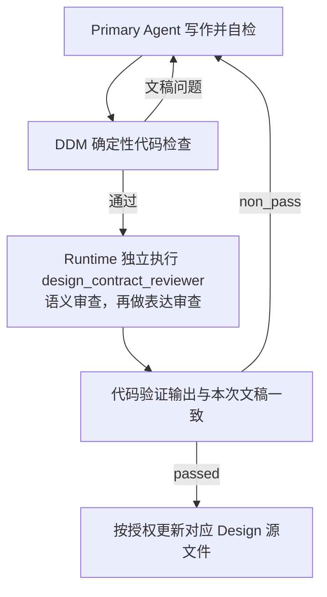

# Design 文档编写

## 0. AI-facing Authoring Rules

<!-- embedded-resource:soul:bestpractice_ai_facing_writing:start -->
## 核心原则

### 原则一：先明确结果要求，再确定必要方法（结果确定性优先于过程确定性）

AI 开始写作前，应明确文稿要完成什么、服务什么读者，以及怎样判断内容已经正确、充分、可用。依据这些结果要求，确定需要交代的内容和采用的写作方法。

写作任务至少应明确四件事：

1. **目标**：谁在什么情境下需要所设计的能力或任务产物，以及应获得什么实际结果。
2. **验收依据**：哪些要求决定文稿是否正确、充分并符合用途，如何核对这些要求。
3. **依据与方法**：使用哪些材料、知识和工具，哪些步骤或先后关系会影响结果。
4. **交付要求**：文稿需要达到什么深度，采用什么形式；已有明确的格式、路径或 schema 要求时，遵守相应要求。

凡步骤、顺序、工具或执行身份会影响正确性、授权边界或证据有效性的要求，应明确规定。例如，独立审核需要针对准确候选执行，审核结论需要与该候选对应。

其余方法由 AI 根据任务选择。步骤式指导、例子和经验，只要能帮助完成任务，就可以保留；避免强制执行与结果无关的过程，也避免只给目标而缺少必要方法。

#### Intended Outcomes：统一表达预期结果

Design 和 Skill 用一个 `Intended Outcomes` 章节集中表达主要结果要求。每项主要能力应有对应的实质结果，并说明接收者用途和决定结果能否使用的必要质量。不能只列产物名称，或用“完整、可靠、可实施”等词代替具体要求。目的、范围和适用条件以解释结果所需的深度保留。

作者先从授权目标和主要能力确定结果，再逐章反向核对全部正文；对象定义、职责边界和共同约束等位置也可能含有重要结果要求。重要结果或必要质量若只在后文出现，应补入结果章节；局部字段、操作步骤和检查命令仍放在所属位置。多项能力可以共享一个结果，一项能力也可以产生多个结果。不设固定条数、篇幅或逐项同名的要求，不为凑全内容增加未经授权的能力。

同一结果可以在不同章节出现：结果章节定义要达到什么，方法说明怎样达到，完成与验证说明凭什么确认。各处履行不同职责，不算重复定义；重复整项要求时才合并。修订先保留有效含义，再组织表达，不只更换标题或拼接旧段落。

Design 描述所设计系统或能力的功能与作用。Skill 描述执行任务的交付、接收者用途和必要质量。专业知识文稿需要说明其提供哪些专业认识，以及这些认识支持何种判断；是否使用固定章节沿其所属文稿规则确定。

“读者能找到入口、理解职责”等要求用于作者和 Reviewer 的冷读检查，正文直接把入口和职责讲清楚。教学、培训等任务以读者能力变化为实际产出时，可以将具体可验证的能力写成预期结果。

结果章节说明要做成什么，后续对应章节说明如何实现。Skill 在 `Method` 中写判断方法和操作过程，在 `Inputs and Completion` 的三个子节中分别明确输入、输出规格和完成条件；Design 按所属层级在功能、流程、架构和接口章节中明确必要工作方式。影响正确性、权限或证据有效性的指定方法必须写清楚，不能仅凭执行过方法就判定结果已经成立。

结果确定性要求目标和判断依据明确，并给执行者保留方法选择空间。信息不足时准确交付未知及其影响也可以符合结果要求，不承诺每次得到同一个结论或必须填满所有字段。当前进度、阶段安排和运行记录保留在对应项目或交付记录中。

### 原则二：支持 AI 自主判断，排斥 SOP

AI 具备推理能力。它的上下文容量有限。写入的内容应帮助它完成任务，减少无效的注意力消耗。

方法指导应提供建议和约束，保留 AI 选择执行路径的空间。避免将指导写成固定的标准操作流程（SOP）。

例如，市场分析可以按行业板块组织。如果当天的市场变化主要由一个宏观冲击驱动，AI 应能够选择全局分析。

已知陷阱应当写清楚。AI 可能无法仅凭当前上下文识别这些问题。真实的失败经验通常比泛泛的建议更有用。

保留一段内容前，检查两点：

1. 删除它是否会降低任务质量或成功率。
2. 它是在说明预期结果，还是在规定操作方法。

**优先保留预期结果的说明。操作方法只有在确实能提高任务成功率时才保留。**

---

### 原则三：先写清 AI-facing 文档的契约，再压缩表达

Skill 是 AI 执行任务时使用的契约文档。写作应先保证执行所需的信息完整，再优化篇幅和版面。

这条原则适用于主要供 AI 使用的稳定文档，包括顶层设计文档、路由文档、规则、公理和入口文档，如 `CLAUDE.md`、`AGENTS.md`。

#### 必须回答的六个问题

编写或评审任何 AI-facing 文档时，先确保文档能直接回答以下问题：

1. **这一层负责什么？** 说明这一层的用途。
2. **什么时候进入这一层？** 说明进入条件和触发信号。
3. **进入后先读什么？** 明确应优先遵循的权威依据（first authority），以及承载当前事实的来源（truth surface）。
4. **应该产出什么？** 说明预期的功能、产物或状态变化、接收者用途和必要质量；输出形式按实际交付需要确定。
5. **怎样与相邻层交接？** 说明上游期望什么、下游使用什么，以及失败时如何回退。
6. **哪些相邻概念容易混淆？** 说明它们的区别，以及什么时候应使用其他概念或入口。

**六个问题都写清后，再考虑如何缩短和整理文档。**

#### 契约完整优先于视觉简洁

文档应让 AI 在执行时找到完整的契约。压缩篇幅或调整版面时，必须保留关键边界。

避免以下四类写法：

- **合并不同的任务主线。** 不要为了减少路由表的行数，合并不同的重复性任务主线。实际产出形式不同的主线，应各占一行。
- **混淆层级。** 明确区分任务主线（task mainline）、Skill 层、写作网关层（writer gateway layer），以及确定性构建器与数据包层（deterministic builder / package layer）。名称相近的层尤其容易被误用。
- **只靠名称表达职责。** 名称可能有多种含义。例如，`manager` 可能指角色，也可能指模块。文档应直接说明对象负责什么、不负责什么。
- **先写摘要，后补契约。** 先写清详细契约，再写摘要。

#### 检查删去一段是否影响执行

写完一段后，检查：删去这段，AI 还能完成文档规定的读者目标任务吗？

- 能完成：这段是多余内容，应删除。
- 不能完成：这段属于契约，应保留。

这项检查与 FP4（删除不影响判断的信息）及 `bestpractice_prose_without_editorial_meta.md` 中的检查互为补充。它们删除无助于判断的句子，避免无效扩写；本项检查保留执行所需的契约，避免删减造成含义不清。AI-facing 文档应同时满足这两项要求。

---

### 原则四：固定不变量，保留实现选择

结果确定性优先于过程确定性。写作时还应区分：哪些结果要求必须保持一致，哪些实现选择应留给 AI。

约束所有细节会限制 AI 自主判断。缺少必要约束，会使系统反复改变同一对象的定义和做法，失去连贯性。

**必须固定的不变量**包括：

- 产物的规范路径与命名。
- 产物的身份字段，如 `report_date`、`asset_id`、`theme_id`。
- 上游依赖的身份与新鲜度契约。
- 产出此节点的唯一规范构建器（canonical builder）。不允许第二条产出路径。
- 与相邻 Skill、构建器和写作器的接口形式。

**应留给 AI 选择的内容**包括：

- 正文的具体写法。
- 判断路径与取舍。
- 中间过程的组织方式。
- 哪些证据需要重点展开，哪些只需简述。

写作时应明确区分这两类要求。固定不变量，使系统保持连贯，产物可以追踪，并能跨任务复用。保留实现选择，使 AI 能根据当前上下文作出合适判断。

如果文档只规定正文结构和写作步骤，却没有写清不变量，就会同时限制 AI 的判断空间，并允许产物偏离约定。

检查每条要求：

- 它属于不变量，还是实现细节？
- 如果属于实现细节，能否写成建议和失败信号，保留 AI 的选择空间？
- 不变量是否足以防止系统偏移，同时数量少到 AI 能记住和使用？

### 原则五：同时写清禁止事项和违规特征

仅写“不要做什么”，依赖 AI 主动注意并遵守禁令。AI 绕过禁令后，产物仍可能看似合格，禁令本身无法帮助它发现问题。

每条关键边界都应同时说明两件事：

- **禁止事项**：哪些行为或结果不被允许。
- **违规特征**：发生违规后，可以观察到什么。

例如，数据更新边界可以写成：

- **禁止事项**：数据更新完成前，不得编写投资经理（PM）报告。
- **违规特征**：已经产出报告，却没有确认 `daily_update_status.json` 中的 `blocking == false`。报告本身可能看不出问题，但上游数据的新鲜度要求尚未满足，需要通过后续复盘发现。

主题补充分析的边界可以写成：

- **禁止事项**：主题补充分析（theme overlay）不得替代任务的首要依据（first authority）。
- **违规特征**：报告的核心论述采用主题的一般结论，取代了对当前股票或当前市场的分析。读者据此判断主题，判断对象偏离了当前股票或市场。

描述违规特征时，尽量做到：

- 给出 AI 能在产出后检查的可观察特征。
- 指出缺少哪类证据或使用了哪个错误的依据来源（truth surface），不要只说“读起来不对”。
- 如果问题只能在后续环节发现，明确指出哪个环节能够发现。

这样，AI 在自主选择路径后，仍能检查自己是否越过边界。可观察的违规特征有助于发现仅凭禁令容易遗漏的偏差。

### 原则六：按陌生读者的理解顺序组织概念

执行者通常没有参与作者当时的讨论。写作顺序必须从读者已有的知识出发，使每个新概念只依赖读者已经知道、或前文已经说明的对象、任务与边界。

先明确读者的起点和目标：

- **读者起点**：进入时已经知道哪些对象、字段、工具和上游事实。
- **读者目标状态**：读完后能判断何时进入、应优先信任什么、需要产出什么、何时完成，以及何时停止或提交给有权处理的人。

引入新概念时，优先按以下顺序说明：

1. 当前对象、任务或可观察问题是什么。
2. 它与相邻对象、正常路径或读者已有认知有何关键差异。
3. 这项差异会改变什么执行、判断或交接。
4. 最后给出需要长期复用的正式名称。

Schema、协议对象或法律术语可以先定义，以保证精确。定义首次出现时，应同时说明其通俗含义、适用任务或操作影响，让读者能够理解这个名称的作用。

解释性段落应让陌生读者理解三件事：正在描述什么、为什么需要这样规定、会改变什么。纯字段表、枚举、代码块和引用块无需逐项回答这三个问题，但前后必须有足够的用途说明。

交付前统一检查是否存在缺陷。以下任一问题回答“是”，都必须修改或记录为审核发现（finding）：

- 是否在说明任务或对象前引入抽象术语，迫使读者暂存尚未理解的名称？
- 是否有解释性段落无法让读者理解正在说什么、为什么需要，以及会改变什么？
- 是否存在机械编号、教科书式口吻或不自然的概念堆叠？
- 是否在过短的篇幅内引入过多独立概念？
- 是否存在段落间的契约缺口或推理断层？
- 改写是否改变了权威来源中的数字、身份、权限、因果方向、不确定性、兼容性或停止条件？

最后一项检查保护原意。作者只能改善表达的可理解性。若更自然的措辞会改变权威来源的含义，应保留原意，或交由该内容的负责人决定；不得借润色重写契约。

---

<!-- embedded-resource:soul:bestpractice_ai_facing_writing:end -->

## 1. Task Summary

Primary Agent 使用本 Skill，编写或修订一份 Charter、T0、T1 或 T2 正式设计文档，使读者能够理解
本层要建设或改变的功能、承担动作的主体及交付结果，作出判断并继续实施。输入是已授权的文稿编写或修订请求，也可以是现有计划中的文档
编写步骤。复杂工作需要拆分或确定依赖时使用 System Change；范围、负责人和文稿目标已经明确时，
直接开始写作。


Primary Agent 在开始写作时按授权目标、用途和处理对象识别具体项目的解决方案 T1 与技术 T2。
Charter、所有 T0 的新增与修订、通用治理设计及其他用途的 Design 继续本 Skill 原路径，不自动追加项目文档审核。

## 2. Intended Outcomes

交付符合授权目标和所属层级的完整 Design，使接手者能够继续下层设计、实现或执行。产物应满足以下要求。

1. **建设目标具体且完整。** 文稿的 Intended Outcomes 覆盖主要能力的结果、使用情境与必要质量。目标有授权和设计依据，既不只列抽象质量词，也不把未来工作或未定建议写成当前承诺。
2. **本层方案已经作出必要决定。** 功能、执行主体、关键行为、协作交接、必要约束和验收依据足以支持下一步。会改变结果的主要分支和失败有明确后果。合理下层选择保留，接手者不必补作本层应定的关键决定。
3. **结构和依据支持独立使用。** 层级与作用范围相符，所选 DDM 模块承担各自职责。身份、来源、继承与必要引用可定位；设计目标、实现事实和待决事项分开。正文与图一致，无需聊天背景或作者解释。
4. **修订保持有效含义和相邻约定。** 新稿解决本次问题，保留有效条件、例外和职责。受影响的设计和交接一致，同一规则只有一个完整定义；同一结果在目标、机制和验证中的必要表达仍然保留。
5. **交付材料能够支持采用或继续修订。** 完整候选、适用自检、代码检查和所需独立审核准确对应，问题处理可追溯。适用项目专业要求得到相应材料支持。缺少资料、决定或执行条件时，已完成文稿、具体缺口、影响与提供方明确。

本次源更新及交付的完成条件见第 4.3 节。源更新、安装或部署分别说明实际结果。

## 3. Boundaries

Primary Agent 负责写作、自检和组织调用；Reviewer 以独立执行身份判断文稿。写作结束、独立审查和更新源文件是明确的工作步骤，不是文档生命周期状态。

用户授权决定本次目标和范围，所属 Design 决定具体含义，DDM 决定文档表达规则。代码说明实际实现，
不会因为现有实现方便就取得设计权。纯工作路径与规则的修改，不要求虚构 Registry、状态或哈希字段。

请求若实际是在改 Skill、Reviewer prompt、代码或 Runtime 配置，转给对应方法。Design 文件名、
目录或附近代码只帮助定位，不能替代对工作目标的判断。

| 边界 | 可观察的越界 |
| --- | --- |
| 所属 Design 决定目标，Skill 提供写作方法 | 作者从现有代码或 Reviewer 建议反推新产品要求 |
| 内容保持在本层 | Charter 承载操作流程，T0 复制下层实现，或 T2 接管其他领域职责 |
| 合理下层选择由下一层决定 | 为了声称“完整”而补入本层没有需要的状态、接口或错误码 |
| 自检与独立审查分开 | 作者自行写 `passed`，或者只读 Reviewer prompt 就声称完成外审 |
| 源文件更新与部署分开 | 手改安装投影，或把源文件更新说成其他项目已部署 |
| 问题按证据处理 | 因 note 增加未授权机制，或忽略有证据的实际缺陷 |

Reviewer source 存放在本包不产生作者自审。独立调用使用 `design_contract_reviewer`；若它不可用，
返回 Runtime 调用路径的负责人处理。Reviewer prompt 的修改另用 `the-review-authoring`，不混入普通
Design 编写；Runtime registration 和部署也不由本 Skill 顺带完成。


## 4. Inputs and Completion

### 4.1 Inputs

本 Skill Package 携带独立 `design_contract_reviewer` 的 prompt、schema、fixtures 和 registration source。它是 Design 语义审查的指定 Runtime Module。

进入时明确本次文稿目标、修改范围、目标层级、负责人，以及要编辑的准确源文件。已有文档的修订还需
取得当前内容和需要保留的含义。输入不够时指出缺什么；职责或产品取舍未定时交给用户或相应负责人。
可先讨论和形成建议，但不能把未决定的取舍写成已确认的要求。

- 本次授权目标、范围和已有计划（如有）；计划中的当前步骤、完成条件、相关排除项与后续边界随文稿送审，不为可直接开始的请求额外要求计划。
- `designDoc/the_design_doc_management.md`（DDM）：第 3.1 节决定层级深度，第 5.2 节定义可选模块及其完成效果，第 5.3 节规定标题、顺序和组合，第 7、8 章规定文稿交付与审核。
- 目标文档及判断本次修改所需的父级、同级或依赖文档。改变职责划分时比较完整受影响集合；普通修订
  不自动加载全部 T0 或全部同级文档。
- 实际实现、schema 或测试结果，仅在判断实现事实或兼容性确有需要时取得。
- 当前环境的 DDM 校验入口、`design_contract_reviewer` 的 Runtime 调用入口，以及需要重新判断的历史 finding。

校验或 Reviewer 调用入口缺失时明确报告哪条路径不可用，不能靠相似工具冒充已完成检查或独立审核。

按 DDM 第 6.4 节判断专业依据是否适用。设计实际定义时间字段、时钟、日历、新鲜度或时间比较时，
读取 `designDoc/the_timestamp_semantic.md`。设计实际定义机器边界中的标识、引用、版本、内容哈希、
指针或定位符时，读取 `designDoc/the_identifier_and_reference_semantics.md`。普通文字、示例或路径中
出现日期、ID、ref，不触发加载；未触及相应含义时，不增加字段、占位章节或空引用。

本 Skill 自身按 Skill Management 的五章结构编排。使用本 Skill 写出的正式 Design 才按 DDM 选择模块。

### 4.2 Output

将完整文稿、适用检查与独立审核材料交给本次请求方和接手实现或维护的负责人。文稿使用 DDM 规定的 Markdown 结构。采用前，将文稿保存在本次指定的候选位置，并提供准确入口；审核中、未通过、审核入口不可用或源更新未获授权时，保留候选，现行源文件保持原内容。满足第 4.3 节的条件后，才在授权内更新第 4.1 节确定的正式源文件。交付说明列出实际完成内容、检查与审核结果、源更新结果、未完成事项及其负责人。安装或部署另行报告实际结果。

文稿的内容与质量沿用第 2 节。Intended Outcomes 集中说明所设计对象的使用情境、功能结果及必要性质；正文落实本层职责、输入输出和完成条件，并保留适用 Flowmap。程序实际消费的字段遵守对应 schema，机器生成的数据交给代码。

### 4.3 Completion Contract

适用项目文档方法时，先取得其专用审核的有效通过结果，再执行本段的 Design 审核；任一后续修订改变项目内容的重要含义时，按 Project Documentation 重新取得适用结果。保留全部含义的编辑仍使用所属合同的保真检查，不重复要求独立审批。

重要设计含义改变时，适用代码检查通过后，必须取得 `design_contract_reviewer` 对本次完整文稿的有效 `passed`。
Primary Agent 核对证据、处理成立的必修问题；满足 DDM 的采用条件后，才在既有授权内更新准确源文件。纯编辑修正与
未改内容的机械复制按 DDM 的对应范围处理，不冒充本轮取得了新的语义审查。

提供给 Reviewer 的结果包括完整文稿、授权目标、修改范围、必要背景和实际确定性检查证据。候选与
背景明确分开。哈希与调用元数据由代码记录；本 Skill 不手工填造。

新方法或审核入口不可用时保留文稿，并按对应方法返回缺失的资源或执行负责人，
不以本 Skill 的自检替代专用独立结果。更新 Portable T0 源与部署到安装投影或其他项目分开；
本 Skill 不因更新源文件就宣称消费环境已经更新。

## 5. Method

### 5.1 确定层级并选择模块

属于具体项目的解决方案 T1 或技术 T2 时，读取 `designDoc/the_project_documentation.md`，
使用 `project-documentation-authoring` 完成项目内容的写作、自检和独立 `project_documentation_reviewer`，
然后回到本 Skill 完成 DDM 检查和 `design_contract_reviewer`。两个方法围绕同一份正文工作。

<!-- embedded-resource:t0:design_layer_semantics:start -->
| 层级 | 本层应确定的内容 | 接手者据此开展的工作 | 留给其他层的决定 |
| --- | --- | --- | --- |
| Charter | 产品服务谁、解决什么问题、覆盖哪些工作；核心业务对象；人类决策权和全系统必须遵守的最高要求。 | 各设计负责人据此划定领域范围、分配顶层职责，并判断哪些方案符合产品方向和授权。 | 具体领域方案、接口、日常操作和运行配置。 |
| T0 | 多个独立下层必须一致采用的概念、规则和职责。共同能力还要确定必要的工作方式、逻辑接口及失败含义。 | 下层作者直接采用这些规定，设计自己的系统；消费者能够按共同约定调用或交接，不必各自决定同一个跨系统问题。 | 具体项目的内部组成、局部算法、当前实例和部署配置。 |
| T1 | 一个领域或独立子系统提供什么功能、由哪些部分承担，以及它们怎样协作完成任务。 | 下层作者能据此分别展开各项能力；实施方能确定各组件的责任、依赖和整体交付。 | 有界能力内部的详细处理，以及同级领域自己的决定。 |
| T2 | 一项有界能力的输入、处理行为、输出、影响和必要接口。明确关键判断、完成条件、失败处理及验证要求。 | 实施者能编写实现和测试；调用方能按约定使用结果，处理已定义的失败。 | 不改变约定行为的内部算法、类组织和其他工程选择，以及其他能力负责的决定。 |
<!-- embedded-resource:t0:design_layer_semantics:end -->

先按上表和 DDM 第 3.1 节确定本层必须作出的决定，再用第 5.2 节的方法形成具体内容。
不要先铺满目录，再为每个标题凑一段解释。

形成内容后，按 DDM 第 5.2 节选择模块。逐项对照“写什么、完成效果、分工、选用”四项说明：

- 将每项决定放到负责它的模块。结果要求放在 Intended Outcomes；具体工作方式放在相应功能或组成模块。
  边界、接口和完成条件各自回答不同问题，不另写一遍整个功能。
- 对照完成效果检查所选模块。正文直接写出决定、条件和动作，不把“读者能理解……”抄成新的结果段落。
- 可选模块没有独立内容时省略；内容少且适合放在相应功能旁时合并。必要条件、例外和职责仍须保留。
  必需模块、层级专用模块及择一组合按 DDM 第 5.3 节处理。
- 同一对象可以出现在流程、功能和交接说明中，但每处须承担不同作用。完整定义只留一处，其他位置引用。
  合并重复段落前，先核对是否有某处独有的条件或后果。

最后按 DDM 第 5.3 节安排准确标题、编号和顺序。使用正式模块名，不为不同方向另造同义标题。
模块内的小节按实际对象或功能命名。检查范围与独立审核见第 5.4 节。

### 5.2 从场景推导本层设计

围绕本次实际要建设、维护或改变的对象形成设计，再用第 5.1 节确定需要写到的精度。职责划分来自
完成这些功能所需的动作，不能用一组领域名称代替具体设计。

1. **还原对象和使用情境。** 从请求指出的系统、组件或能力开始，结合现有 Design 和实际依据，
   说明谁遇到了什么问题、希望该对象提供什么功能。修订时分清已有能力、需要保留和需要改变的
   部分；新建时说明拟建功能，不能假称已存在。直接相关的父级约束与相邻能力用于判断方案，
   不先编一份角色分类再把需求塞入其中。
2. **作出本层功能和交付决定。** 沿具体情境说明哪个主体对什么对象做什么、依据什么条件作出
   关键选择、产生什么可用结果。涉及多个部分时说明如何协作完成该功能，以及交接后接收方继续
   什么工作。对会改变结果的输入不足或失败说明相应动作。修订既有系统时说明所选改动及理由；
   请求需要项目提案或交付设计时，把它写成针对该对象的方案和可验收功能，而不只列下一步名称。
   必须由用户决定的产品取舍按第 4.1 节提出明确建议，不能默认为已批准。
3. **用文稿检验交付是否明确。** 对照授权目标和每项主要能力，检查 Intended Outcomes 是否写出了相应结果与必要质量。再逐章反向核对全部后文，补入只在后文出现的重要结果或必要质量；局部实现要求仍放在所属模块。不能只靠产物名称、质量词或固定条数宣布完整。
   不依赖聊天，沿相同情境推导下游应做的动作和取得的结果。
   如果“维护、支持、协调”仍可能被解释成实质不同的功能，补明主体、对象或动作；若分歧仅在
   已允许下层决定的内部算法、类或实现方式，保留选择空间。核对 Flowmap 与正文中的主体、
   动作、结果一致，合并散落的同一功能说明。走读用于判断文稿，不要求提前实现、部署或逐例运行。

例如，设计一个已存在的日报生成系统时，“维护 Agent 负责报告可用性”仍不能说明工作。更具体的
设计可以规定：维护 Agent 核对失败的日报任务及输入；输入已齐且属于获准重跑的任务时，调用现有
生成入口并回读报告，将恢复结果交给报告使用者；需要改变生成功能时，提出针对生成组件的修改方案，
说明新功能与验收结果。实际文稿应使用材料中可核实的组件和产物名称。这个例子说明所需精度，不为
其他系统增加重跑授权、维护角色或报告流程。

场景用于澄清主要功能和真实歧义，数量由任务决定。主体、对象、动作和结果可在连贯正文中说明，
无需每段套用固定句式、增加字段表或另建对象。也不能为显得具体而编造接口、路径或未授权的新机制。

正文以中文为主，标识符、代码符号和引用保留准确名称。优先使用简单句，先写清谁做什么。
拆句时保留条件、例外、职责与因果；不能把“只有……才……”改成“如果……就……”。

实际软件接口直接定义输入、输出和影响；程序需要根据失败选择处理时，使用接口已有或明确设计的
error code。文稿修订、补充资料、审查和采用可以直接表达，不必注册成软件接口。

### 5.3 Author Self-Check

<!-- embedded-resource:t0:skill_author_self_check:start -->
调用外部 Reviewer 前，author 必须直接消费本 Skill 声明的、由 subject authority 拥有的 canonical checklist，不能手抄第二份 checklist。每次调用只形成临时结果表：

| `check_id` | `exact evidence` | `local result` | `unresolved finding` |
| --- | --- | --- | --- |

每个 required `check_id` 恰好出现一次，并绑定当前 exact candidate 的证据。依据本次授权目标、适用计划步骤、完成条件与排除项判断当前必要性；历史 `prior_findings` 在当前候选上重新核对，不能继承旧 verdict。经核对成立且影响本步完成的必修问题列为 unresolved finding，先在本 Skill 内修订；note 不列入该栏，也不自动实施。对证据错误或越界的历史意见，在 exact evidence 中说明理由并交回独立 Reviewer 重判，不能自行改写原结论。只有没有已知未解决的必修问题时，才冻结候选并调用独立 Reviewer。

Author Self-Check 只防止作者把自己已经看见的缺口交给 Reviewer。它不产生 `passed`、approval、admission 或任何可替代独立审核的结果，也不创建持久化 record、Registry 或跨系统 schema。
<!-- embedded-resource:t0:skill_author_self_check:end -->

以下 checklist 由 DDM 通过代码提供。自检逐项核对具体证据，不把填完表当作设计正确的证明。

<!-- embedded-resource:t0:design_contract_review_checklist:start -->

| 顺序 | `check_id` | 必须确定的结果 | `finding_class` |
| --- | --- | --- | --- |
| 1 | `intent_and_reader_result` | Intended Outcomes 覆盖授权范围内本层每项主要能力的预期结果及必要质量，说明使用情境和接收方用途，保留目的依据与适用边界。对照主要能力及全部后文要求，确认重要结果没有遗漏或只出现在后文；不能仅列产物名称或空泛质量词。不以条数、篇幅或逐项同名判断完整性，不要求搬入局部实现细节。读者理解或指定过程不能替代系统结果，无证据的结论或后续工作不能成为当前承诺。 | `intent_gap` |
| 2 | `layer_owner_and_parent` | 层级、负责人和必要父级清楚。本次结果涉及的职责没有重叠或缺口，也没有为了检查完整性而重整全部邻接系统。 | `layer_or_owner_defect` |
| 3 | `layer_content_fit` | 内容属于本层，所选模块承担明确的内容职责。机制按实际需要使用，没有为填满标题而增加下层设计。 | `layer_content_misfit` |
| 4 | `peer_authority_and_inheritance` | 设计遵守适用上游规则，与直接相关同级系统的交接一致。实际涉及时间或机器引用语义时，遵守对应 T0。 | `peer_or_inheritance_conflict` |
| 5 | `boundary_coherence` | 主要职责有明确执行主体、处理对象和动作。交接写清结果、接收方及其后续工作。文档负责人不替代执行主体，职责区分不创造多余管理角色。 | `boundary_ambiguity` |
| 6 | `design_and_code_truth_separation` | 文稿区分目标与实际实现，当前事实有代码依据，不额外要求没有消费需要的机器对象。 | `code_truth_leakage` |
| 7 | `flow_interface_and_error_closure` | 流程图、正文、实际需要的输入输出和失败处理一致。材料交接没有被误写成软件接口。 | `flow_or_interface_closure_gap` |
| 8 | `failure_completion_and_rollback` | 完成、信息不足和真实失败的后果清楚。恢复或回滚只在实际影响需要时定义。 | `failure_or_completion_gap` |
| 9 | `implementability_without_redesign` | 本层已决定实际情境中的主要功能、工作方式和交付结果，接手者无需重新猜测。实质功能歧义按设计缺口处理，不降为文字建议。合理下层选择和不影响本步的后续工作仍被保留。 | `implementability_gap` |
| 10 | `review_approval_and_admission` | 审核、实现和采用分别有对应证据，所需授权清楚，没有新增不必要的状态或重复审批。 | `review_or_admission_conflict` |
| 11 | `prose_and_meaning_preservation` | 语义要求成立后，没有聊天背景的读者能准确理解设计。文字修正保留事实、职责和条件。 | `prose_or_communication_defect` |

<!-- embedded-resource:t0:design_contract_review_checklist:end -->

### 5.4 独立审核与更新

在项目根目录，使用当前项目的 Python 运行随包 DDM 检查工具：

```sh
python -B 09_soul/governance/t0/validation/artifact_contracts/design_artifact_contract.py \
  --layer T0 path/to/candidate.md
```

将 layer 和路径换成本次目标；支持 `Charter`、`T0`、`T1`、`T2`。工具只读文件，返回实际结构问题或
检查结果；`--json` 提供机器可读输出，`--help` 说明参数。此结果不替代独立 Reviewer 的语义判断。

运行前核对工具实际采用的规则和覆盖范围，尤其是模块名称、适用层级、择一组合、编号与顺序。
报告中写明本次采用的 DDM 内容及工具尚未覆盖的要求；作者仍按这些要求自检，并把缺口随候选交给 Reviewer。
若当前工具拒绝符合目标规则的候选，或不能支持所需检查，保留候选和原始结果，交给校验负责人处理。
不能修改文稿迎合旧规则，也不能凭编号起点推定规则版本、虚构参数，或将旧规则通过称为新版通过。

独立审核使用同包 `design_review.py`，或环境中指向它的已配置命令：

```sh
python -B 09_soul/governance/t0/validation/artifact_contracts/design_review.py \
  --candidate path/to/candidate.md \
  --goal "本次要达到的结果" --change "本次修改范围与要点" \
  --context peer_contract=path/to/relevant_peer.md \
  --output path/to/new_review_result.json --root path/to/runtime_root
```

背景只提供本次需要的文件；没有该类背景时省略 `--context`。新建文档加 `--new`；已有 finding 可用
`--prior-findings` 传入。代码加载 DDM 和固定 checklist、记录受审内容、调用现成执行入口并核验输出；
不得覆盖文稿或既有结果文件。结构、输入或执行失败不表示 Reviewer 已给出 verdict。

审核经随包 `runtime_review.py` 调用 Agent Runtime Test Run 运行已注册的 `design_contract_reviewer`；
`--root` 必填，定义来源与执行参数见 Portable README“独立审核的执行”。Reviewer 未注册或 Runtime 不可用
时返回环境维护者，不能临时写替代执行器。
查看 `--help` 和所在环境的使用说明即可取得参数，不从历史聊天复制运行脚本。



Primary Agent 对每条必修意见核对依据、范围、当前后果与本步必要性，再修正成立的设计缺陷。
缺少资料或外部决定时找到提供方；调用或校验失败返回相应负责人。note 默认不实施，错误或越界
意见附理由交回独立 Reviewer 重判，不能由作者改写未通过结论。多轮保持本次目标与完成条件；
重新打开已处理问题须有新证据、候选变化或原处理失败，范围约束不豁免实际回归。

完成源文件更新后说明本次改了什么、哪些检查与审核已经完成。部署需要单独执行；尚未部署时，
如实说明安装环境仍使用哪个版本。
