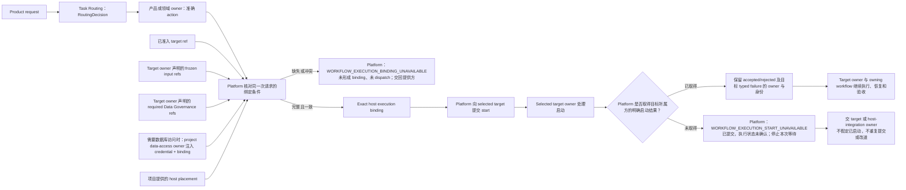

# Agency Platform 组合合同（Agency Platform Composition Contract）

Agency Platform 把产品入口、共享服务、执行环境和领域实现组合为一个产品宿主。它接收已完成语义路由的工作，为指定执行目标绑定本次请求及其必要输入，然后提交启动。本文规定这项组合能力在不同项目中必须保持一致的职责、服务放置规则和启动约定。

## 1. Primary System Flow



完整绑定条件见第 4 章，启动接口见第 5 章，责任终点及失败处理见第 6 章。

## 2. Intended Outcomes

产品宿主的实现者、任务调用方和执行目标负责人应取得一致的服务组合与工作启动结果。

1. **服务可以按共同分类组合和放置。** 项目使用六个 service plane 承载产品入口、控制、执行、集成、数据和信任运维服务。Plane 只表示放置类别，不变成流程顺序、权力层级或第二套业务归属；具体网络、存储和部署仍由项目设计。
2. **承载不会转移语义决定权。** 各 action 有明确的产品或领域负责人，服务自己的记录、业务含义、状态、质量、human gate 和验收继续归所属方。路由、数据库授权、host binding、执行和领域验收分别产生结果，任何一项成功都不能替代另一项。
3. **启动绑定完整且对应同一次请求。** 已路由 action、所属注册提供的 admitted target、目标方声明的 frozen inputs 与必要数据引用、placement，以及适用的数据库输入准确匹配。Platform 不猜测 action 身份，不选择或准入执行目标。确定性执行、Runtime Workflow 和 direct Module 使用同一标准，direct Module 不被强制包装为 Workflow。
4. **数据库输入按真实需求受控携带。** Target owner 决定是否需要数据库访问及哪些引用，project data-access owner 提供 credential 与 binding。Platform 不解析、签发、刷新、持久保管或扩大凭据。实际 read/write 权限由访问 adapter 消费，不被当作启动授权或宿主权力。
5. **启动结果和失败有准确归属。** 调用方取得 exact binding 与目标方明确的 accepted/rejected start，或 Platform 的准确失败。绑定缺失时未 dispatch；已提交但取不到结果时，执行状态不被猜成成功或失败，也不自动重复提交、切换目标或建临时路径。目标的 typed failure 保留其 owner 和身份。
6. **后续执行能由正确负责人接手。** Platform 完成启动义务后，target owner 和 owning workflow 继续负责执行、输出含义、恢复及领域验收。Platform 不可用也不静默退回会话 Agent、直接 provider、相邻工作流、无限制数据库凭据或其他 writer。
7. **实现和符合性可以核验。** 服务放置、binding 与启动行为有代码验证和只读 inspection 依据，当前服务、部署和 release 状态不从文稿推定。项目可以具体化服务和约束，但保持共同分类、承载与启动边界；设计决定、实现、发布和领域验收分别判断。

## 3. Owned System Object

### 3.1 管理对象

```text
enterprise product host and Workflow Control Plane
    含义：产品服务的组合宿主，以及为已路由工作绑定执行目标并提交启动的控制面。
    统一决定：服务分类、服务放置的含义、host binding 的成立条件和启动交接。
    适用：需要由项目产品宿主启动的已路由 action。
    责任边界：本对象提供产品组合、放置和控制措施的落实位置。
        被承载服务的记录、决定和业务对象，仍由该服务的 semantic owner 定义。

service plane
    含义：一项服务在产品组合中所属的放置类别。
    取值：第 3.2 节的六类。
    限制：不表示业务流程顺序、authority rank、具体网络结构或部署产品。
    下层使用：项目将它映射到服务、网络、存储、部署区域和恢复单元；
        可以增加具体服务及约束，不建立竞争分类或改变本合同的承载与启动边界。
```

本 T0 的对象同时包含服务组合与工作启动。Action 的业务含义、数据库访问决定、执行实现、数据内容和最终领域判断，由第 8 章所列的对应负责方持有。

### 3.2 六类服务

| Plane | 承载的职责 | 仍由其他负责方持有的事项 |
| --- | --- | --- |
| Access and Delivery | 产品入口、请求传输、结果交付和人机交互。 | Identity 状态、数据库权限、路由、领域判断及交付记录的含义。 |
| Product Control | 产品协调、Workflow Control Plane、服务放置和共享控制服务。 | 领域内容、Runtime 执行、Data Asset 含义和商业判断。 |
| Execution Cell | 已准入的确定性执行、Agent Runtime 和领域实现的隔离运行环境。 | 产品策略、跨范围权限和领域验收。 |
| Controlled Integration | 受控的模型、工具、搜索、连接器、事件及外部副作用网关。 | 路由选择、领域事实和无限制访问。 |
| Cell Data | 项目配置的持久化、查询、引用读取和恢复实现。 | 所存对象的含义、写入权、数据库权限和 Runtime lineage。 |
| Trust and Operations | 工作负载信任、时钟健康、可靠性和事故处理。 | 数据库授权、数据库凭据、领域内容和规范决定。 |

## 4. Capability and Operation

### 4.1 绑定对象和输入来源

```text
host execution binding
    含义：同一次产品请求与准确执行目标、运行位置及全部必要输入的绑定。
    成立条件：下表中的必需内容完整、相互一致，并指向同一次 exact request。
    目标限制：仅引用所属执行方已准入的 target。
    作用：为第 5 章的启动交接提供确定输入。
    不产生：新的 route、Workflow registration、数据库权限、Runtime release、
        Runtime lineage、数据所有权或领域验收。
```

| 必要内容 | 提供方及约束 |
| --- | --- |
| 产品请求和准确 `RoutingDecision` | Task Routing 已选择 action 的语义负责人，Platform 消费该决定。 |
| Domain-owned action identity | 每个 action 只有一个产品或领域负责人。其 code-owned project registration 提供稳定身份和执行需求；Platform 不从目录、文件名、prompt 或当前工作树猜测身份。 |
| Admitted execution-target ref | 产品或领域 T1 的 action registration 提供准确目标。Platform 验证和消费该引用，不选择或准入 target。 |
| Frozen execution input refs | 由 selected target owner 声明本次执行所需输入。 |
| Host placement | 项目 T1/T2 提供与第 3 章相符的运行位置。 |
| Required Data Governance refs | 由 selected target owner 声明本次执行需要的数据治理引用。 |
| Database credential 与 binding | 仅当 target 声明需要数据库访问时必需，按第 4.2 节由项目注入。 |

执行目标可以是确定性执行、Agent Runtime Workflow 或允许独立执行的 Module。这三类入口使用同一套 host binding 和放置标准；涉及数据库访问时，使用相同的数据库授权标准。直接 Module 无需包装成单节点 Workflow。目标类别的具体字段、release、entry policy、schema 和校验由所属执行方的下层设计及代码定义。

### 4.2 数据库输入与授权

| 参与方 | 负责的工作 |
| --- | --- |
| Selected target owner | 通过 input closure 声明是否需要数据库访问，以及必要的 Data Governance refs。 |
| Data Governance | 定义 Data Asset、数据库访问与 physical binding 的含义，并指定 project data-access owner。 |
| Project data-access owner | 取得并注入本次所需的数据库凭据及 binding。 |
| Agency Platform | 原样携带注入内容；不解析、签发、刷新、持久保管或扩大凭据，不持有领域 SQL。 |
| Product Authorization 与 project data-access adapter | Product Authorization 决定 `user_key` 对数据库的读写权限；adapter 在实际数据库操作发生时消费 allow/deny。 |

操作级 allow/deny 不进入 `workflow_execution_start`，也不被扩展为 action-level authorization。携带凭据和绑定完成各自的输入职责，不授予产品宿主数据库权限或数据所有权。

## 5. Public Interface and Effects

### 5.1 工作启动

```text
workflow_execution_start
    所属方：Agency Platform。
    输入：第 4.1 节列明的本次请求、路由、action、目标、位置和全部必要输入。
    前置条件：准确 host execution binding 可以成立。
    动作：将请求及全部 required input refs 绑定到 exact host，向 selected target 提交启动。
    输出：准确 host execution binding 及 target owner 的 execution-start result；
        或第 6.2 节定义的明确失败。
    责任终点：按第 6.1 节判定。
    错误码：WORKFLOW_EXECUTION_BINDING_UNAVAILABLE、WORKFLOW_EXECUTION_START_UNAVAILABLE。
```

## 6. Completion, Failure, and Recovery

### 6.1 启动责任终点

Selected target owner 接受或拒绝 start，或者 Platform 明确返回 `WORKFLOW_EXECUTION_START_UNAVAILABLE` 时，Platform 的启动义务结束。绑定条件不足时，Platform 在提交之前按第 6.2 节拒绝启动。

Target 收到请求后产生的 accepted、rejected、resolved output 和 typed failure 都由 target owner 定义。Platform 保留并传递结果所属方与错误身份；执行、输出含义、恢复及领域验收由 target owner 和 owning workflow 继续负责。启动成功不能代替后续执行或领域验收。

### 6.2 失败与继续处理

| `error_code` | 触发条件 | 已完成或未完成的工作 | 调用方动作 |
| --- | --- | --- | --- |
| `WORKFLOW_EXECUTION_BINDING_UNAVAILABLE` | 第 4.1 节的必需内容缺失、冲突或无法绑定同一次 exact request。 | 在 binding 形成及 dispatch 前停止，尚未启动。 | 把缺失或冲突的准确引用返回真实负责方；不替换 target、不扩大范围或创建临时执行路径。 |
| `WORKFLOW_EXECUTION_START_UNAVAILABLE` | Exact binding 已提交给 selected target，但无法取得其所属方明确的 accepted 或 rejected start result。 | Platform 无法确认 target 是否接受 start；本次启动义务以明确失败结束。 | 停止等待，交回 selected target 或 host-integration 的真实负责方；不得假定执行已开始、重复提交、切换目标或建立临时路径。 |

两项错误均由 Agency Platform 持有。第二项只表示宿主未取得启动结果，不决定 target 实际是否执行、是否失败或怎样恢复。目标自己的 typed start failure 保留原 owner 与 error identity。

Platform 不可用时，不得静默改用会话 Agent、直接 provider 调用、相邻 Workflow、无限制数据库凭据或其他 canonical writer。

## 7. Dependencies and Verification

### 7.1 下层承担的设计

| 负责方 | 下层设计与代码承担的内容 |
| --- | --- |
| Project T1/T2 | Product API、Identity and Session、tenant service、notification、metering、quota、billing handoff、service catalog、Workflow registration、Cell layout、integration gateway、data-service composition、support operation 和部署拓扑。 |
| Owning product/domain T1 | Action meaning、Workflow graph、state、quality rule、human gate 和 terminal outcome。 |
| Agent Runtime T1/T2 | Runtime release、execution、recovery、inspection 和 provider adapter。 |
| Data Governance 的项目实现 | `DataAccessAdapter` 实现、database binding 和领域数据服务的交接。 |

具体 Registry、记录类型、字段、hash、schema、validator 路径、存储和 inspection 展示由代码持有。当前服务、binding、deployment 和 release 状态从 code-owned inspection 取得；本合同定义应满足的规则，不证明当前实现已满足规则。

### 7.2 必须提供的符合性证据

代码应能登记、验证当前服务放置和 host execution binding，并提供只读 inspection。符合性检查至少证明：

| 判断事项 | 所需证据 |
| --- | --- |
| 服务组合符合第 3 章 | 具体服务映射到六类 plane；承载没有转移服务的语义决定权。 |
| Binding 符合第 4 章 | 全部必需内容对应同一次 exact request；缺失或冲突在 binding 形成和 dispatch 前被拒绝。 |
| 启动符合第 5、6 章 | 可区分未 dispatch、目标返回启动结果和无法取得启动结果，并保留准确负责方及错误身份。 |
| 项目扩展保持共同规范 | 具体服务及约束沿用本合同的 plane 分类、承载含义和启动边界。 |

这些检查证明产品宿主的相应行为；目标执行和领域验收仍使用所属方的证据。

## 8. Peer Boundaries

消费项目的 Project Charter 提供宪制约束。下表列出产品组合中的直接协作关系，具体规则在所属章节定义。

| 相关方 | 与 Agency Platform 的交接 | 对方保留的决定 |
| --- | --- | --- |
| Task Routing | Platform 提供产品任务入口，消费准确 `RoutingDecision`，用于第 4.1 节的绑定。 | Action 的语义负责人选择。 |
| Agent Runtime | Platform 携带已准入目标及其输入，提交 execution start，接收所属方的启动结果。 | Release admission、必要执行输入、执行及结果含义、恢复和 lineage。 |
| Product Authorization | Platform 承载项目管理入口和 data-access adapter；授权关系按第 4.2 节处理。 | `user_key` 的数据库读写权限；实际操作由 adapter 消费其决定。 |
| Data Governance | Platform 消费 selected target owner 声明的 refs，接收 Data Governance 指定的 project data-access owner 注入的 credential 与 binding，并提供数据服务的承载位置；具体分工见第 4.2 节。 | Data Asset、数据库访问、physical binding 及数据处理约束；领域 SQL 仍由领域负责人决定。 |
| Timestamp and Clock Semantics | Platform 记录及跨服务比较使用其时间含义。 | Time-field、clock-domain 与时间比较规则。 |
| System Change Governance | 在采用计划的任务中提供对应步骤，参见第 8 章。 | Changed surfaces、依赖、顺序和负责人。 |
| Design Doc Management | 提供 Agency Platform 文稿的编写、审核及采用方法。 | Design artifact 的规范与审查要求。 |
| Software Delivery | 接收产品宿主组合与放置的实现约束，参见第 7、8 章。 | 实现、release、部署、rollback 和 retirement admission。 |

### 8.1 本规范的设计与采用

Agency Platform 的设计含义由其负责人决定，文稿编写、独立审核、源文件更新和采用遵守 [Design Doc Management](the_design_doc_management.md)。明确授权的设计请求可以直接进入该方法；使用 System Change 计划时，按对应步骤和已确定的范围、依赖及顺序工作。

软件实现、发布、部署、回滚和退役采用 [Software Delivery](the_software_delivery.md) 的要求。文稿审核、宿主符合性、软件交付和领域验收分别使用各自结果。

重要设计候选须取得 DDM 所要求的有效独立结果，并由 Agency Platform owner 单独作出设计接受决定。文稿通过不替代这一决定或后续软件交付。

## 9. References

- Project Charter：`designDoc/the_charter.md`，由消费项目提供。
- [System Change Governance](the_system_change_governance.md)
- [Product Authorization](the_product_authorization.md)
- [Task Routing](the_task_routing.md)
- [Agent Runtime](the_agent_runtime.md)
- [Data Governance](the_data_governance.md)
- [Timestamp and Clock Semantics](the_timestamp_semantic.md)
- [Design Doc Management](the_design_doc_management.md)
- [Software Delivery](the_software_delivery.md)
