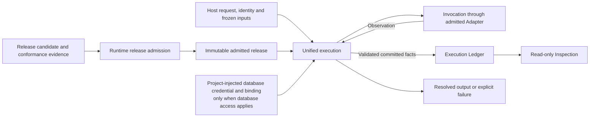

# Agent Runtime 合同（Agent Runtime Contract）

Agent Runtime 准入并执行 provider-neutral Agent Module 与 Workflow，保存执行事实，提供输出或明确失败及只读查询。本文定义不同执行入口和实现必须保持一致的 release、执行、记录、恢复与集成边界。

## 1. Primary System Flow



接口在第 5 章定义，失败、恢复与重复提交在第 6 章说明；流程结束不代替领域接受。

## 2. Intended Outcomes

产品宿主、领域 Workflow 和验证负责人应能使用独立分发、provider-neutral 的 Runtime，取得可检查、可重现的执行事实和结果。

1. **执行定义有唯一、不可变的准入依据。** 完整 release candidate 及符合性证据产生 admitted release ref 或准确拒绝。只有 Runtime 的准入 authority 能授予执行权；行为改变产生新 release，已有 execution 固定在原 release。软件安装、工作树 Skill 或宿主绑定不能替代准入。
2. **不同入口受同一执行控制。** Direct Module 与 Workflow node 共用 identity、frozen input、invocation、lineage、resolution 和 inspection 规则。直接 Module 无需 synthetic Workflow，也不能降低控制；未 resolved 的输出不记为 Runtime success。
3. **输入、能力和隔离范围确定。** Provider、tool、workspace 和 network 受显式 capability 约束，不取得未声明的仓库、宿主文件、授权表或历史状态。模型与工具只通过 admitted Adapter 调用，provider-native session 不成为唯一状态来源，也不跨越隔离边界。
4. **领域语义和数据权限继续独立。** 领域通过 opaque input/output 保持任务、SQL、writer、acceptance 与 publication 的决定权。数据库访问沿项目 adapter 和 admitted binding 进行，Runtime 与 Module 只携带注入的 credential/binding，不解析、保管、刷新或扩大权限；非数据库 provider/tool invocation 不进入这一凭据模型。
5. **执行事实和重复请求可追溯。** 每次调用的 release、execution、输入、capability、输出和 usage lineage 可以重建。Observation 经验证提交后才成为不可变 Runtime fact；相同已确认启动身份返回已有 committed facts，实质不同请求形成新 execution root。Ledger、Registry 与只读 inspection 的职责清楚，不以日志、provider 或宿主状态代替权威记录。
6. **失败和恢复不重复已提交影响。** 输入不合法时不能建立 root，执行 terminal failure 保留可读的 failure lineage 和真实后续负责人。恢复不重复 committed invocation 或 protected effect，不暗中更换 release、input、Profile、data scope 或 binding。其他负责方的失败保留 owner 与含义，Runtime 不自行作业务恢复决定。
7. **查询和替换实现保持共同约定。** Inspection、telemetry 和 durable history 不创建事实、修改 Ledger 或越权披露内容。Core 不依赖宿主或领域实现，provider、durability、record-store、data-access 和 host seam 可替换且有符合性证据。当前覆盖由代码与已提交事实说明，Runtime success 不冒充领域采用、产物可用、发布或部署结果。

## 3. Owned System Object

```text
provider-neutral Agent execution
    含义：不依赖特定模型提供方的 Agent 准入、执行和执行事实管理能力。
    包含：Runtime release admission、统一执行内核、Runtime-owned facts、
        可替换集成边界和只读 inspection。
    统一决定：可执行 release 的准入条件；direct Module 与 Workflow 节点共用的控制；
        execution identity、lineage、outcome、usage fact 的归属；各执行组件的事实职责。
    下层决定：具体对象类型、字段、状态、重试、checkpoint、adapter profile、存储与宿主配置。

Runtime release
    含义：Runtime 准入后允许执行的不可变定义。
    权限：只有 Runtime 所属准入方能授予或修改 Runtime execution authority。
    变化规则：行为改变形成新的 immutable release；已有 execution 固定在原 release。
    准入效果：允许 Runtime 执行，不授予软件部署、领域采用或产品发布权限。

execution root
    含义：一次已确认 execution-start identity 对应的执行及其 Runtime lineage 的根。
    重复提交：相同已确认 identity 返回既有 committed facts。
    新请求：实质不同的请求使用新 identity，并建立新的 execution root。
    下层规则：identity 字段、claim 与 crash-window 处理由具体执行合同定义。
```

Module 规定任务行为，Execution Profile 规定面向 provider 的执行选择，Adapter 执行调用并规范化 provider result。产品行为、领域含义、数据库权限、数据策略、canonical domain write、软件部署和发布决定归第 8 章列明的负责方。

## 4. Capability and Operation

### 4.1 统一执行入口

Standalone-capable Module 可以直接启动；Workflow 可以组织多个 Module 及 durable transition。两者使用同一套 execution identity、frozen input、invocation、lineage、resolution 和 inspection 控制。直接执行保持自己的入口，不强制包装为 synthetic Workflow，也不降低控制要求。

### 4.2 Frozen input 与 capability

每次执行接收准确的 frozen input closure 和显式 capability。Provider、tool、workspace 和 network 使用范围受该 capability 限制；模型或 provider process 不获得未声明的 repository、host filesystem、authorization table 或 prior state。

模型与工具调用仅通过 admitted Adapter。Provider-native session 可以用于延续执行，但不能成为唯一的规范状态或 continuity source，也不能跨越不兼容的隔离边界。Module、Profile 与 Adapter 的职责按第 3 章区分。

### 4.3 数据库访问

数据库访问仅通过项目 `DataAccessAdapter`，使用 Data Governance 定义的已准入 binding 和共享 adapter 边界。

| 参与方 | 输入或负责事项 | 约束 |
| --- | --- | --- |
| Target owner | 声明 governed-data refs 与执行所需输入。 | 领域 SQL、migration、query 和 canonical write 由 domain owner 定义。 |
| Data Governance 指定的 project data-access owner | 取得并注入数据库凭据及 binding，实现项目 adapter。 | 凭据经 product host 进入 Runtime execution context。 |
| Runtime 与 Module | 原样携带 host 注入的准确凭据和 binding 到受控 adapter。 | 不取得、解析、签发、刷新、持久保管或扩大凭据；不创建 ambient database connection，不持有领域 SQL 或写入定义。 |
| Project data-access adapter | 在实际数据库操作中消费 Product Authorization 的权限决定。 | Runtime 不判断、缓存或扩大数据库权限，也不把该权限当作 Workflow 启动授权。 |

`user_key` 可以作为 frozen target input 原样交给 adapter；Runtime 不解析该字段、permission result 或 credential。非数据库 provider/tool invocation 不进入这一数据库凭据模型。

本节规定共同职责。项目 adapter、连接池、provider account、具体数据库产品及其绑定配置，由所属下层决定；本合同不指定或修改项目 T1/T2 的具体合同。

### 4.4 执行事实

| 组件或事实来源 | 负责什么 | 边界 |
| --- | --- | --- |
| Invocation | 返回模型或工具调用的 observation。 | Observation 经 Execution 验证与提交后才成为 Runtime committed fact。 |
| Execution | 验证并提交 identity、lineage、outcome 和 usage 等 Runtime fact。 | 每次调用的 release、execution、input、capability、output 与 usage lineage 必须可重建。 |
| Execution Ledger | 保存 authoritative committed facts。 | `logical:agent_runtime_execution_ledger` 是对应逻辑事实来源。 |
| Runtime release registry | 保存准确的 Runtime release 准入事实。 | `logical:agent_runtime_release_registry` 是对应逻辑事实来源。 |
| Inspection | 从已提交事实生成只读视图。 | Inspection、telemetry 和 durable history 不创建事实、不修改 Ledger，不越权暴露受保护内容。 |

已提交的 execution identity、lineage、outcome 和 usage fact 保持不可变。

Provider、host、Skill 文件、生成投影和手写日志都不能独立成为 Runtime truth。当前实现与 release 状态依据 code-owned registry、validator 和持久化记录，通过 generated inspection 展示；文稿和生成视图本身不建立另一套事实来源。

### 4.5 可替换实现

Runtime core 可独立发布，其代码不 import host 或 domain implementation。Provider、durability、record-store、data-access 和 host integration 通过可替换边界连接；具体 provider、model、后端、数据库产品和宿主产品的选择留给下层及实际配置。

Runtime 自己的 T1/T2 与 code-owned contracts 负责对象类型、字段、state machine、retry、checkpoint、provider request、adapter profile、record-store schema、test fixture 和 current release binding。宿主组合与部署拓扑采用所属系统的设计。本文固定共同含义及其落实要求，不维护开发进度或当前对象清单。

## 5. Public Interface and Effects

### 5.1 Release admission

Runtime 处理具备完整依赖的 release candidate，并在准入时取得相应符合性证据，形成不可变的 release disposition。Release 的准入与一次 execution 分开：前者确认哪个定义可执行，后者按已经准入的准确定义执行请求。

```text
runtime_release_admission
    所属方：Agent Runtime。
    输入：dependency-closed Runtime release candidate 和 conformance evidence。
    输出：不可变的 admitted release ref，或 rejection。
    影响：仅准入成功时产生本 release 的 Runtime execution authority。
    失败：RUNTIME_RELEASE_CLOSURE_INVALID。
```

只有一处 Runtime authority 可以准入或修改 release。宿主绑定、工作树 Skill 和已安装软件不产生 Runtime execution authority。

### 5.2 执行

```text
runtime_execution
    所属方：Agent Runtime。
    输入：execution-start identity、admitted target ref、frozen input closure、
        target owner-declared governed-data refs；
        数据库访问适用时，另含 host-injected database credential 与 binding。
    影响：建立 execution root，提交该 root 的 Runtime lineage；重复 identity 按第 3 章处理。
    输出：execution ref 和 resolved output，或明确失败。
    完成要求：输出须经 resolution，未 resolved 的内容不能记为 Runtime success。
    失败：RUNTIME_EXECUTION_INPUT_INVALID、RUNTIME_EXECUTION_TERMINAL_FAILURE。
    其他失败：数据库操作的 Product Authorization 或 adapter failure 保留真实 owner 与身份。
```

### 5.3 只读 inspection

```text
runtime_inspection
    所属方：Agent Runtime。
    输入：针对 committed Runtime facts 的准确查询。
    输出：只读 inspection projection。
    影响：不修改 Registry、Ledger 或 domain state。
    数据访问：需要数据库读取时使用项目 data-access adapter，保留其 allow/deny 或失败身份。
    错误：本合同不另定义 inspection 专用 error code。
```

## 6. Completion, Failure, and Recovery

Release admission、一次 execution 和 inspection 按第 5 章各自交付结果。只有 resolved output 才能成为 Runtime success。Runtime output 不替代 domain admission、artifact readiness、product publication 或 software deployment。

### 6.1 Runtime 失败与继续处理

| `error_code` | 触发条件与含义 | 调用方动作 |
| --- | --- | --- |
| `RUNTIME_RELEASE_CLOSURE_INVALID` | Candidate 的 identity、dependency、contract 或 conformance closure 不完整；候选未取得 Runtime execution authority。 | 在同一负责方下修复候选依赖与定义，形成新 candidate 后重新申请准入。 |

| `error_code` | 触发条件与含义 | 调用方动作 |
| --- | --- | --- |
| `RUNTIME_EXECUTION_INPUT_INVALID` | Target、input closure 或必需 binding 不完整或不一致，本次请求无法建立合法 execution root。 | 修复请求或输入绑定，使用新的 request identity 重试。 |
| `RUNTIME_EXECUTION_TERMINAL_FAILURE` | 已准入执行无法产生 resolved output；执行已结束，但没有可继续使用的 Runtime output。 | 读取 committed failure lineage，由 owning workflow 按自身 recovery 或 stop rule 决定后续动作。 |

三项错误由 Agent Runtime 拥有。数据库操作的 Product Authorization 或 adapter failure 保留真实 owner 和错误身份，不重新解释为 Runtime 的业务结论。

### 6.2 恢复与重复提交

Recovery 使用已提交的执行事实继续工作，不重复已经 committed 的 provider call 或 protected effect，也不能暗中切换 release、input、Profile、data scope 或 owner-supplied binding。请求身份沿第 3 章的重复提交规则处理。

Runtime 的持久执行、记录存储和宿主集成必须可替换，同时保留上述事实与恢复含义。Checkpoint、retry、durability、claim、crash window 和记录存储的具体方案由 Runtime 的下层合同及代码定义。

## 7. Dependencies and Verification

| 符合性事项 | 需要证明什么 |
| --- | --- |
| Release 准入 | Candidate closure 完整，准入权唯一，执行使用准确不可变 release。 |
| 统一执行 | Direct Module 与 Workflow node 均遵守第 4 章，调用通过 admitted Adapter，输入与 capability 没有被环境隐式扩大。 |
| 凭据与授权边界 | 数据库访问遵守第 4.3 节；Runtime 原样携带凭据，未取得保管、解释或扩大权限的职责。 |
| Lineage 与 recovery | 调用事实可重建，重复提交和恢复遵守第 3、6 章；replay 与 isolation 测试支持相应结论。 |
| Inspection | 查询保持只读，访问控制和受保护内容边界有效。 |
| 独立分发及替换 | Core import boundary 有效，更换 adapter、持久执行、存储或宿主实现时保持共同合同。 |

各项证据只证明已覆盖的 Runtime 性质。Runtime success 不等于 domain admission、artifact readiness、product publication 或 software deployment；这些结果由对应负责方验收。

## 8. Peer Boundaries

### 8.1 外部交接

消费项目的 Project Charter 提供宪制约束。

| 相关方 | Runtime 接收或提供什么 | 对方保留的决定 |
| --- | --- | --- |
| Product/domain owner | 接收准确 executable target 和 opaque task input/output 语义。 | 产品 action、领域含义、内容质量、Workflow 接续、验收与发布。 |
| Governed data owner | 接收准确 input ref 与有范围限制的读取结果。 | 数据策略、领域 SQL 和 canonical data。 |
| Product Authorization | 原样携带适用 `user_key`，数据库交接采用第 4.3 节。 | 数据库权限的含义与决定。 |
| Data Governance 与 project data-access owner | 接收 admitted binding、共享 adapter 约定，以及经宿主注入的凭据；具体分工见第 4.3 节。 | 数据治理含义、数据库凭据取得与注入、项目 adapter 实现及其数据访问职责。 |
| Skill Management | 接收 immutable Skill 及声明的 Module export。 | Skill 定义与方法；工作树内容不产生 Runtime execution authority。 |
| Agency Platform 或 product host | 接收准确 Runtime target binding 和兼容的宿主组合，返回执行事实与结果。 | 产品宿主组合；宿主不得改变 Runtime release authority。 |
| Subject Design authority | 接收 Reviewer 的判断对象、目标含义及专用 checklist。 | Reviewer 的适用性、判断标准和结果使用。 |
| Review Contract | 接收通用 Reviewer instruction 和 prompt layout。 | 共同审核纪律；不成为所有审核的入口或各产物 checklist 的拥有方。 |
| Software Delivery | 接收已安装软件及部署证据，提供 Runtime 符合性事实。 | 软件构建、安装、release、deployment 和交付准入。 |
| Timestamp Semantics | Runtime facts 使用其 timestamp role、clock-domain 与 comparison law。 | 时间含义与比较规则；wall-clock 顺序不能替代 causal/runtime 顺序。 |

### 8.2 Reviewer 的执行边界

Runtime 按已注册 Module Release、frozen subject、input closure 和 Execution Profile 执行 Reviewer Module，记录独立执行证据。Reviewer 的含义及专用 checklist 来自 subject authority，通用指令来自 Review Contract；Runtime 不补写 finding、不解释 verdict，也不决定是否需要该 Reviewer。

### 8.3 本文的审核与采用

本合同的编写、准确候选的独立 Design review 和源文件采用遵守 [Design Doc Management](the_design_doc_management.md)，Runtime owner 决定是否接受设计。Code Design、software release、Runtime release admission 和 product/domain acceptance 各自采用其所属要求；任何一项决定都不能替代其他项。

## 9. References

- Project Charter：`designDoc/the_charter.md`，由消费项目提供。
- [Design Doc Management](the_design_doc_management.md)
- [Review Contract](the_review_contract.md)
- [Agency Platform](the_agency_platform.md)
- [Product Authorization](the_product_authorization.md)
- [Data Governance](the_data_governance.md)
- [Timestamp and Clock Semantics](the_timestamp_semantic.md)
- [Software Delivery](the_software_delivery.md)
- [Skill Management](the_skill_management.md)
