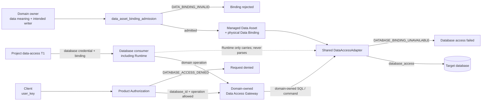

# 数据治理（Data Governance）

Data Governance 规定受管理数据的归属、权威存储、写入边界和处理约束，并统一数据库访问的受控边界。数据内容由所属 domain 定义；数据库访问及生命周期操作的具体实现由项目 T1/T2 与代码负责。

## 1. Primary System Flow



数据对象见第 3 章，访问职责与生命周期见第 4 章，两项逻辑接口见第 5 章。箭头只说明交接，不增加权限。

## 2. Intended Outcomes

数据负责人、访问实现和数据库消费者应能按同一套约定使用、保存和迁移受管理数据。

1. **数据归属和写入权威唯一。** 每个 record family 与 scope 的 semantic owner、System of Record 和 canonical writer boundary 可唯一确定。副本、缓存、索引、备份、工作流历史和导出不因保存 bytes 取得数据所有权或独立写入权。
2. **物理绑定足以约束实际处理。** 准入结果明确存储、writer 及适用的隔离、分类、驻留和生命周期要求。不合格候选被拒绝，未准入位置不能承载 canonical write。Object store 载荷的身份、owner、hash、policy、lifecycle 和 locator 仍由权威存储管理。
3. **共享访问机制保留领域责任。** Domain Gateway 保有 schema、SQL、query semantics、result mapping 与 writer rule；共享 Adapter 只承担数据库访问机制。共享实现不等于共享凭据、数据库目标、tenant scope 或 writer authority。
4. **每次访问满足全部适用条件。** 产品当前权限、数据 binding、领域规则和数据库 enforcement 分别有效，任何一方拒绝都停止操作。Canonical write 只经 registered writer boundary，不通过内部表、跨 domain 文件或旁路连接绕过。
5. **凭据和数据库目标受控。** Client 不取得数据库凭据；`user_key` 在访问链中只用于产品授权路径的 `database_id + operation` 判断，不是数据库凭据，也不能兑换、返回或暴露凭据。Runtime、Module 及其他消费者只携带项目注入的 credential 与 exact binding，不解析、签发、刷新、扩权或自行选择数据库；凭据只存在于受控数据库访问链，非数据库 provider/tool 不进入这一凭据模型。
6. **保存、迁移和恢复维持既定权威。** Retention、legal hold、backup、restore、export、migration、rollback 和 retirement 遵守已准入约束，不产生第二个 active writer、silent fallback 或未声明的权威切换。具体过程与业务数据决定仍由下层负责人承担。
7. **失败和实现状态可以准确交接。** Binding 或凭据不可用、目标不匹配时，访问停止并返回真实提供方，不另建旁路。当前注册、实现和覆盖有代码及生成视图依据，目标与现状差异明确；设计接受、实现、发布和实际运行分别取得结果。

## 3. Owned System Object

### 3.1 对象定义

```text
managed Data Asset
    含义：纳入治理、具有明确语义负责人和适用 scope 的数据对象。
    要求：每个 record family 与 scope 只有一个 semantic owner、
          一个 registered System of Record 和一个 canonical writer boundary。
    边界：数据内容、schema 和业务接受标准由所属 domain 决定。

physical Data Binding
    含义：Data Asset 与其物理权威存储、写入边界及适用处理约束的绑定。
    必须确定：semantic owner、System of Record、canonical writer，
              以及 isolation、classification、residency 和 lifecycle constraints。
    用途：约束数据库访问、数据保存以及后续迁移和恢复。

System of Record
    含义：在已登记 record family 与 scope 内承载权威数据的物理位置。
    区别：保管副本或保存相同 bytes，不取得该权威地位。

canonical writer boundary
    含义：获准提交该 Data Asset 权威写入的唯一边界。
    要求：canonical write 经 registered writer boundary 提交。
    限制：不得通过内部表、跨 domain 文件或旁路连接绕过该边界。
```

Data Governance 拥有这些归属和物理绑定的共同含义。Domain owner 保留 record meaning、schema、SQL、query semantics、result mapping、migration content 和 canonical writer rule；物理存放者不会因此取得数据的语义所有权。

### 3.2 不同存储的职责

| 存储或副本 | 承载内容 | 权威限制 |
| --- | --- | --- |
| Version-controlled source authority | Code、Design、schema definition、migration 和 test。 | 持有版本化源内容，运行状态按下一行确定其权威存储。 |
| Registered database | Managed runtime state。 | 按已准入 binding 承载相应 record family 和 scope。 |
| Object store | 大型 immutable payload。 | Payload 的 identity、owner、hash、policy、lifecycle 与 locator 仍由 registered System of Record 持有。 |
| Replica、projection、cache、index、backup、workflow history 和 export | 复制、检索、恢复或使用所需的 bytes。 | 不因保存内容取得 semantic ownership，也不接受独立 canonical write。 |

具体数据库产品、物理拓扑和上述存储的实现由项目 T1/T2 决定。共享一个物理或软件设施，不改变每个 Data Asset 的独立归属。

## 4. Capability and Operation

### 4.1 Gateway 与 Adapter 的分工

Domain Service Owner 提供 Data Access Gateway，共享 `DataAccessAdapter` 提供数据库访问机制。两者承担的工作如下。

| 参与者 | 负责的处理 | 保留的边界 |
| --- | --- | --- |
| Domain-owned Data Access Gateway | 把已经允许的 domain operation 转换成 domain SQL 或 command，并处理领域结果。 | Schema、query semantics、result mapping 和 writer rule 由 domain 持有。 |
| Shared `DataAccessAdapter` | 接收 domain command、已准入 binding 和受控数据库凭据，执行数据库访问。 | 不解释 `user_key`、domain meaning 或 SQL meaning，不取得领域数据权威或 permission policy。 |
| 数据库消费者，包括 Runtime、Module | 通过 domain Gateway 发起领域操作，向 Adapter 携带项目注入的凭据和 binding。 | 不绕过 Gateway 和 Adapter 直连内部表；凭据处理条件见第 4.2 节。 |
| Project data-access T1 | 组合访问组件，提供 credential 和 binding，处理无法安全建立访问的问题。 | 具体 provider、连接方式和故障处理由其 T1/T2 与代码决定。 |

Adapter 可在项目实现中承担 connection acquisition、transaction mechanics、tenant context、retry classification 和 access audit。是否采用这些能力及其字段、算法由下层设计决定。共享 Adapter implementation 不代表共享 credential、database target、tenant scope 或 writer authority。

### 4.2 数据库凭据与目标

```text
database credential
    存在与用途：只存在于受控数据库访问链，并仅供该链的数据库访问使用。
    提供方：project data-access T1 负责取得和注入；具体 secret provider、
            resolution implementation 及 custody lifecycle 由该 T1/T2 与代码定义。
    消费方：受控 DataAccessAdapter。
    携带方：Runtime、Module 或其他数据库消费者只传递已注入的凭据和 exact binding。
    限制：携带方不读取或解析凭据内容，不签发、不刷新、不扩大 scope，
          不自行选择数据库。非数据库 provider/tool 不进入这一凭据模型。
```

在数据库访问链中，`user_key` 只用于 Product Authorization 的 `database_id + operation` 判断；adapter 对 key 的认证属于该授权路径。它不是 database credential，也不能兑换、返回或暴露数据库凭据。Client 永远不接收 DSN、password、token 或 service credential；访问结果和 metadata 也不能成为凭据披露渠道。

Data Governance 规定上述使用和隔离边界，不持有 secret value，不选择具体凭据 provider，也不负责 `user_key` 的生成、验证或权限分配。Runtime 继续负责 Module/Workflow 执行和证据，不取得凭据管理、数据库选择或 domain SQL 的职责。

### 4.3 保存、迁移与恢复

Retention、legal hold、backup、restore、export、migration、rollback 和 retirement 遵守已准入 physical binding 及其 isolation、classification、residency 和 lifecycle constraints。

这些操作必须保持唯一的 System of Record 和 canonical writer，不得产生第二个 active writer、silent fallback 或未经声明的 authority switch。Migration target、backup 或恢复位置仅因取得数据副本，不会自动成为新的权威存储。

Domain owner 决定迁移的数据内容；下层 T1/T2 与代码定义具体 state machine、deadline、job、evidence schema 和 recovery procedure。Software Delivery 负责软件实现、发布、部署、回滚和退役，沿本章的数据安全约束处理其实际动作。

## 5. Public Interface and Effects

### 5.1 数据绑定准入

Domain owner 提供数据意图和预期 writer，并提交物理位置及适用约束。Data Governance 判断候选能否明确建立第 3 章的归属与处理边界。

```text
data_asset_binding_admission
    Owner：Data Governance。
    Input：domain-owned Data Asset intent、intended writer、physical binding，
           以及 applicable constraints。
    Output：admitted binding meaning 或 rejection。
    Effects：只建立 Data Governance-owned authority 与 handling boundary。
    边界：不创建 domain schema 或 writer。
    Error：DATA_BINDING_INVALID。
```

`DATA_BINDING_INVALID` 表示候选无法唯一确定 semantic owner、System of Record、canonical writer 或适用约束，因此没有形成可用的物理权威绑定。调用方修正候选；未准入位置不得承载 canonical write。

准入确定的是数据权威和处理约束。当前 binding、准确 Registry 和 schema、policy version、migration state、implementation ref、coverage 与检查视图由代码维护，见第 7 章。

### 5.2 数据库访问

每次数据库访问必须同时满足 Product Authorization 的当前操作权限、Data Governance binding 及适用的 tenant、Cell、classification、residency 和 retention 约束、domain rule，以及 database enforcement。任何一方拒绝都停止操作。各方只决定自己负责的条件，Data Governance 不能代为授予产品权限。

```text
database_access
    Owner：Data Governance。
    Input：admitted physical binding、Product Authorization allow result、
           domain-owned command，以及 project 提供的 database credential。
    Output：database operation result 或明确失败。
    Effects：执行受控数据库访问。
    边界：保持第 4.1 节的机制与领域分工，不扩大权限或重新解释业务命令。
    Error：DATABASE_BINDING_UNAVAILABLE。
```

`DATABASE_BINDING_UNAVAILABLE` 表示 exact physical binding 或 database credential 不可用，或两者不对应同一受控目标。本次访问不能安全建立，调用方停止访问并交给 project data-access T1 owner 处理；不得绕过 Adapter 自建连接。

`DATABASE_ACCESS_DENIED` 沿 Product Authorization 的定义使用，是正常权限拒绝结果，不属于 Data Governance error。查询可见信息与每次操作重新授权的条件，直接使用 [Product Authorization](the_product_authorization.md)。

## 6. Completion, Failure, and Recovery

数据绑定是否准入、一次访问返回什么结果，分别按第 5.1、5.2 节判断。绑定准入不会创建领域 schema 或 writer，访问返回也不替代领域对业务结果的接受。

候选绑定被拒绝时，由提交方修正归属、物理目标或约束；在重新准入前不承载 canonical write。Binding 或 credential 不可用、目标不匹配时，保留实际失败，交 project data-access T1 owner 修复，不绕过 Adapter 重试。产品授权的正常拒绝继续使用其所属接口，不改写为数据治理系统故障。

恢复、迁移和回滚按第 4.3 节保持唯一权威与 writer，并继续遵守全部适用处理约束。具体恢复过程、记录格式和执行证据由下层设计与 Software Delivery 规定；本规范不增加另一套状态机或默认回退路径。

## 7. Dependencies and Verification

### 7.1 来源与下层设计

本 T0 统一数据对象、物理权威、访问和生命周期边界。当前注册、实现和覆盖情况只由 code-owned Registry、持久化事实和 generated inspection 声明。当前实现与本文目标语义之间的差异应明确记为 implementation debt，不能通过手工在 T0 复制当前字段消除差异。

项目 T1/T2 负责准确 ID、schema、SQL、driver、connection pool、transaction、retry、credential provider、migration command 及部署配置。数据语义、业务接受、Runtime 执行和 provider/tool 行为仍沿各自负责人决定，本文提供的是它们共同遵守的数据约束。

### 7.2 必需证据

下层设计和实现应提供与其范围相符的证据，证明下列性质。此处规定核对对象，具体检查和测试实现由 Software Delivery 承接。

| 核对对象 | 需证明的性质 |
| --- | --- |
| Data Asset 与 binding | 能唯一确定第 3 章所需的归属、权威存储、writer 和约束，准入拒绝不会形成可用写入位置。 |
| 副本与载荷 | 副本没有独立 canonical write；Object store payload 的权威描述保留在 registered System of Record。 |
| 访问组成 | Gateway 保留领域职责，Adapter 保留共享机制职责，访问路径没有绕过适用权限、数据或数据库条件。 |
| 凭据与目标 | 符合第 4.2 节的注入、携带、隔离和使用范围；binding 不可用时按第 5.2 节停止访问。 |
| 生命周期操作 | 迁移、恢复和回滚保持第 4.3 节的唯一权威与 writer 条件，并遵守适用处理约束。 |
| 当前事实 | 实现与覆盖结论可以追溯到代码事实和生成检查结果。 |

## 8. Peer Boundaries

| Peer authority | Data Governance handoff | Peer 保留的职责 |
| --- | --- | --- |
| Product Authorization | 消费 `database_id + operation` allow/deny result；提供受控 database resource boundary | `user_key` permission assignment、visibility 与 allow/deny meaning；不解析或暴露 database credential |
| Agent Runtime | 提供 exact database binding boundary；Runtime 可携带 project 注入的 database credential 与 binding | Module/Workflow execution；不解析 credential、不选择 database、不持有 domain SQL |
| Domain T1 | 接收 admitted Data Asset 与 physical binding constraints | Record meaning、schema、SQL、query semantics、result mapping、migration content 与 canonical writer rule |
| System Change Governance | 采用计划路径时消费已审 `SystemChangePlan` 的对应步骤；明确授权的 Design 请求可直接进入 DDM 方法 | 计划的修改范围、顺序、owner 与 route；Data Governance 保留数据权威与处理边界的含义、Design 审核及 owner 决定 |
| Timestamp and Clock Semantics | 消费 time-field 与 clock comparison semantics | Timestamp role、clock、expiry 与 comparison meaning |
| Design Doc Management | 交付 exact Data Governance Design candidate | Design 结构、文稿审核与 `design_contract_reviewer` 合同 |
| Review Contract | 由 Data Governance Reviewer source 消费通用审核规则 | Universal Reviewer instruction；不拥有 Data Governance checklist 或 verdict |
| Software Delivery | 提供 data safety、binding 与 writer constraints | Code Design、implementation、test、release、deployment、rollback 与 retirement |

明确授权的 Design 请求直接使用 [DDM](the_design_doc_management.md) 的编写和审核方法；使用 [System Change Governance](the_system_change_governance.md) 统筹时，消费已审核 `SystemChangePlan` 中的对应范围、负责人和顺序。Data Governance 的设计接受由 accountable Data Governance owner 决定。

重要设计候选的独立审核和采用遵循 DDM，通用审核纪律引用 [Review Contract](the_review_contract.md)。Adapter、schema、migration 和数据库实现另行进入 [Software Delivery](the_software_delivery.md)。设计审核结论不替代实现、发布或运行证据。

数据约束涉及时间字段、时钟、expiry 或比较含义时，采用 [Timestamp and Clock Semantics](the_timestamp_semantic.md)；该规范继续拥有这些时间语义。

## 9. References

- Project Charter：`designDoc/the_charter.md`，由消费项目提供。
- [Product Authorization](the_product_authorization.md)
- [Agent Runtime](the_agent_runtime.md)
- [System Change Governance](the_system_change_governance.md)
- [Timestamp and Clock Semantics](the_timestamp_semantic.md)
- [Design Doc Management](the_design_doc_management.md)
- [Review Contract](the_review_contract.md)
- [Software Delivery](the_software_delivery.md)
