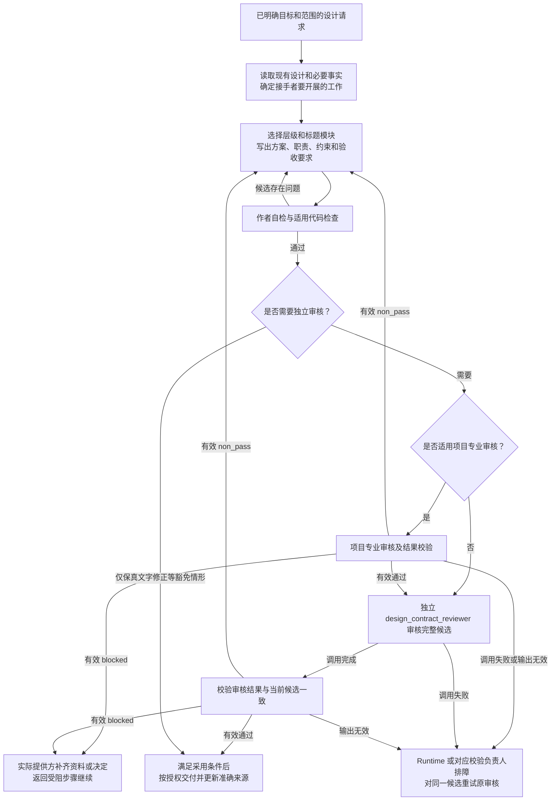

# 设计文档管理（Design Doc Management）

设计文档说明要建设什么、采用什么方案、由谁做什么、必须遵守哪些约束，以及怎样验收。接手的人或 Agent 根据这些决定开展下层设计、实现或执行。文稿应提供这项工作所需的依据，不能依赖原始聊天和作者临时补充。

Design Doc Management（DDM）指导正式设计文档的编写、修改、审核和交付。它规定各层应作出的决定、可选用的标题模块，以及每个模块应写出的内容和效果。具体产品和技术方案仍由相应设计负责人决定。

文中的写作、审核和交付流程，处理的是进入 DDM 的设计文稿。本文自身也按这些要求编写和审核。实际审核结果随交付材料保存，不写入规范正文。

## 1. Primary System Flow

Primary Agent 接到设计请求后，先确认需要交付什么，再选择层级和适用模块。作者完成文稿和自检；需要独立审核时，审核者针对这份完整候选作出判断。



图中按审核阶段区分了修订、补齐依据和排障三种去向。具体适用条件和处理见第 7 章；检查范围和审核标准见第 8 章。源文件更新、安装副本更新和系统实际运行，各有自己的执行结果。

## 2. Intended Outcomes

DDM 应支持作者编写、修订和交付正式 Design，并让下层设计、实现和执行采用一致的要求。具体结果如下。

1. **本层的设计决定足以支持后续工作。** 文稿明确所设计对象在实际情境中提供哪些主要能力，各自产生什么结果、必须满足哪些质量。方案、承担动作的主体、必要约束和验收要求足够具体。多个主体协作时，交出的结果、接收方及其后续工作明确。会改变结果的信息不足、条件变化或失败有明确后果和处理去向。接手者无需猜测主要功能或补作本层应作出的决定。合理的下层实现选择仍然保留。
2. **层级和内容职责清楚。** 作者能够按决定的作用范围选择 Charter、T0、T1 或 T2，并使用同一套标题模块组织内容。每个模块承担自己的内容职责；重要结果不因去重而丢失，局部实现也不会被抬成共同规则。设计的能力和机制与本次授权结果及实际需要相称，不能为补满目录增加接口、状态、机器对象或审批。
3. **设计有准确来源，可以独立使用。** 文稿标明身份、层级、来源及必要继承关系。读者可以定位依据，区分设计目标、当前事实和待决定事项，不依赖原始聊天。父级、同级和下层采用共同概念时，不形成彼此冲突的定义。
4. **修订解决问题并保留有效要求。** 新稿落实授权修改，保留仍然有效的目标、条件、例外和职责。各模块、流程图和引用表达一致。替换或删除文稿时，仍在使用的引用有明确处理，接手者保有有效入口。
5. **审核能支持采用判断和具体修订。** 对准确候选的判断覆盖适用要求。问题说明位置、依据、后果和需要恢复的结果，修订可以对应到处理情况。作者自检、机械检查和独立语义审核分别提供各自证据，不互相冒充。
6. **交付状态真实，受阻工作可以继续。** 请求方取得准确文稿、适用检查和审核材料，以及源更新的实际结果。缺少必要资料、决定或执行条件时，已完成内容与具体缺口、影响和提供方一并交出。源更新、安装副本更新和被设计系统的实际完成分别说明。DDM 的写作、审核和交付不要求额外的注册计划、状态或批准对象，审核通过也不扩大实际授权。

## 3. Owned System Object

DDM 管理设计决定及其依据的文档表达，称为 Design Intent。它适用于 Charter、T0、T1、T2 正式设计文档。业务需求、操作手册和进展报告按各自用途编写；仅有项目背景或技术内容，不会自动使它们成为正式 Design。

### 3.1 设计层级

层级决定这份文稿需要作出哪些决定。标题模块决定这些内容放在哪里。两者分别选择。

表格两侧的 HTML 注释标记用于定位这段共用定义。标记本身不会把内容发送给 Agent，实际同步方式见 8.3。

<!-- design-layer-semantics:start -->
| 层级 | 本层应确定的内容 | 接手者据此开展的工作 | 留给其他层的决定 |
| --- | --- | --- | --- |
| Charter | 产品服务谁、解决什么问题、覆盖哪些工作；核心业务对象；人类决策权和全系统必须遵守的最高要求。 | 各设计负责人据此划定领域范围、分配顶层职责，并判断哪些方案符合产品方向和授权。 | 具体领域方案、接口、日常操作和运行配置。 |
| T0 | 多个独立下层必须一致采用的概念、规则和职责。共同能力还要确定必要的工作方式、逻辑接口及失败含义。 | 下层作者直接采用这些规定，设计自己的系统；消费者能够按共同约定调用或交接，不必各自决定同一个跨系统问题。 | 具体项目的内部组成、局部算法、当前实例和部署配置。 |
| T1 | 一个领域或独立子系统提供什么功能、由哪些部分承担，以及它们怎样协作完成任务。 | 下层作者能据此分别展开各项能力；实施方能确定各组件的责任、依赖和整体交付。 | 有界能力内部的详细处理，以及同级领域自己的决定。 |
| T2 | 一项有界能力的输入、处理行为、输出、影响和必要接口。明确关键判断、完成条件、失败处理及验证要求。 | 实施者能编写实现和测试；调用方能按约定使用结果，处理已定义的失败。 | 不改变约定行为的内部算法、类组织和其他工程选择，以及其他能力负责的决定。 |
<!-- design-layer-semantics:end -->

层级取决于决定的作用范围，细节多少不决定层级。例如，DDM 的字段含义需要多个消费者一致采用，属于 T0。字段解析器的实现属于技术设计和代码。

本层必须解决会导致下游采用不同主要功能、责任或交付标准的歧义。已经明确交给下层的选择可以保留。缺少决定时，应写清待决定的事项、影响和负责人；有理由的建议仍须标明其尚待决定。

### 3.2 文档身份字段

同一份设计可能有被维护的源文件、供其他环境使用的安装副本，以及待判断的候选副本。文件开头的 YAML 信息块称为 frontmatter，用于辨认文档和追溯来源。复制文稿时应保留它的身份，不能把临时存放位置当作新来源。

本篇使用的字段如下：

```yaml
---
title: Design Doc Management
layer: T0
canonical_owner: designDoc/the_design_doc_management.md
owned_system_object: Design Intent
t0_layer_id: the_design_doc_management
---
```

```text
title
    用途：供使用者发现和辨认文档。
    填写：所有 Design 必填。使用能辨认设计对象的非空标题。

layer
    用途：确定文稿承担的设计范围。
    填写：所有 Design 必填。按 3.1 选择 Charter、T0、T1 或 T2。
    限制：不能依据篇幅、文件编号或技术细节多少选择层级。

canonical_owner
    用途：定位这份文稿的准确来源。
    填写：所有 Design 必填。沿所属项目的引用规则填写来源引用。
    投影：安装副本和候选副本保留上游源引用。
    限制：不填写负责人姓名，也不改成临时候选或安装副本的路径。

owned_system_object
    用途：标明本文负责设计的对象或决定。
    填写：所有 Design 必填。用简短名称或说明概括正文实际承担的设计。
    限制：声明设计对象不要求创建同名运行对象、记录或 Registry。

parent
    用途：标明直接设计继承关系中的父文档。
    填写：T1、T2 存在该关系时，填写准确父文档引用；不存在时省略。
    限制：Charter、T0 不填写。各层均不使用 null 占位。
    区分：上游约束、同级依赖、参考资料和文件编号不会自动构成父级。

t0_layer_id
    用途：供现有消费者识别 T0 的兼容标识。
    填写：已有消费者需要它的 T0 保留准确值。
    限制：不向其他层级增加相同字段要求。
```

例如，T2 展开某份 T1 已划定的能力，两者存在直接设计继承时，`parent` 指向该 T1。同一份 T2 遵守的时间规范是约束依据，另一领域提供的接口是依赖；它们按引用关系处理。

### 3.3 来源与引用

`canonical_owner` 和适用的 `parent` 遵守 Identifier and Reference Semantics。所属项目的解析器确定解析根和解析方式。校验器按该规则检查引用，不按临时候选所在目录任意拼接路径。

Frontmatter 保留定位所需信息。目标读者、设计理由和职责写入正文；检查、审核和部署的实际结果随交付材料提供。不向 frontmatter 增加文稿状态、读者清单、审核结论、模型配置或部署信息。

## 4. Authority

DDM 决定正式 Design 的内容、结构和质量要求。具体方案由相应设计负责人在授权范围内决定。作者负责把这些决定写成可接手的文稿；独立审核者判断候选是否满足适用要求。文档负责人、文稿作者和系统中的执行主体可以不同，应按实际职责说明。

范围、目标和负责人已明确的授权请求，可以直接进入设计写作。工作入口不清时，由 Task Routing 选择入口。用户要求统一规划，或未指定起点且工作确需统筹范围与依赖时，由 System Change 形成相应计划。已有计划时，写作和审核须保留当前步骤、完成条件、排除项及后续边界。设计请求无需额外携带注册计划、request ID、hash 或审批状态。

新的产品或架构取舍由有权负责人决定。已有授权覆盖的一般修订按授权继续。文稿通过审核不授予产品决定、数据操作、软件发布或部署权限。DDM 与相关规范的职责分工见第 9 章。

## 5. Capability and Operation

### 5.1 从实际工作写出设计

作者先确认这份设计交给谁，接手者下一步要完成什么。然后读取现有设计和直接相关事实，写出本层需要决定的方案。修订已有系统时，应说明保留什么、改变什么及其理由。新建系统时，应明确拟建的能力和依据。

写作采用 Project Documentation 的基本方法：围绕一个实际任务，说明谁处理什么对象、依据什么条件采取什么动作，以及产生什么可用结果。多个组件合作时，说明它们怎样交接，接收方继续什么工作。会改变结果的资料不足、条件变化或失败，应有相应处理。

例如，“维护 Agent 负责报告可用性”还没有确定功能。文稿需要说明它检查什么、在什么条件下能采取哪些恢复动作、什么情况需要交给哪个负责人，以及使用者最终取得什么结果。所用组件和入口应有依据。作者不能为了补齐这段话，自行增加重跑权限、维护角色或未获授权的新功能。

作者应对关键方案说明理由和代价。资料不足时，把已知事实、建议和待决定事项分开。写“确保一致”“支持协作”“提高质量”之前，先确定它具体要求谁改变什么行为、交付什么结果。

形成方案时，作者先从授权目标和主要能力中找出结果要求。逐项说明接收方实际得到什么，以及哪些质量决定结果能否使用。写完后逐章反向核对全部后文：若其中首次出现本层的重要结果或必要质量，应补入 Intended Outcomes。对象定义、权限、共同约束、系统组成和各层专用模块也在核对范围内。局部实现限制仍留在原处。不规定结果条数、段落数或统一句式，也不要求另交一张覆盖表。

写完后，作者按文稿走一遍主要任务，再检查会改变结果的真实分支。后续执行者应能继续工作。必要的步骤、顺序、工具或执行身份须保留；不影响约定结果的实现方式由下层选择。这项走读用于检查设计，无需提前实现或运行系统。

### 5.2 标题模块及其交付要求

作者从以下模块中选择文稿实际需要的内容。模块内容和适用条件在本节定义，标题写法、编号与组合规则统一见 5.3。模块内部可以按真实对象或功能命名小节。

每项说明区分四件事：写什么；写到什么程度才够用；与其他模块怎样分工；什么时候选用。这里的“完成效果”用于判断该模块是否写全，正文应直接给出相应决定和说明，无需再写一遍“读者能够……”或另设检查字段。

#### Intent Capsule：开篇简介

- **写什么：** 用简短导语交代正在设计什么、为什么需要它，以及理解后文所需的基本关系。新概念首次出现时，说明它在实际工作中的用途。
- **完成效果：** 接手者可以判断这份文稿是否适用于当前工作，并知道接下来讨论的对象是什么。
- **分工：** 结果要求放在 `Intended Outcomes`，准确对象定义放在相应定义处。简介不维护第二套输入、输出和边界。
- **选用：** 需要开篇背景时，用正文编号之前的无编号导语承载，不另设独立章节。已有导语足够时，不再增加一份摘要。

#### Primary System Flow：主要工作流程

- **写什么：** 从任务进入到结果交付，说明主要执行主体、关键动作、改变去向的条件，以及交接的对象和接收方。图中的连线应表达动作顺序、依赖或交接关系。
- **完成效果：** 执行者可以沿主流程确定下一步由谁处理、需要什么结果才能继续，以及在哪些关键分支改变处理方式。
- **分工：** 本模块展示完整工作路径。单项功能的判断方法在 `Capability and Operation` 展开；权限在 `Authority` 定义；调用约定在接口模块定义。流程图引用这些决定，不再定义一份。
- **选用：** T0、T1、T2 存在任务处理或多方协作流程时选用。纯概念规范没有运行流程时可以省略，不把编写和审核本文的过程画成被设计系统的流程。Charter 的开篇权力导航使用 `Constitutional Authority Map`。

#### Intended Outcomes：预期结果

- **写什么：** 本层每项主要能力应产生什么结果或变化，供谁在什么情境下使用，以及每项结果必须满足哪些质量。保留解释这些要求所需的目的、范围和适用条件。结果要求应覆盖主要能力，不能只列产物名称，或用“完整、可靠、可实施”等词代替具体要求。
- **完成效果：** 设计和实施人员能够逐项确定要做成什么，以及做到什么程度才满足用途。审核者对照授权目标与主要能力，能在本节找到相应结果要求；本层的重要结果和必要质量不能只藏在后文。
- **分工：** 本模块集中定义主要结果及其必要质量。工作机制说明怎样做到；完成条件说明何时可以宣布任务完成；验证说明用什么证据判断要求成立。后文可围绕同一结果展开不同内容，不再重抄整项要求。局部字段、算法、操作步骤和检查命令留在所属模块。
- **选用：** 所有正式 Design 必须使用。写被设计系统或能力的结果，不用作者的写作步骤、文稿通过审核或“读者理解了”替代系统结果。

#### Owned System Object：设计对象

- **写什么：** 本文负责设计的对象或决定；对象的含义、区分条件和必要关系；多个功能共同使用的定义。只在一处使用的字段及条件，可随使用它的功能集中定义。
- **完成效果：** 下层作者和消费者可以辨认自己处理的对象，并采用相同含义。面对相似对象时，可以判断适用哪套要求。
- **分工：** 此处定义“处理什么”。`Authority` 定义“谁有权决定什么”，功能模块定义“对它做什么”。文档对象不自动成为运行实体。
- **选用：** 对象或概念需要独立定义时选用。对象简单且已在导语完整说明时，可以合并。T1 已使用 `Domain Outcome and Owned Objects` 时，不重复设置同义模块。

#### Authority：职责与决定边界

- **写什么：** 本设计负责哪些决定；哪些主体可以作出什么决定或执行什么动作；授权、委派和停止条件；哪些事项应交给其他负责人。
- **完成效果：** 执行者可以判断当前事项是否由自己处理、自己可以决定到哪里，以及缺少决定或超出范围时应交给谁。
- **分工：** 本模块固定决定权和职责边界。主流程只展示这些主体怎样协作；`Peer Boundaries` 说明双方交付什么及如何接手。具体功能和接口自己的局部条件留在相应定义旁。
- **选用：** 存在需要单独说明的决定权、授权或责任划分时选用。少量且只适用于一个功能的边界，可以完整写入该功能。没有独立内容时，不再把已有职责汇总一遍。

#### Capability and Operation：功能与工作方式

- **写什么：** 按实际功能说明触发条件、执行主体、处理对象、必要输入、关键判断、动作及结果。说明已选择的方法及理由，以及影响结果的重要例外。
- **完成效果：** 接手者能据此实施或执行各项功能。其余选择可以留给下层，但不能让下层重新猜测功能本身、主要处理方式或交付内容。
- **分工：** 本模块展开功能怎样完成。流程模块提供全程导航；接口模块定义调用者可以依赖的约定；完成模块定义停止及后续处理。已有定义直接引用。
- **选用：** 需要说明系统怎样提供能力，或一种工作方法怎样产生结果时选用。章节内按具体功能分节，不使用“自有内容”作占位标题。纯概念或规则文稿只选用实际需要的功能说明。

#### Architecture and Lifecycle：系统组成与对象生命周期

- **写什么：** 系统由哪些组件组成，各自承担哪些功能，对象归谁管理，组件怎样依赖。对象确有生命周期时，再说明哪些事件导致哪些状态变化，以及谁负责这些变化。
- **完成效果：** 下层作者能够按已定边界分别设计组件。实施者能够确定组件之间的依赖，并按实际生命周期处理对象变化。
- **分工：** 本模块决定系统如何分成各部分。功能模块说明各部分怎样完成任务。一次操作的成功和失败由完成模块定义。对象没有持久状态变化时，无需设计状态机。
- **选用：** 多组件系统或实际需要生命周期设计的对象使用。只有组成内容时可以只写组成；不能为了标题中的 Lifecycle 增加状态、Registry 或生命周期记录。

#### Public Interface and Effects：对外接口与影响

- **写什么：** 对外提供的操作、调用者、输入输出及其含义、前置条件、可观察影响和失败表示。使用已有接口或类型时，给出准确引用。
- **完成效果：** 调用方可以准备有效输入、使用返回结果，并按已定义的失败选择后续动作；实现方可以据此实现接口而不改变调用约定。
- **分工：** 本模块定义外部可依赖的行为。内部处理在功能模块展开；失败后的责任和恢复在完成模块展开。错误码由拥有接口的代码合同定义一次。
- **选用：** 存在实际软件调用或稳定对外操作约定时使用。人员交付材料或文稿审核可以直接说明交接，无需造 API、schema 或错误码。T1 整体对外约定也可使用后文的 `Public Boundaries and Quality Rules`。

#### System-wide Invariants：共同约束

- **写什么：** 本设计范围内，多个功能或阶段始终必须遵守的要求。逐条说明适用范围、条件和例外，使实现者能够判断什么行为违反要求。
- **完成效果：** 各下层方案即使采用不同实现方式，也能保持规定的共同性质。验证者可以识别实际违例。
- **分工：** 本模块只定义需要集中说明的共同约束。某个字段、接口或功能的局部限制随其定义保存。已经在别处完整定义的规则不在这里再抄一份。
- **选用：** 确有跨功能约束时使用。没有独立内容时省略。这里的 System-wide 以本篇设计负责的系统范围为限，不自动扩大为整个产品的权限。

#### Peer Boundaries：与相邻系统的分工和交接

- **写什么：** 与哪些相邻系统合作；各自负责什么；何时传递什么结果；谁接收并继续哪些工作；交出方还保留什么责任。注明必须共同遵守的规范入口。
- **完成效果：** 双方可以分别完成自己的工作，并按明确条件交接。依赖缺失或责任争议出现时，可以找到应处理的负责人。
- **分工：** 此处定义交接关系，不复制对方的内部步骤。已有软件接口直接引用 `Public Interface and Effects`；本方决定权直接引用 `Authority`。
- **选用：** 有多方责任关系需要独立说明时使用。只有一处简单交接时，可完整写入相关功能或接口。不同位置不得各自维护同一份交接定义。

#### Completion, Failure, and Recovery：完成、失败与恢复

- **写什么：** 明确正在判断哪项任务、操作或产物。规定何时完成、何时只能部分交付，以及停止或失败后哪些影响已经发生、保留什么结果、由谁继续。存在恢复需求时，再定义重试、恢复或回滚的条件。
- **完成效果：** 执行者可以判断能否宣布完成；出现失败时，能够保护已完成结果，并采取适用的后续动作或交给正确负责人。
- **分工：** 本模块把预期结果落实为完成判断和异常处理，不另立目标。接口模块保留失败表示，验证模块保留取证方法。系统运行完成、业务结果可用和设计文稿审核通过，分别判断。
- **选用：** 设计涉及有终点的任务、操作或交付时使用。无恢复需要时说明实际后续处理即可。后文的 `Completion and Failure` 是同一用途的简版标题，各层均可选用。

#### Dependencies and Verification：依赖与验证

- **写什么：** 所需的外部能力、输入、环境或上游决定，以及使用条件。对需要验证的要求，说明验证对象、场景、检查或测试方法、预期证据和覆盖范围。
- **完成效果：** 实施者能够准备必要依赖；验证者能够针对准确对象开展检查，并根据证据判断哪些要求成立、哪些仍未知。
- **分工：** 本模块提供验证方法，不新增另一套完成标准。实际检查结果属于执行记录。设计本身包含审核工作时，还应说明审核者针对什么对象、按哪些标准和证据作出判断；完成审核可以得到不通过结论。每份文稿自身的 DDM 送审规则由本规范统一规定，无需在文稿中重复。
- **选用：** 存在需要说明的依赖或专属验证要求时使用。少量要求可合并到相关功能。需要按项目组织专业审核时，另按 7.1 判断适用范围。

某个 T0 规定产物写法且拥有专用 Reviewer 时，本模块还应写明受审对象和输入、确定性检查范围、唯一的专用 checklist、检查项与 `check_id` 的对应方式、允许 `not_applicable` 的条件（如有），以及专用结果校验。对应方式可以是直接标识，也可以是与 schema 或 validator 的明确位置映射，无需强制所有 checklist 使用同一表格布局。

该类产物的交付或采用条件写入 `Completion, Failure, and Recovery` 或其简版模块，与这里的检查依据相互引用。通用结论和结果结构沿用 Review Contract。例如，Skill Management 在这里规定怎样审核一份 Skill；Skill Management 文稿自身的 DDM 审核，仍由本规范第 7、8 章规定。

#### References：依据入口

- **写什么：** 本文实际使用的上位设计、同级规范、接口或技术依据的准确入口；有版本要求时注明适用版本。
- **完成效果：** 接手者能够找到所引用的依据，并核对其适用性。
- **分工：** 引用清单不替代正文决定。影响某项方案的条件和理由应在相关正文中说明，引用指向其来源。
- **选用：** 所有正式 Design 使用。当前部署、运行状态或测试是否通过，引用相应事实来源，不手写一份长期清单。

#### T1 常用的补充标题

以下标题沿用既有 T1 文档的用途。表中的适用层级决定哪里可以选用；“常用”不表示每份 T1 都必须选用。

| 可选标题 | 适用层级 | 应写什么 | 写完应达到的效果 | 分工与选用条件 |
| --- | --- | --- | --- | --- |
| `Domain Outcome and Owned Objects` | T1 | 说明本领域接收哪些工作、管理哪些对象，哪些内容由别的领域负责。引用 `Intended Outcomes` 中的领域结果。 | 下层作者能划定自己的对象和工作范围；任务负责人能判断一项需求应进入本领域还是其他领域。 | 标题中的 Outcome 只建立对象与既定结果的关系，不再写一套预期结果。与 `Owned System Object` 择一。 |
| `Public Boundaries and Quality Rules` | T1 | 说明领域对外提供什么、从外部取得什么，以及消费者可依赖的质量要求。给出接口定义入口和必要交接。 | 邻接系统能安排协作，下层能力设计能保持同一对外承诺。 | 适用于领域整体对外约定。具体字段和失败表示由对应接口定义；多个接口共用的质量规则在此定义一次。与其他接口或交接模块不重复维护。 |
| `T2 Partition and Dependencies` | T1 | 列出需要由 T2 展开的能力边界、各项应交付的功能，以及相互依赖和先决条件。 | 各能力负责人能分别开展详细设计，知道必须共同确定的接口和需要先取得的结果。 | 实际需要拆分 T2 时使用。无需为每个组件或每项任务强建 T2。系统已有组成说明直接引用，不重复介绍组件。 |
| `Completion and Failure` | Charter、T0、T1、T2 | 规定本层任务何时完成、部分完成或失败；说明结果交付和后续责任。在 T1 中判断领域端到端任务。 | 负责人能按同一标准验收任务，并处理未完成部分。 | 与 `Completion, Failure, and Recovery` 择一。确需规定恢复时使用后者，或在本模块完整说明，不并列两套完成标准。 |

#### Charter 常用的补充标题

Charter 使用这些模块确定产品方向、最高权力和共同限制。`Design and Code Boundary` 也适用于其他层级，其余标题限 Charter 使用。它们均为可选模块，使用时须满足对应内容要求。

| 可选标题 | 适用层级 | 应写什么 | 写完应达到的效果 | 分工与选用条件 |
| --- | --- | --- | --- | --- |
| `Constitutional Authority Map` | Charter | 用关系图表示最终决定权、委派关系、主要系统职责及其范围。 | 各负责人能找到决定来源，并沿委派关系判断应向谁请求决定。 | 用于 Charter 的整体权力导航。具体权利及条件在 `Human Authority` 定义，图不产生额外授权。 |
| `Product Identity and Scope` | Charter | 产品服务谁、解决哪类问题、范围内外是什么；核心业务对象及其必要关系。 | 下层负责人能判断一项建设是否属于产品，并据此划定领域范围。 | 不重复预期结果，也不维护当前功能清单。领域对象的详细 schema、生命周期和质量规则由下层决定。 |
| `Human Authority` | Charter | 哪些决定由人保留，哪些可以委派，委派有什么条件和撤回限制。 | 人与 Agent 能区分可自主事项、需决定事项和超出授权的事项。 | 负责宪制层的人类决定权；权限实现由相应系统负责。与通用 `Authority` 按内容择一或明确分工。 |
| `Constitutional Invariants` | Charter | 各层必须遵守的最高要求、冲突处理顺序，以及已经在宪制层选定的共同执行基础。 | 下层能排除违背产品最高约束的方案，并据此设计共同基础。 | 对应 Charter 范围的共同约束。当前版本、部署绑定和内部算法由所属设计及事实记录提供。 |
| `Design and Code Boundary` | Charter、T0、T1、T2 | 设计意图、实现事实和验证证据各自说明什么；不一致时如何辨认差异、修正事实或提交设计变更。 | 负责人能判断系统“要求做到”与“实际做到”的区别，并选择正确的修正入口。 | 适用于需要规定这项共同分工的文稿。不能用当前实现替代产品决定，也不能把目标写成已经实现的事实。 |
| `Amendment Authority` | Charter | 谁可以修改 Charter，哪些变化需要相应决定，修改后怎样取得适用依据。 | 作者能判断自己能否推进一项宪制修改，并把超出权限的取舍交给有权负责人。 | 只规定修订权限和必要条件。具体写作、审核和交付方法引用 DDM，不复制执行步骤。 |
| `T0 Topology Reference` | Charter | 各 T0 负责的系统对象、彼此关系及准确入口。 | 下层作者能为一个跨系统问题找到负责的 T0，并遵守相关约束。 | 提供顶层分工导航，不重写各 T0 的内部定义。当前注册清单使用可追溯的生成视图。 |

### 5.3 选择模块与安排顺序

作者按下列形式组织新建或修订的正式 Design。模块内容使用 5.2 的定义，层级深度使用 3.1 的要求。

| 事项 | 规定 |
| --- | --- |
| 导语 | 放在文档标题之后、编号正文之前。`Intent Capsule` 由这段无编号导语承载，不设置单独的二级章节。新版不使用 `## 0. Intent Capsule`。 |
| 主章节与编号 | 主章节使用 Markdown 二级标题，从 `1` 开始连续编号。格式为 `## <编号>. <模块正式名称>`。省略可选模块后重新连续编号，不保留空号或占位章节。 |
| 标题写法 | 二级标题使用 5.2 列出的英文模块正式名称，保持大小写和标点，不附中文译名或自拟后缀，不使用同义替换。中文说明写在正文；下级小节可以按真实对象或工作命名。 |
| 必需模块 | `Intended Outcomes` 和 `References` 各自独立成章，不能省略或并入其他模块。 |
| 开篇顺序 | T0、T1、T2 选用 `Primary System Flow` 时，将它放在第 1 章，`Intended Outcomes` 紧随其后。Charter 选用开篇导航时使用 `Constitutional Authority Map`，位置相同。省略开篇导航时，`Intended Outcomes` 为第 1 章。 |
| 末章与中间章节 | `References` 必须是最后一个编号章节。其余所选模块放在 `Intended Outcomes` 与 `References` 之间，按理解和工作需要排序，不设固定扩展区。 |
| 层级适用 | `Primary System Flow` 限 T0、T1、T2。两组补充标题按 5.2 表格中的层级选用。其余通用模块可供四个层级使用，但须满足各自选用条件。 |
| 择一组合 | `Owned System Object` 与 `Domain Outcome and Owned Objects` 不并列成章；`Completion and Failure` 与 `Completion, Failure, and Recovery` 不并列成章。两个开篇导航标题也不能同时出现。其他模块是否重复，按其实际内容和分工判断。 |
| 省略与合并 | 只对可选模块适用。合并后，主章节保留其中一个适用的正式模块名；并入的内容写在相应段落或小节，不拼接新的顶层标题。必要含义、条件和职责仍须完整。 |
| 重复与空内容 | 同一主模块最多出现一次。已选模块须有实质内容，不能仅有空标题、占位词或对标题的重复。 |

上述标题限制约束的是本文实际选用的主模块。解释模块定义、引用其他文稿或在代码块中展示样例，不算选用了该模块。下级标题不能用于规避本层的内容边界。

以下组合帮助作者选择可选模块，不要求填满一行中的全部模块。必需模块和准确形式以上表为准。

| 文稿用途 | 通常需要的模块 |
| --- | --- |
| Charter：产品方向和最高约束 | `Constitutional Authority Map`、`Product Identity and Scope`、`Human Authority`、`Constitutional Invariants`、`Design and Code Boundary`、`Amendment Authority`、`T0 Topology Reference`。 |
| T0：共同概念和语义规则 | `Owned System Object`、`System-wide Invariants`；存在职责分界时用 `Authority` 或 `Peer Boundaries`；存在专属符合性验证时用 `Dependencies and Verification`。 |
| T0：共同运行能力 | `Primary System Flow`、`Owned System Object`、`Authority`、`Capability and Operation`、`Public Interface and Effects`、`Completion, Failure, and Recovery`；按需要增加组成、共同约束、交接和验证模块。 |
| T0：编写、审核或交付方法 | `Primary System Flow`、`Owned System Object`、`Capability and Operation`、`Completion, Failure, and Recovery`、`Dependencies and Verification`；涉及多方决定权和交接时，使用 `Authority`、`Peer Boundaries`。 |
| T1：领域或子系统方案 | `Primary System Flow`、`Domain Outcome and Owned Objects`、`Architecture and Lifecycle`、`Capability and Operation`、`Public Boundaries and Quality Rules`、`Completion and Failure`；需要分解时用 `T2 Partition and Dependencies`。 |
| T2：单项能力的详细设计 | `Primary System Flow`、`Capability and Operation`、`Public Interface and Effects`、`Completion, Failure, and Recovery`、`Dependencies and Verification`；对象或权限复杂时增加对应模块。 |

例如，Skill Management 可以把一项方法的适用边界与方法定义放在一起，并省略单独的 `Authority` 章节。Reviewer 仍须判断这些边界是否完整；代码不能仅凭标题存在或省略，就宣布内容充分。

同一对象在多处被提及是正常的，但完整定义只保留一处。例如，流程图可以展示审核者接收候选；权限模块说明作者不能代替审核者作出独立结论；接口模块说明交入什么材料。各处承担不同的执行需要，不能各自重述整套审核职责。

仅作为依据读取的旧文稿不因被引用而自动改写；其修订候选按新版规则检查。旧格式兼容检查应明确声明所用规则和范围，不能仅凭编号起点切换规则，也不能将旧规则通过算作新版通过。修改涉及标题消费者时，应说明需要同步的解析器、模板或指令；文稿候选本身不证明这些消费者已经更新。

## 6. System-wide Invariants

### 6.1 一项定义只有一个完整来源

同一对象、字段、规则或交接只有一个完整定义。适用条件、取值、例外及直接限制随定义写全，其他章节引用。同一结果可以分别出现在预期结果、实现机制和验证中：各处说明要求、实现办法和判断证据。这种分工不是重复定义，不能为了去重删掉 Intended Outcomes 中的主要结果要求。共用类型和上游要求引用准确来源，不在本篇建立第二套同义定义。

文稿保留影响正确性、权限或证据有效性的必要步骤。接口、状态、事务、回放、恢复、schema、Registry 和 Validator 只在实际需要时设计。没有适用内容时不填空表，不为结果另建不必要的文件或记录。结果可以是功能、对象变化、判断或材料。

### 6.2 设计目标与实现事实分别有依据

设计说明要求系统做到什么。代码和 schema 说明实际接口及实现，测试说明已验证哪些行为。发现不一致时，应标明目标与现状的差异，并修正错误的事实陈述。需要改变目标时，仍由有权负责人作出设计决定。

当前版本、文件清单和检查结果由实际代码及记录提供。生成视图须能追溯到对应代码或发布内容。DDM 不要求每份设计另建 `Code Projection`、`Current Inspection` 或注册记录。

### 6.3 表达应保留完整含义

中文正文优先使用简单句。先写清谁做什么，一句话表达一个主要动作或判断。不同事项、长定语和多层条件应分句说明。拆句必须保留条件、例外、职责、因果、不确定性和停止条件，不能为缩短句子删内容，也不能把“只有……才……”改成“如果……就……”。字段、枚举、表格和代码保留其需要的结构。

术语首次出现时应有必要背景。定义、取值和约束可以用表格或 docstring 集中表达；解释段落只补充会影响判断的理由或例子。流程图、正文和接口中的主体、动作及结果必须一致。图应保留会改变处理方式的分支和依赖。

### 6.4 只加载实际适用的专业规范

设计定义时间字段、时钟、日历、新鲜度或时间比较时，遵守 Timestamp Semantics。定义机器标识、引用、版本、内容哈希、指针或定位方式时，遵守 Identifier and Reference Semantics。普通文字、示例或路径出现日期、ID、ref 等词，不构成适用条件。

新增或改变职责划分时，作者比较完整的受影响集合。局部修订读取判断该变化所需的背景。文档同属一层，不要求同时重整全部邻接系统。

## 7. Completion, Failure, and Recovery

本章判断的是设计文稿的交付和采用。被设计系统怎样完成一次任务，由该系统的设计另行规定。

### 7.1 何时需要独立审核

新增 Design，或改变职责、行为、公开接口、接受标准及其他重要含义时，Primary Agent 须组织独立 `design_contract_reviewer` 审核完整候选。只有修订限于文法、链接或机械投影，且保留全部含义时，才可仅运行适用代码检查并完成作者保真自检。旧审核结论不能表述为针对新内容的独立结论。

面向具体项目交付的解决方案 T1，以及定义具体能力行为的技术 T2，还适用 Project Documentation 的专业要求。Primary Agent 根据任务用途判断是否适用，使用 `the-design-authoring` 组织正式设计，并通过 `project-documentation-authoring` 完成同一份文稿的项目内容。先取得项目专业审核结果，再取得 DDM 审核结果。重要项目含义再次改变时，重新取得受影响要求的适用审核结果。

Charter、T0、通用治理设计和其他用途的正式 Design 使用 DDM 路径。采用项目写作中面向执行者的方法，不会使所有文稿都需要项目专业审核。文稿的 T1 或 T2 标签本身也不触发该要求。

### 7.2 采用条件与失败处理

文稿只有同时满足以下条件，才可作为完成的 Design 交付或采用：

1. 内容满足授权目标和所属层级要求。
2. 适用检查通过。
3. 所需独立审核有效通过，且结论准确对应当前候选。
4. 采用处于已有授权范围内。

所属设计另有采用条件时，也须满足。

| 实际结果 | 接下来的处理 |
| --- | --- |
| 代码检查发现候选内容问题 | 作者修正问题并重新检查。 |
| 有效 `non_pass` 指出设计缺陷 | Primary Agent 核对证据、适用要求和当前影响，修订成立的问题。完整修订候选重新接受适用检查和独立审核。 |
| 有效 `blocked` 指出缺少必要资料或决定 | Primary Agent 保留已完成内容，把具体缺口、影响和所需条件交给真实提供方。补齐后继续工作。 |
| 调用失败，或审核输出未通过任一必需校验 | 此时没有有效审核结论。Runtime 或校验代码负责人处理问题后，对同一候选重试。执行失败本身不要求作者修改设计。 |
| 有效 `passed` | Primary Agent 核对其余采用条件，完成授权范围内的交付和源更新。 |

共同结论含义和意见处理纪律由 Review Contract 定义。作者应修订成立的必修问题；错误或越界意见应附理由交回独立重判，不能自行把未通过结论改成通过。可选建议 `note` 默认不实施。多轮修订保留相同授权目标和完成条件；重新打开已处理问题须有新证据、候选变化或原处理失败。范围限制不豁免实际回归。

尚缺检查、审核或决定时，作者可以交付候选或问题材料，并准确说明缺项及影响。作者自检、指定模型的编辑意见、调用结束或输出文件存在，都不能替代所需的有效独立通过。发现依赖缺口也不自动扩大文稿、实现或部署范围。

### 7.3 源更新、安装与替换

完整交付包含准确文稿、适用检查和审核结果，以及问题处理和未决事项说明。问题处理应对应具体要求及修改。

候选审核期间，现行文稿仍按原内容使用。修改 Portable 文稿时，应更新准确上游来源；项目文稿更新所属源文件。版本控制保存历史，使用入口指向当前采用的内容。

将选定内容更新到安装副本或其他环境，由相应负责人按实际授权执行。安装同一份未改变含义的 Portable 内容时，只检查引用和投影一致性。源更新不表示消费环境已更新，部署也不是文稿审核通过的前置条件。交付应分别说明源更新和涉及环境的实际结果。

删除或替换文稿前，应先处理仍在使用的引用，为接手者保留有效入口。涉及多方依赖时，先明确依赖和责任，再按需要使用已有统筹方法。普通文稿修改不额外创建生命周期对象、注册计划或批准状态。

## 8. Dependencies and Verification

本章规定文稿作者、检查工具和 Design Reviewer 使用哪些依据，以及怎样判断候选满足本规范。作者和审核者使用同一份专用标准。

### 8.1 输入与确定性检查

作者提交完整候选、授权目标、修改范围、必要设计背景和实际检查结果。已有计划时，附上适用步骤和边界。背景文件不自动成为修改目标。本次明确授权改变的旧规则作为比较依据，不能成为要求候选保留该规则的循环理由。

送审前，代码检查文档身份、引用、机器字段和共同指令投影。结构检查以 5.3 的明确形式为依据：检查主标题名称、编号、必需模块、开篇与末章位置、层级限制、择一组合、重复和空内容；正文中的引用、模块定义及代码样例不能被计为主章节。

结果须对应准确候选，并说明实际覆盖的规则和失败位置。缺少某项检查时，如实列明，不把未实现或未执行的检查宣称为通过。模块内容是否充分、是否满足选用条件、合并后有无丢失要求，以及章节是否存在语义重复，由 Reviewer 判断。

审核返回后，结果须同时通过 Runtime 的共同格式校验，以及 DDM 对检查覆盖、候选范围和结论一致性的专用校验。任何一项未通过，都不能作为有效审核结论使用。

代码检查不能证明目标合理、设计范围完整或证据支持结论。Reviewer 使用实际代码结果作语义判断，无需重复计算 hash、解析 schema 或核对机械投影。

### 8.2 独立审核标准

以下区间是本规范中 Design 专用 checklist 的唯一完整定义。`check_id` 标识检查项，`finding_class` 标识对应问题类别。作者按这些要求检查准确候选，先处理已知且影响当前交付的缺陷，再组织独立审核。

作者自检按 Skill Management 的“写作产物送审前的作者自检”执行，逐项记录当前候选的证据和判断。历史意见重新核对，不继承旧结论。该方法直接使用以下标准，不另写一份 Design checklist。

<!-- design-contract-review-checklist:start -->

| 顺序 | `check_id` | 必须确定的结果 | `finding_class` |
| --- | --- | --- | --- |
| 1 | `intent_and_reader_result` | Intended Outcomes 覆盖授权范围内本层每项主要能力的预期结果及必要质量，说明使用情境和接收方用途，保留目的依据与适用边界。对照主要能力及全部后文要求，确认重要结果没有遗漏或只出现在后文；不能仅列产物名称或空泛质量词。不以条数、篇幅或逐项同名判断完整性，不要求搬入局部实现细节。读者理解或指定过程不能替代系统结果，无证据的结论或后续工作不能成为当前承诺。 | `intent_gap` |
| 2 | `layer_owner_and_parent` | 层级、负责人和必要父级清楚。本次结果涉及的职责没有重叠或缺口，也没有为了检查完整性而重整全部邻接系统。 | `layer_or_owner_defect` |
| 3 | `layer_content_fit` | 内容属于本层，所选模块承担明确的内容职责。机制按实际需要使用，没有为填满标题而增加下层设计。 | `layer_content_misfit` |
| 4 | `peer_authority_and_inheritance` | 设计遵守适用上游规则，与直接相关同级系统的交接一致。实际涉及时间或机器引用语义时，遵守对应 T0。 | `peer_or_inheritance_conflict` |
| 5 | `boundary_coherence` | 主要职责有明确执行主体、处理对象和动作。交接写清结果、接收方及其后续工作。文档负责人不替代执行主体，职责区分不创造多余管理角色。 | `boundary_ambiguity` |
| 6 | `design_and_code_truth_separation` | 文稿区分目标与实际实现，当前事实有代码依据，不额外要求没有消费需要的机器对象。 | `code_truth_leakage` |
| 7 | `flow_interface_and_error_closure` | 流程图、正文、实际需要的输入输出和失败处理一致。材料交接没有被误写成软件接口。 | `flow_or_interface_closure_gap` |
| 8 | `failure_completion_and_rollback` | 完成、信息不足和真实失败的后果清楚。恢复或回滚只在实际影响需要时定义。 | `failure_or_completion_gap` |
| 9 | `implementability_without_redesign` | 本层已决定实际情境中的主要功能、工作方式和交付结果，接手者无需重新猜测。实质功能歧义按设计缺口处理，不降为文字建议。合理下层选择和不影响本步的后续工作仍被保留。 | `implementability_gap` |
| 10 | `review_approval_and_admission` | 审核、实现和采用分别有对应证据，所需授权清楚，没有新增不必要的状态或重复审批。 | `review_or_admission_conflict` |
| 11 | `prose_and_meaning_preservation` | 语义要求成立后，没有聊天背景的读者能准确理解设计。文字修正保留事实、职责和条件。 | `prose_or_communication_defect` |

<!-- design-contract-review-checklist:end -->

前十项判断设计含义，第十一项随后检查表达。同一根因只生成一条 finding，按最直接的判断项归类；其他受影响项引用同一问题。发现职责或可实施性歧义时，应指出具体条款，以及它会导致哪些不同动作或结果。已允许下层选择的算法和类组织不属于这类缺陷。

### 8.3 方法、工具与执行证据

`the-design-authoring` 提供读取依据、写作、自检、组织审核和处理结果的实际方法及工具入口。它的 Skill 包保存 `design_contract_reviewer` 的指令、输入输出 schema 和校验样例。源内容存在不证明 Reviewer 已注册或已经执行。

Runtime 中的任务执行定义称为 Module。正式独立审核由 Agent Runtime 执行已注册的 Reviewer Module。Runtime 提供独立执行身份、输入隔离、共同格式校验和执行证据。作者方法和 Reviewer 可以存放在同一个包中，执行独立性仍须由实际运行保证。

DDM 定义 Design artifact schema 的含义、专用判据和问题分类。其所属 Portable Governance 代码维护 schema、parser、validator、review adapter、hash 及投影同步。Parser 解析字段，validator 检查来源和正文的一致性，review adapter 将统一解析结果和完整候选装配为审核输入。消费者复用相同解析结果，不另写一套字段解释。

代码向作者方法和 Reviewer 提供相同的 checklist。代码表示、生成结果和嵌入内容须与 8.2 保持相同含义和标识。文档中的标记区间用于定位完整定义；修改该区间本身不表示 schema、生成器或已安装指令已经更新。共享片段按其实际生成与投影机制处理。

## 9. Peer Boundaries

| 相关方 | DDM 交付或使用什么 | 对方继续负责什么 |
| --- | --- | --- |
| Charter 与各 Design 负责人 | 使用其目标、授权和设计决定，交付符合用途的文稿和 Design 审核材料。 | 决定产品范围、最高约束和各自方案；处理超出作者权限的取舍。 |
| Task Routing 与 System Change | 在工作入口及范围确定后，接手 Design 写作。 | 选择任务入口；需要统筹时，确定范围、依赖和分步任务。 |
| Project Documentation | 对适用项目文稿采用专业方法和审核结果，继续完成正式 Design 检查。 | 规定具体项目文稿的专业内容、深度和材料组织要求。 |
| Skill Management | 提供设计写作方法和 Reviewer 需要实现的目标与判断要求。 | 管理完整 Skill 的内容、发现方式及 Skill 审核。 |
| Review Contract | 提供 Design 专用 checklist 和问题类别，使用共同审核规则。 | 定义共同审核纪律、结果结构，以及 Reviewer 指令的编写和审核。 |
| Agent Runtime | 提交准确审核输入，使用有效执行证据和审核结果。 | 提供独立 Module 执行、隔离和共同机械校验；处理执行故障。 |
| Software Delivery | 交付已确定的目标、职责、约束和必要接口要求。 | 按授权组织 Code Design、实现、测试、发布、部署及必要恢复。DDM 自身工具的实现同样遵守这项分工。 |

## 10. References

- Project Charter：`designDoc/the_charter.md`（由消费项目提供）。
- [Task Routing](the_task_routing.md)
- [System Change Governance](the_system_change_governance.md)
- [Skill Management](the_skill_management.md)
- [Project Documentation](the_project_documentation.md)
- [Review Contract](the_review_contract.md)
- [Agent Runtime](the_agent_runtime.md)
- [Software Delivery](the_software_delivery.md)
- [Timestamp Semantics](the_timestamp_semantic.md)
- [Identifier and Reference Semantics](the_identifier_and_reference_semantics.md)
