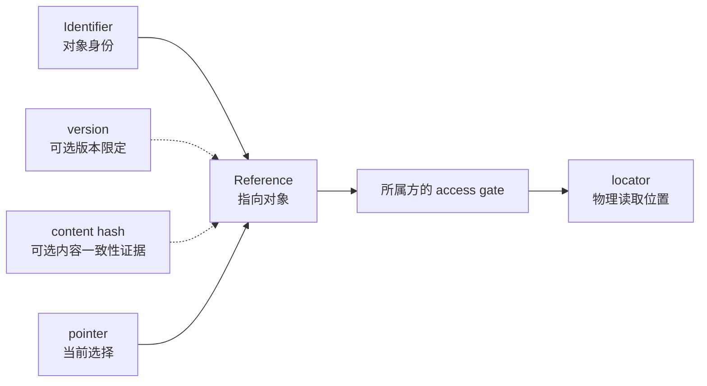

# 标识符与引用语义合同（Identifier and Reference Semantics Contract）

`Identifier` 说明这是哪个对象，`Reference` 说明另一处怎样指向这个对象。版本、内容指纹、当前选择和读取位置各有不同用途。本合同统一这些含义，各业务负责人继续决定对象本身、具体格式和实现。

## 1. Intended Outcomes

领域设计者、schema 负责人和 Runtime 维护者应能准确使用对象身份与引用，保持跨系统比较和迁移的含义一致。

1. **身份与引用可以唯一解释。** 实际机器边界能确定 subject、meaning、scope、encoding、target 和负责人。Identifier 稳定识别对象，Reference 说明另一处指向哪个目标及所需精确程度，不靠 prefix、目录、字段名习惯或调用位置猜测。
2. **精确限定按真实需要使用。** version 限定版本，content hash 证明相同 algorithm 和 coverage 下的内容一致性；它们不自动成为稳定身份，也不被强制加入所有引用或不可变记录。确需把某项属性纳入身份时，由业务对象合同明确决定。
3. **当前选择、位置和权限各自成立。** pointer 改变选择，不重写目标或改变其 Identifier；locator 变化不改变身份，位置相等不证明引用相等。引用、授权、访问、业务接受和 pointer update 分别判断，不能凭一个引用取得读写或执行权限。
4. **比较与失败有确定含义。** Identifier 按对象种类、scope 和身份字段比较，Reference 按目标含义及适用限定比较。无法安全解释、解析或比较时 fail closed，由实际接口负责人提供错误和后续动作，不以局部猜测继续。
5. **兼容和迁移保留原义。** 既有 ID、版本、引用和内容指纹不会因采用本规范被原地改义。可唯一恢复含义的旧字段有明确兼容 mapping；无法消除歧义时使用新名称或引用。后续迁移、切换、回滚和退役有实际负责人及项目决定，不冒充已经完成。
6. **共同语义不增加无用机制。** 业务对象、具体格式和存储由所属方决定，未使用的概念不增加字段、占位值或空合同。各 owner 的代码验证本地机器合同并提供当前事实，不为统一含义创建中央 Registry、通用 resolver、统一错误体系或第二份人工清单。

## 2. Owned System Object

本合同管理 `machine-facing identifier and reference semantics`：Identifier 与 Reference 的关系，以及 `version`、`content hash`、`pointer`、`locator` 的从属作用。它规定命名、比较和非破坏性迁移的共同要求。

业务负责人决定具体对象是否存在、含义是什么、由谁创建，以及具体 Identifier、Reference format、version rule、是否需要 content hash、pointer 和 locator。对象的当前版本选择、存储位置、权限和生命周期也由所属方决定。

本合同不统一所有业务 ID 的字符串格式或 reference scheme，不要求每个 class、DTO 或 nested record 注册新的 identification object。它不建立中央 Identifier Registry、统一 resolver、通用 validation service 或 pointer update interface。数据库、repository、URL、object store、provider 和 transport 的选用继续归实际负责人。

### 2.1 Identifier

```text
Identifier
    含义：在声明的 object kind 和 scope 内，稳定标识一个逻辑对象。
    必要结果：调用方可以唯一判断“这是哪个对象”。
    表示：可以使用单一字段或组合字段；不要求统一字符串格式或 kind + scope + id envelope。
    负责人：业务对象负责人定义 identity fields 及其含义。
    边界：version、status、environment、storage path 和 content hash 不自动成为 stable identity。
    例外：某个业务对象确实把上述信息作为 identity 的组成部分时，必须在所属 contract 中明确规定。
```

Identifier 的含义由对象合同决定。字段名称或本合同的一般规则不能替代上述明确的业务决定。

### 2.2 Reference、version 与 content hash

```text
Reference
    含义：在另一处机器边界中，明确指向一个对象。
    必要结果：接收方知道 target subject 和所需精确程度。
    仅指向逻辑对象：可以只携带该对象的 Identifier。
    锁定某个版本：增加适用的 version。
    锁定不可变内容：可以增加 content hash，以证明内容一致。
    边界：Reference 与 Identifier 不能相互替代；使用引用不产生读取、写入或执行权限。

version
    含义：在需要时，将 Reference 限定到对象的某个版本。
    适用：调用方需要锁定版本。
    负责人：对象负责人定义 version rule。
    边界：可选的精确限定信息，不自动成为 stable identity。

content hash
    含义：内容指纹，例如 SHA-256，用于证明指定内容保持一致。
    适用：需要证明内容完全一致时，可以作为 Reference 的限定信息。
    比较条件：algorithm 和 coverage 都相同。
    边界：不能单独证明业务对象 identity；不是所有 Reference 或 immutable record 的必填字段。
```

Reference 可以指向稳定逻辑对象、特定版本或特定不可变内容。所需精确程度决定实际使用哪些限定信息；不要求所有引用同时携带整个字段集合。

### 2.3 Pointer 与 Locator

```text
pointer
    含义：由 owner 控制的可变选择，表示当前使用哪个 Reference。
    修改影响：选择可以改变，但不重写目标对象，也不改变目标 Identifier。
    更新要求：是否需要 compare-and-set、revision 或 rollback，由 pointer update interface 的 owner 定义并验证。

locator
    含义：Reference 经权限检查和解析后得到的物理读取位置。
    示例：repository path、database key、URL 或 object-store key。
    修改影响：位置可以改变，而 Identifier 与 Reference 保持不变。
    边界：位置或位置相等都不能证明对象身份；读取继续遵守所属 authorization 和 data-access boundary。
```

`version`、`content hash`、`pointer` 和 `locator` 只提供相应限定信息或角色，不构成另一套通用对象体系。未使用的概念不要求字段、占位值或空 contract；实际使用时，遵守相应结构与语义要求。

引用、授权、目标访问、业务接受和 pointer update 是不同决定。下面的关系图只展示概念与访问之间的关系，具体解析、权限检查和读取由所属方实现。



## 3. System-wide Invariants

### 3.1 机器合同必须交代的内容

在 persistence、public DTO、event 或跨系统边界中使用 Identifier 或 Reference 的负责人，必须在自己的 machine contract 中说明适用字段的 `subject`、`meaning`、`scope`、`encoding` 和 `target`。调用方必须能确定字段指向的对象及其负责人。

Public machine boundary 的字段名或 enclosing typed class 必须使 subject 和 meaning 明确。例如，`module_id`、`module_release_version`、`module_release_ref`、`module_release_sha256` 与 `module_store_locator` 可以表达不同用途，但这些名称不构成所有对象必须复制的字段模板。

### 3.2 相等判断

| 比较对象 | 相等所需条件 |
| --- | --- |
| Identifier | subject kind、scope 和 owner-defined identity fields 均相同。 |
| Reference | target meaning 及全部适用的限定信息均相同。 |
| Content hash | 仅在 algorithm 和 coverage 相同的前提下，比较内容指纹。 |
| Locator | 位置相等只能用于位置判断，不能推出 Identifier 或 Reference 相等。 |

具体 comparison、normalization 和 encoding 由 subject owner 的 code 定义。无法确定字段的 subject、meaning、scope 或 target 时必须 fail closed，不能依赖 prefix、目录或调用方猜测继续。

## 4. Capability and Operation

本合同成为 Current 不会原地改写既有 ID、version、Reference 或 content hash。每个 consuming project 先检查现有使用面，由实际负责人决定保留、临时兼容、生成 successor 或退役。

| 既有内容的情况 | 处理规则 |
| --- | --- |
| 可以从 exact context 唯一恢复含义的 legacy field | 可以临时保留 compatibility mapping。 |
| 仍有不可消除的歧义 | 使用新名称或新 Reference。 |
| Compatibility 或 successor | 保留明确 mapping，既有 Identifier 与 Reference 不原地改义。 |

Persistence migration、backfill、cutover、rollback 和 retirement 由 domain owner、Data Governance 与 Software Delivery 决定。既有项目的 adoption order 和 compatibility window 仍待各项目决定，本合同不声称已经完成迁移。

## 5. Dependencies and Verification

各 subject owner 的代码确定性验证自己的 machine contract，提供实际 validation、resolution 和 update operation，并保留 owner-local stable error code 与 caller action。机器验证失败不能改由语义 Reviewer 重新判定为合规。本合同不复制或统一这些接口和错误分类。

当前 field、schema、binding、pointer、locator 和 migration facts 由各 owner 的代码、持久化状态及生成视图保存；Design 不维护第二份 current inventory。一般语义正确不代表某个接口已经实现，也不证明当前引用已经成功解析。

### 5.1 使用共同语义时的符合性要求

使用本合同的 Design 和 machine contract 应能证明：

| 判断事项 | 依据 |
| --- | --- |
| 身份与引用明确 | 每个实际使用的 Identifier 和 Reference 对应唯一 subject meaning 和 owner；适用字段满足第 3.1 节。 |
| 概念未混用 | Identifier、Reference 和四类附属信息按第 2 章分别承担身份、引用、限定、选择或位置的作用。 |
| 比较与失败有确定解释 | 对应类型使用第 3.2 节的相等条件；无法确定含义时，由实际接口拒绝并处理。 |
| 未扩大职责 | 业务对象、authorization、data、time、Runtime execution 和 delivery 的决定仍由所属方承担。 |
| 兼容含义保留 | 修改未原地改变既有身份与引用；适用 mapping 和后续迁移责任明确。 |

本合同的专业内容审查判断上述定义是否足以避免概念混用、支持下一层设计，以及相关依据是否充分。表达审查针对同一准确候选，确认读者能够区分 Identifier、Reference 及四类附属信息；润色保留 authority、compatibility 与 migration 含义。

## 6. Peer Boundaries

Project Charter 决定本 authority 是否进入项目的 T0 topology。本合同向各方提供共同机器语义；各方继续定义自己的对象、实际操作和生命周期。

| 相关方 | 使用共同语义表示什么 | 对方继续负责 |
| --- | --- | --- |
| Agency Platform | product、service、session、workload。 | host、composition、placement 和 authentication。 |
| Agent Runtime | Module、Workflow、Execution、Artifact、release。 | Runtime admission、execution 和 recovery。 |
| Product Authorization | user_key、database permission assignment。 | database visibility、database operation 的 allow/deny，以及 assignment activation/revocation。 |
| Task Routing | request、logical owner、RoutingDecision。 | requested-result classification 和 owner selection。 |
| System Change Governance | plan、step、candidate。 | affected scope、dependency order 和 SystemChangePlan 含义。 |
| Data Governance | Data Asset、physical binding、migration Reference。 | data meaning、placement、retention 和 migration。 |
| Timestamp and Clock Semantics | 时间规则涉及的对象引用。 | time role、clock、calendar 和 comparison meaning；timestamp 不能替代 Identifier 或 Reference。 |
| Design Doc Management | Design candidate、parent、dependency。 | Design Intent、层级、文稿审核与采用。 |
| Skill Management | Skill、prompt source、Module export。 | Skill Definition、review 和 delivery。 |
| Review Contract | subject、context、finding、Reviewer source。 | 通用 Reviewer instruction 与 finding discipline。 |
| Software Delivery | software asset、commit、release、deployment record。 | implementation 与 release admission。 |

各 peer 的完整流程、字段清单、错误表和 implementation binding 保留在其所属定义中。

### 6.1 本规范的修改与采用

本合同文稿的结构和确定性检查、完整候选与背景要求、先语义后表达的独立审查，以及审核结果的有效性，采用 [Design Doc Management](the_design_doc_management.md) 和 [Review Contract](the_review_contract.md)。检查所要求的身份、来源、准确内容、schema、hash 和背景对应由 DDM 所属工具验证，不在本文复制工具流程。

明确授权的请求不要求先取得 `SystemChangePlan`；已有已审计划时附对应步骤。职责划分发生改变时审查完整受影响集合，局部修订仅提供判断本次变化所需的上游、同级、依赖背景和适用的 frozen current-state evidence。

Material T0 candidate 进入 Charter amendment、peer migration、implementation 或 portable release 之前，DDM 所属 schema 和 semantic validator 必须接受准确的 `design_contract_reviewer` output，registered verdict 必须为 `passed`，并由 Identifier and Reference Semantics owner 作出明确 Design decision。Review、owner decision、Design admission、implementation authorization 和 Software Delivery admission 分别保留实际结果；其中一项不替代另一项。

## 7. References

- Project Charter：`designDoc/the_charter.md`，由消费项目提供。
- [Agency Platform](the_agency_platform.md)
- [Agent Runtime](the_agent_runtime.md)
- [Product Authorization](the_product_authorization.md)
- [Task Routing](the_task_routing.md)
- [System Change Governance](the_system_change_governance.md)
- [Data Governance](the_data_governance.md)
- [Timestamp and Clock Semantics](the_timestamp_semantic.md)
- [Design Doc Management](the_design_doc_management.md)
- [Skill Management](the_skill_management.md)
- [Review Contract](the_review_contract.md)
- [Software Delivery](the_software_delivery.md)
