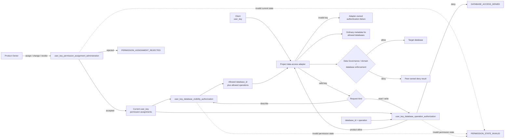

# 产品授权（Product Authorization）

Product Authorization 管理 `user_key` 的数据库权限分配，决定该 key 可以看见哪些数据库，以及是否允许对指定数据库执行 `read` 或 `write`。本 T0 统一权限含义、逻辑接口和拒绝行为；数据库访问的具体实现由项目 T1/T2 与代码承接。

## 1. Primary System Flow



流程中的接口见第 4 章，数据库访问组成见第 5 章，拒绝与失败见第 6 章。

## 2. Intended Outcomes

Product Owner、Client 和数据库访问实现应取得一致、可使用的权限结果。

1. **权限变更有准确结果。** 已确认具有 administration authority 的 Product Owner 可以分配、改变或撤销 `user_key` 对指定数据库的 `read`、`write` 权限。接受后形成相应 active 或 revoked assignment；拒绝和无效当前状态不会被当作变更已生效。
2. **可见范围与当前权限一致。** 查询只返回该 key 可访问的 `database_id` 及允许操作，无权限时返回空集合。Adapter 提供的普通 metadata 不披露无权限数据库的 identity、count、name、schema 或其他 metadata，也不能作为后续操作的永久授权。
3. **每次操作按当前权限判断。** 相同 key 的结果不依赖 Client 是人、Agent、Module 还是 Runtime。Unknown key、缺少匹配权限、撤销或不覆盖该数据库与操作时，不能获得 allow；每次操作重新检查。产品 allow 仍受独立的数据、领域和数据库条件约束。
4. **凭据和职责保持隔离。** Client 不能凭 `user_key`、metadata 或操作结果取得数据库凭据。Adapter 不创建、扩大或推断权限。身份验证、凭据管理、连接、SQL 和 Runtime 执行仍由各自负责人承担，产品授权只给出自己的判断。
5. **拒绝和故障有不同且可处理的含义。** 正常 deny 不被当成系统故障，拒绝原因不向 Client 细分。权限存储无效时 fail closed，不返回可见性、不执行操作、不提交权限变更；调用方能找到修复方并在条件恢复后重试。
6. **下层能实现和验证同一套语义。** 逻辑接口、状态影响和失败含义足以指导项目访问实现；当前 assignment、schema、接口格式与检查视图由代码提供，文稿不维护动态权限清单。设计接受、工程验证和实际发布各有自己的依据，不互相替代。

## 3. Owned System Object

```text
user_key permission assignment
    含义：一个 user_key 对指定 database_id 的当前操作权限。
    至少绑定：user_key、database_id、allowed operation、active/revoked status。
    负责人：Product Authorization。
    用途：计算数据库可见范围，判断单次数据库操作是否具有产品权限。

allowed operation
    取值：read、write。
    限制：schema、table、domain operation 和 metadata 内容不改变
          database_id + operation 这一判断范围。
    区别：describe 是 adapter 的查询入口，不是独立 permission operation。

active
    含义：已接受 assign/change 后形成的有效权限状态。
    效力：可用于与该 assignment 的 user_key、database_id 和 operation 匹配的授权判断。

revoked
    含义：已接受 revoke 后形成的撤销状态。
    后果：该 assignment 不再提供数据库可见性或操作权限。
```

上述定义固定权限含义，不规定实际记录格式。准确字段、schema、table、index、hash、store 和当前权限清单由代码持有。本文不引入 Principal、Group、Runtime identity、Module permission、delegated grant 或按执行实例产生的授权对象。

`user_key` 的签发、保存、轮换和凭据验证由相应身份与访问实现负责。Product Authorization 接收 key 进行权限判断，不负责这些凭据操作。

## 4. Public Interface and Effects

### 4.1 权限分配与撤销

Product Owner 通过项目 administration surface 提交权限命令。该入口负责确认调用方身份和 Product Owner authority，再把命令交给 Product Authorization；入口不能直接写 permission assignment 或改变其含义。Agency Platform 可以承载这一入口，保留宿主组合职责。

```text
user_key_permission_assignment_administration
    Owner：Product Authorization。
    Input：Product Owner 提交的 user_key、database_id、allowed operation，
           以及 assign/change/revoke command。
    Output：accepted 或 rejected result。
    Effects：只验证并改变 Product Authorization-owned assignment。
             assign/change accepted 后为 active；revoke accepted 后为 revoked。
    Errors：PERMISSION_ASSIGNMENT_REJECTED、PERMISSION_STATE_INVALID，见第 6 章。
    边界：不签发 user_key，不定义数据库，不建立数据库连接。
```

操作集合使用第 3 章的 `read` 和 `write`。接受结果表示对应权限变更已经形成；拒绝结果不能充当当前权限。权限存储无法通过有效性检查时，保留现有 assignment，不提交变更。

### 4.2 数据库可见性

```text
user_key_database_visibility_authorization
    Owner：Product Authorization。
    Input：user_key 和 current permission assignments。
    Output：该 key 当前可访问的 database_id，以及每个数据库的 allowed operations。
            没有权限时返回空集合。
    Effects：只计算 permission visibility。
    Errors：PERMISSION_STATE_INVALID，见第 6 章。
    边界：不定义或生成 metadata，不连接数据库，不返回 credential。
```

可见范围由 active database operation permission 派生。无权限数据库的 identity、count、name、schema 和其他 metadata 均不得披露。

Adapter 和 database owner 定义普通 metadata 的内容与 schema，并由 adapter 把上述可见范围转换为 Client 可以读取的信息。这份信息只描述查询时的可访问范围，不构成后续操作的永久授权。

### 4.3 单次操作

```text
user_key_database_operation_authorization
    Owner：Product Authorization。
    Input：user_key、database_id、requested operation，
           以及 current permission assignment。
    Output：一个 allow 或 deny result。
    Effects：提交本次操作的授权结果，不执行 SQL，不建立连接，不扩大权限。
    Errors：DATABASE_ACCESS_DENIED、PERMISSION_STATE_INVALID，见第 6 章。
```

每次数据库操作前，adapter 都重新调用本接口检查当前权限。Unknown key、没有 active matching permission、已撤销权限或不匹配的数据库和操作均不能获得 `allow`。

`allow` 只表示本次请求满足产品权限。Data Governance 的数据边界、domain rule 和 database enforcement 仍分别判断其条件，任一方拒绝都不得执行操作。`deny` 是正常授权结果，其拒绝原因不向 Client 细分披露。

## 5. Capability and Operation

Data Governance 定义共享 `DataAccessAdapter` 的机制边界，domain owner 定义自己的 Data Access Gateway。项目 data-access 实现把权限检查与这些能力组成受控访问路径。

| Adapter 逻辑入口 | 职责与接续 |
| --- | --- |
| `authenticate(user_key)` | 验证 key，返回 valid 或 invalid。Invalid 由 adapter 返回其拥有的认证失败结果。 |
| `describe(user_key)` | 使用第 4.2 节的可见范围，返回允许访问数据库的普通 metadata。 |
| `execute(user_key, database_id, operation, request)` | 使用第 4.3 节的当前授权结果，经适用数据和领域边界执行受控数据库访问，返回操作结果。 |


数据库访问使用项目受控的 database credential。`user_key` 不能兑换、返回或暴露该凭据；Client 永远不能取得 DSN、password、token、service credential 或其他 secret。Adapter 也不能创建、扩大或推断权限。

身份验证实现、metadata 和 result schema、credential resolution、connection、transaction、retry、buffer、SQL mapping 由项目 data-access T1/T2 与代码定义。Product Authorization 不接管这些机制，也不取得 tenant/Cell isolation、data classification、domain writer rule 或 database migration 的决定权。Runtime 作为普通 Client 使用本章访问约定，其 admission、Module/Workflow 执行和证据仍由 Runtime 负责。

## 6. Completion, Failure, and Recovery

| Result / error code | 触发条件 | 必须发生的结果 | 继续处理的责任 |
| --- | --- | --- | --- |
| `PERMISSION_ASSIGNMENT_REJECTED` | 权限变更使用未支持的 operation。 | 不形成或改变 permission assignment。 | 调用方改为 `read` 或 `write` 后重试。 |
| `DATABASE_ACCESS_DENIED` | 没有 active matching permission，或已 revoked，或不覆盖请求的 `database_id` 和 operation。 | 不执行数据库操作；返回统一拒绝结果。 | Product Owner 检查或重新分配权限。 |
| `PERMISSION_STATE_INVALID` | 权限 assignment 无法通过 Product Authorization schema 或 current-state validation。 | Fail closed：不返回 visibility result，不执行操作，不提交 assignment change。 | Product Authorization code owner 修复 permission-store 状态后重试。 |

这三个结果的含义由 Product Authorization 持有。Adapter 认证失败、Data Governance 拒绝及数据库执行失败沿各自接口返回，由对应负责人处理，不能改写成 Product Authorization 已经授权。

## 7. Dependencies and Verification

本 T0 提供第 3 至 6 章的权限语义和跨组件约定。代码维护 permission assignment schema 与 current store、逻辑接口的准确输入输出 schema、权限查询和撤销实现、可见性校验，以及当前注册的检查视图。文档不手工维护 key、permission、database、schema、table 或 connection status 的当前清单。

下层实现需要提供确定性证据，覆盖以下性质。具体测试组织和工具由 Software Delivery 承接。

| 核对对象 | 需证明的性质 |
| --- | --- |
| 分配与撤销 | 接受、拒绝和 invalid state 对 assignment 的影响符合第 4、6 章。 |
| 权限查询 | 相同 key 的判断不依赖 caller kind；unknown、missing、revoked 及 invalid state 均按相应条件关闭访问。 |
| 可见性 | 返回集合与 active permission 对应，不泄露未授权数据库的存在信息或 metadata。 |
| 操作检查 | 每次操作使用当前权限，旧 metadata 或其他层的允许结果不能替代本次产品授权。 |
| 凭据隔离 | Client 无法由 key、metadata 或操作结果取得数据库凭据。 |
| 组合边界 | 产品允许结果不绕过其他数据、领域和数据库条件；adapter 不自行生成权限。 |

## 8. Peer Boundaries

| Peer authority | Product Authorization handoff | Peer 保留的职责 |
| --- | --- | --- |
| Agency Platform | 承载 project administration surface，并把 Product Owner command 送入 `user_key_permission_assignment_administration` | Host composition；不决定 permission meaning，也不直接写 permission assignment |
| Data Governance | 定义 portable data-access mechanism，并在 authorized operation 上继续执行 tenant、Cell、classification、residency 与 retention boundary | Data-access mechanism、data boundary 与 data lifecycle；可以独立 deny operation，但不能授予 Product permission |
| Agent Runtime | 作为普通 Client 使用 `user_key` | Runtime admission、Module/Workflow execution 与 evidence；不改变 user_key permission |
| Design Doc Management | 定义本 T0 Design candidate 的结构与 `design_contract_reviewer` contract | Design 结构、文稿审核与采用要求；产品设计接受仍由本规范的 owner 决定 |
| Review Contract | 向 Design Reviewer source 注入通用审核规则 | Universal Reviewer instruction；不拥有 Product Authorization checklist 或 result |
| Software Delivery | 准入 adapter、permission store、schema、migration 与 database implementation | Code Design、engineering review、release、deployment、rollback 与 retirement |

项目 data-access T1 是本规范的实现消费者，不是 Portable peer T0。它负责访问组件的具体设计，通过 Code Design 与 Software Delivery 实现，并与项目数据库和领域 Gateway 对接。

重要设计变更在实施前取得 DDM 所要求的独立审核，并取得 accountable Product Authorization owner decision。Adapter、permission store、schema、migration 和数据库实现另按 Software Delivery 完成工程计划、实现验证、独立工程审核及适用发布。文稿通过审核不证明代码或部署已经完成。

## 9. References

- Project Charter：`designDoc/the_charter.md`，由消费项目提供。
- [Agency Platform](the_agency_platform.md)
- [Data Governance](the_data_governance.md)
- [Agent Runtime](the_agent_runtime.md)
- [Design Doc Management](the_design_doc_management.md)
- [Review Contract](the_review_contract.md)
- [Software Delivery](the_software_delivery.md)
