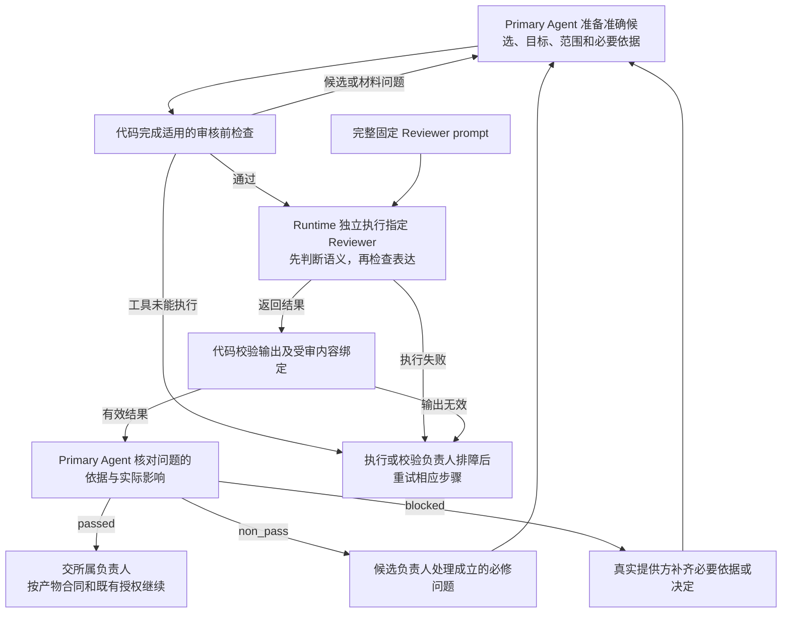
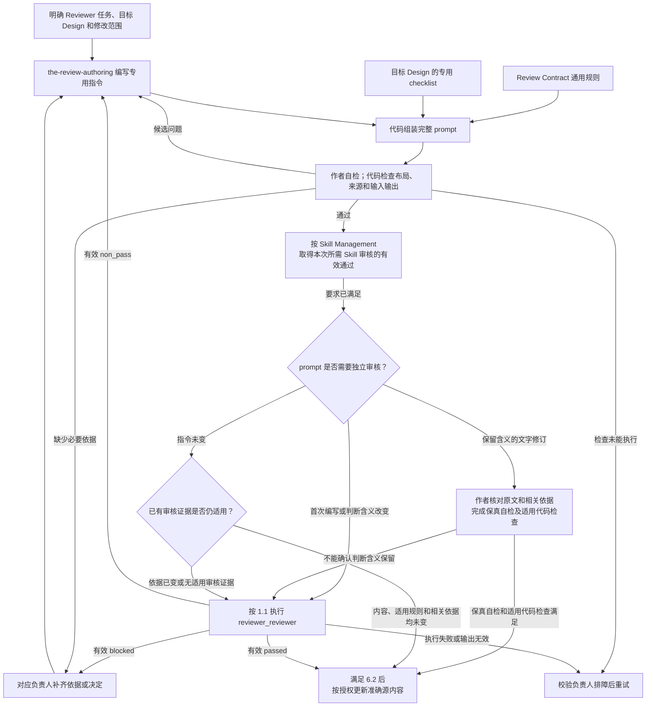

# 审核合同（Review Contract）

一份设计、Skill 或工程方案写好后，作者需要独立审核者检查它是否达到本次要求。审核者须说明哪些要求已经满足、哪里有具体缺陷，以及哪些判断还缺依据。组织者据此修订或补充材料，再判断能否继续交付。

执行这项工作的 Agent 称为 Reviewer。每类 Reviewer 使用一份固定任务指令，称为 Reviewer prompt。它由共同审核规则、该类产物的专用检查标准和专用任务说明组成。本次要审的候选、授权目标和背景材料另行提供。

Review Contract 规定共同审核规则、文稿与指令审核的结果含义，以及 Reviewer prompt 的组成和审核要求。具体产物应该达到什么要求，由该产物的 Design 决定。本文自身是一份 T0 Design，使用 DDM 的结构；本文规定的 Reviewer prompt 使用第 5.2 节的五章结构。

## 1. Primary System Flow

### 1.1 使用已有 Reviewer

本流程适用于一次已有审核任务。Primary Agent 准备材料，Runtime 独立执行 Reviewer，代码核对返回结果。候选负责人根据有效结果继续工作。



结论的含义见第 4 章。有效结果、候选通过和后续采用的区别见第 6.1 节。争议意见按第 4 章保留证据并交回独立重判。

### 1.2 编写或修改 Reviewer prompt

需要新增、修改或投影固定指令时进入本流程。普通产物审核直接使用已有 Reviewer，不因一次调用就重写指令。第 5.3 节区分判断含义改变、保留含义的文字修订和未变指令的投影。



第 5.3 节规定两类审核的适用条件和先后关系。源内容交付、Runtime 注册、宿主安装和一次实际执行分别产生结果，不能互相代替。

## 2. Intended Outcomes

Review Contract 应支持有依据的独立审核，以及可重复使用的 Reviewer 指令。组织者、候选负责人和指令维护者应取得以下结果。

1. **独立判断覆盖本次适用要求。** 审核针对准确候选和明确范围，完整判断专业要求，并在语义通过后检查表达。结论说明哪些要求成立、哪些存在缺陷、哪些尚缺依据。同一根因不重复报成多个问题，发现首个问题不会提前结束其他必要判断。
2. **问题足以指导修订或补齐条件。** 每项必修意见有具体位置、适用要求、证据、当前后果和需要恢复的结果，说明为何必须在本步处理，接手负责人明确。候选负责人能够据此修改或提出有依据的争议。每次审核都保持已确定的目标、范围和取舍；合理留给下层或后续的选择不算当前缺陷。可选建议、必修缺陷和真实依赖分别表达，形式完整、偏好或未来收益不构成增加要求的依据。
3. **结论可被一致地使用。** passed、non_pass、blocked 及问题标签保持共同含义。逐项判断、问题和整体结论相符，并与受审内容和执行证据对应。组织者能够区分调用结束、有效审核结果和候选通过；后续采用仍遵守所属规范及实际授权。
4. **Reviewer 指令能够独立指导审核。** 完整 prompt 与声明输入、资源合用后，足以说明审什么、依据什么、怎样判断、返回什么以及缺件如何处理。专用指令落实目标 Design；通用规则和专业标准保留各自准确来源，不依赖聊天或未声明的仓库搜索。
5. **多轮修订保留判断依据。** 新候选的审核反映当前内容，历史问题和处理能够核对。目标、范围和完成条件保持稳定；新证据、候选变化或原处理失败可以支持重新判断。旧结论不被改写成新内容的通过记录，作者不能代替独立重判。
6. **故障与指令交付如实反映实际完成程度。** 缺失依据、执行故障和无效输出分别有明确去向，已有材料和错误证据被保留。准确指令、声明资源及适用检查和审核材料可以交接；源更新、安装、注册和实际执行分别报告，不能以文件存在或调用成功替代对应结果。

## 3. Owned System Object

### 3.1 审什么，以及依据什么审

```text
候选（candidate）
    含义：本次明确提交给 Reviewer 判断的准确内容。
    范围：同时说明受审对象和本次授权修改范围。
    边界：为理解候选而读取的背景，不因此成为修改目标。

固定指令（Reviewer prompt）
    含义：供一类审核任务重复使用的完整任务说明。
    组成：本合同的通用规则、目标 Design 的专用 checklist、作者编写的专用指令。
    边界：不保存某次候选、历史回复、凭据或执行配置。

本次任务材料
    内容：候选、授权目标、修改范围、必要背景、适用检查结果及需要重新判断的历史问题。
    计划：已有计划时，提供当前步骤、完成条件、排除项和后续边界；
          所属方法无需计划时，使用明确授权请求。
    要求：材料足以支持本次判断，并区分候选、背景和允许使用的资源。

专用检查标准（checklist）
    含义：产物所属 Design 规定的完整审核要求。
    用途：判断该类产物怎样才算满足或违反要求。
    边界：它决定专业检查内容，不能重定义本合同的共同结论和问题标签。
```

Review Contract 拥有共同规则、共同结果含义和 Reviewer prompt 的专用标准。其他产物的目标、专业判断、业务决定及发布权仍归各自负责人。Reviewer 是执行审核的 Agent，不因读取候选就取得修改或采用它的权限。

### 3.2 文稿与指令审核的共同结果

Design、Skill、SystemChangePlan 和 Reviewer prompt 的审核使用下列共同结果。字段的具体机器形式由相应 schema 落实。专业 checklist 可以增加其需要的专用约束，不能重命名共同字段或另写一份重复的判断正文。工程审核继续使用 Software Delivery 的工程证据和输出合同，同时遵守第 4 章的共同规则与结论含义。

| 字段 | 必须表达的内容 |
| --- | --- |
| `verdict` | 本次整体结论，使用第 4 章定义的 `passed`、`non_pass` 或 `blocked`。它须与全部检查和问题一致。 |
| `check_results` | 逐项判断。每项包含 `check_id`、`disposition`、`assessment`、`finding_ids`。 |
| `findings` | 发现的问题。每项有本次结果内唯一的 `finding_id`、问题标签、准确证据和位置、相关要求、实际影响、处理负责人和需要恢复的结果。 |
| `safe_next_step` | 按本次结果说明可以继续什么，或需要向谁补充什么；不增加用户授权。 |

```text
check_id
    含义：所属 Design 用来识别检查项的名称。
    来源：代码从所属标准加载所需检查项，Reviewer 按这些检查项返回结果。

assessment
    内容：该检查项的判断及足以支持判断的依据。
    边界：判断直接写在这里，不另建专属 judgment 对象重复说明。

disposition
    passed：该项要求已满足，可以关联 note。
    finding：该项存在至少一条 fix 或 block。
    not_applicable：所属 Design 明确允许不适用，且本次满足条件；说明相应依据。
    not_run：必要判断尚未完成，不能据此宣布该项通过。

finding_ids
    内容：该检查项所引用的问题标识。
    关系：同一问题可以由多个检查项引用；引用须指向本次 findings 中的实际条目。
```

共同表达项为 `prose_and_meaning_preservation`，放在检查结果末项。专用 checklist 已包含它时，不再增加一项。语义检查未通过时，表达项为 `not_run`；当前已能判断的语义问题仍须返回。

每项必修问题须关联相关检查。同一根因只形成一个 finding。`note` 可以关联 `passed` 项，不使该项失败。问题影响的候选与需要其他负责人处理的背景须可区分，背景引用不能扩大本次修改范围。

finding 使用已有字段说明当前必要性：`requirement` 指出授权结果、计划条款或实际适用规则；`impact` 说明不修对本步结果的影响或实际回归；`required_change` 说明必须恢复的结果及为何不能合理留后。工程结果在已有同义字段中表达这些依据，不另加结果类别。

## 4. System-wide Invariants

以下标记区间是所有 Reviewer 使用的唯一通用指令来源。它约束审核范围、判断顺序、证据、结论和多轮处理。代码按登记来源把区间内全文嵌入完整 prompt；作者和消费者不各自维护改写版本。HTML 标记只供代码定位，本身不会把内容发送给 Agent。

<!-- universal-review-style:start -->
- 以本次用户授权目标、适用上游规则及已确定的计划为依据。已有计划时，使用当前步骤、完成条件、相关排除项与后续边界；所属方法无需正式计划时，使用明确授权请求，不追加计划或 Registry 前置。候选自行增加的承诺不自动成为必须补全的要求。
- 只审明确提供的候选及本次修改范围。可读取完整候选与必要背景；读取范围不等于修改范围，背景不因载入而成为新的修改目标。
- 先按目标 checklist 完成语义判断，语义通过后再检查同一份内容的表达。完整检查指在当前对象、层级和交付阶段内检查完整，不是补齐整个相关系统。只返回约定的结果对象。
- 每项必修问题说明实际适用的要求、候选证据、不修会使本步哪项结果失败或造成什么实际回归，以及为什么必须现在处理。合理留给下一层或后续步骤且不影响当前结果的选择，不是当前缺陷。
- 不为形式完整要求新增未被授权目标或适用规则需要的 object、field、workflow、state、lifecycle、policy 或 mechanism。宽泛的完整性、未来收益或最佳实践偏好本身不足以支持 fix 或 block；真正影响当前结果的多余机制仍可报告。
- 审计划时判断方案能否达到授权目标；审其下游产出时保持已确定的范围与取舍。真实依赖缺失、适用规则冲突、新证据或原处理失败，可以证明原决定需要重新判断。说明受影响结果与负责方；提出问题或挑战排除项不授予扩展工作的权限。本次修改造成的实际回归不因计划未逐字列出而获得豁免。
- 同一根因只报告一次，可以关联多个检查项。一次返回当前可判断的全部问题，不设置 finding 数量目标。
- 按下表区分具体缺陷、阻断判断的缺口和可选建议；不能用措辞强弱、个人偏好或凑数决定标签。
- 说明必须恢复的结果，不替作者指定唯一修法。其他负责人的问题说明影响并交回真实负责人，不能借本次审核扩大修改范围。
- 表达检查保持事实、数值、归因、职责、因果、不确定性、兼容性和停止条件；不能用润色改变设计或判断。审查修订后的候选时，结合受影响的完整段落、章节或接口说明，判断修改是否放在承载该职责或含义的位置，是否与上下文的术语、结构、逻辑及交接一致；检查局部修改造成的突兀插入、重复、前后矛盾或引用错位。
- 对文档、Skill、Reviewer prompt、代码注释和 docstring，按各自用途检查长期使用的正文是否混入本次讨论、修复或测试的过程信息；工作记录和变更日志可以保留相应过程。发现表达问题时，指出准确位置、上下文关系及对读者理解或操作的影响，交由作者修订。检查完整上下文不扩大本次修改范围；必修缺陷与可选润色仍按下表区分。
- 多轮审核沿用同一授权目标和完成标准。历史 finding 在当前候选上重新核对，不继承旧 verdict；允许提出此前漏掉的真实缺陷。重新打开已处理或已裁决问题时，说明新的证据、候选变化或原处理为何未解决问题。
- 审核不编辑候选，不增加用户授权。Primary Agent 先核对意见的依据、范围和实际后果，再修订成立的必修问题；note 默认不进入本轮实施。争议通过证据与范围理由交回独立 Reviewer 重判，作者不能自行把未通过结论改成通过。

审查的整体结论与单条问题标签分开使用：

| 整体结论 | 成立条件 |
| --- | --- |
| `passed` | 规定检查已经完成，产出达到本次授权目标，且没有 `block` 或 `fix`。可以包含 `note`。 |
| `non_pass` | 已有足够依据判断产出，但存在至少一项 `fix`，且没有阻断判断的 `block`。修订后重新审查。 |
| `blocked` | 至少一项必要判断因 `block` 无法成立。返回所缺依据或决定及其提供方；已经发现的 `fix` 仍可同时报告。 |

| 问题标签 | 使用条件 | 必须说明什么 |
| --- | --- | --- |
| `fix` | 有证据表明当前产出违反授权目标或实际适用的规则，影响本步完成条件或造成实际回归，且作者能在本次范围内修正 | 具体证据、实际适用的要求、当前后果、为什么必须本步处理及需要恢复的结果 |
| `block` | 缺少必要依据、存在无法自行裁决的规则冲突，或需要其他负责人先作决定，使当前必要判断无法成立 | 哪项当前判断无法完成、缺什么或冲突在哪里、为什么不能合理留给后续、为什么不能在当前范围内解决、谁能提供依据或决定 |
| `note` | 当前要求已经满足，意见只是可选改进；不采用也不会损害本次结果 | 可选改进带来的收益，并明确它不构成通过条件 |

已能确认的严重缺陷仍按 `fix` 处理；修复前不能通过。`block` 表示判断所需的前提不成立，不是
“更严重的 fix”。Reviewer 不能只因自己犹豫就写 `block`，也不能把必须修复的问题降为 `note`。
一句话不够顺但意思清楚，可以是 `note`；如果歧义会导致读者作出错误动作，则是有证据的 `fix`。
只是更喜欢另一种写法、额外机制或未授权功能，不能形成必须解决的问题。

代码校验结论与标签、检查覆盖和候选绑定是否一致；是否真正违反要求仍由 Reviewer 给出证据。
调用超时、认证失败或输出格式无效是执行或校验失败，没有有效 Reviewer verdict，不能伪装成
`passed`、`non_pass` 或 `blocked`。
<!-- universal-review-style:end -->

共同规则中的专业问题，仍以产物所属 Design 为依据。指令来源一致性由代码检查，Reviewer 是否正确使用证据和作出判断仍需按专业标准评估。

## 5. Capability and Operation

### 5.1 准备和组织一次审核

Primary Agent 先确定本次要审的对象、授权结果和修改范围，再选择负责这类产物的 Reviewer。已有候选需要取得准确内容和必要基线；新候选需要提供足够的任务依据。不能只凭文件名或某个 Reviewer 名称推定审核任务。

Primary Agent 按第 3.1 节准备本次材料，并取得所属产物要求的适用检查结果。缺少依据或外部决定时，指出具体缺口和提供方。工具或执行入口不可用时，交给相应维护者。材料与固定指令分开交付。

Runtime 按已声明的任务、输入及资源范围独立执行 Reviewer。Reviewer 按第 4 章和专业 checklist 完成判断。语义要求成立后，同一个 Reviewer 再检查同一候选的表达，保留事实和原有含义。

返回结果由代码执行第 7.1 节的校验。Primary Agent 只有在结果有效后，才按第 6.1 节处理它。组织审核、作者自检和读取 prompt 都不能代替独立执行。

### 5.2 组成完整 Reviewer prompt

完整 prompt 使用以下五个编号章节。每章承担明确的任务。编号用于定位，不代表五次审核，也不改变本文自身的 DDM 结构。

| 章节 | 来源与写作责任 | 应写什么及完成效果 |
| --- | --- | --- |
| `0. review_contract_universal` | 本文第 4 章标记区间，代码原样注入。 | 提供共同审核规则。Reviewer 使用同一套范围、证据和结论含义。 |
| `1. Review Task` | 目标 Design 定义任务；`the-review-authoring` 编写专用指令。 | 明确目的、准确受审对象和接收方需要的判断。Reviewer 知道本次负责判断什么。 |
| `2. Inputs, Decision, and Output` | 目标 Design 定义输入输出与专业要求；作者写明使用方法。 | 明确必要输入、允许背景、判断方式及输出约定。Reviewer 能依据声明材料作出判断并返回完整结果。 |
| `3. Boundaries and Failure Routing` | 目标 Design 及本合同规定边界；作者落实到该 Reviewer。 | 明确不得处理的对象和动作，以及缺少必要依据时交给谁。Reviewer 能识别越界和真实依赖。 |
| `4. Subject Review Checklist` | 目标 Design 提供专用标准，代码原样注入。 | 提供本类产物须完整覆盖的检查要求。Reviewer 不自行增删专业判据。 |

作者编写第 1 至 3 节，程序按准确来源组装第 0、4 节。专用指令说明怎样执行这项审核，不重复或改写共同规则和专业 checklist。引用目标 Design 的概念时，保留完整适用条件，不再造一份可能改变含义的缩略定义。

完整固定指令与本次任务材料合用后，须足以独立执行。不能要求 Reviewer 从聊天历史、附近文件或未声明的仓库搜索补齐任务。具体任务材料按第 3.1 节提供；模型、凭据、执行配置与实际调用由 Runtime 所属接口处理。

对应 Skill Package 保存 prompt、input/output schema、校验样例和 registration source。保存这些文件不代表 Reviewer 已注册、已执行或已部署。

### 5.3 新增、修改和交付指令

Reviewer 作者先取得已明确的任务、目标 Design、专用 checklist、输入输出含义及准确来源，再使用 `the-review-authoring` 编写完整候选。缺少任务决定时返回目标 Design 负责人，不能靠写 prompt 决定新的产品要求。

首次编写或改变 prompt 的判断含义时，须由独立 `reviewer_reviewer` 审核。

只修改文字或组织、保留判断含义时，按 Skill Management 第 6.1 节完成保真自检和适用代码检查，无需新增独立 `reviewer_reviewer` 审核。作者对照准确旧稿和适用依据，逐项核对任务、标准、范围、证据要求、输出及停止条件没有改变，并记录当前候选的依据和检查结果。无法确认判断含义保留时，转入独立审核。

文字修订的旧稿和历史审核结果可以作为保真核对的背景，不能作为新内容的审核结论。此类交付依据是当前候选的保真自检和实际代码检查，不宣称新稿取得了独立 passed。

只投影未改变的已审指令时，执行来源与内容一致性检查。沿用已有审核证据的条件完整使用 Skill Management 第 6.1 节：prompt 内容、适用规则和相关依据都未改变。其中任一项改变，旧结果只保留为历史背景。

prompt 文本未变，但适用规则或相关依据已变时，Primary Agent 组织独立 `reviewer_reviewer` 按当前依据重新审核。没有适用的已有审核证据时，也须取得当前 prompt 的有效独立结果，才能按已审指令交付或投影。依据缺失或冲突仍按第 6.1 节返回真实提供方，不由作者猜测补齐。

包含它的 Skill 是否需要审核，完整使用 Skill Management 第 6.1 节的条件。Skill 与 prompt 都需要审核时，先取得 Skill 审核的有效通过结果，再审 prompt。本合同不另列一组缩减的触发条件。仅修改 prompt，不重复审核同目录中未变的 Skill 或其他 prompt。prompt 修订如果影响 Skill 的任务或交接，重新判断受影响 Skill 的审核需要。

作者自检使用第 7.2 节的专用标准，先处理已知且影响当前交付的缺陷。适用检查完成后，Primary Agent 组织独立审核。源内容的交付条件见第 6.2 节；正式采用时仍须核对实际受影响的来源、消费者和部署范围。

## 6. Completion, Failure, and Recovery

### 6.1 一次审核怎样结束

以下三种判断回答不同问题，不新增运行状态或结果字段。

| 判断 | 成立条件 | 能据此做什么 |
| --- | --- | --- |
| 本次调用结束 | 执行系统已结束本次调用，并提供实际执行结果或故障信息。 | 判断是否取得输出，以及是否需要执行负责人排障。结束本身不证明审核有效。 |
| 取得有效独立审核结果 | 使用明确候选和声明依据独立执行；返回完整判断；共同格式及所属产物的专用输出验证通过；受审内容、固定指令和执行证据能够对应。 | 按有效结论继续处理。结果可以是 passed、non_pass 或 blocked。 |
| 候选通过本次审核 | 已取得对应当前候选的有效结果，且 verdict 按第 4 章为 passed。 | 按该产物的交付条件和既有授权继续。审核通过不自动授予采用、发布或部署权限。 |

Primary Agent 按第 4 章核对发现的依据、范围和实际后果。候选负责人修正成立的必修问题；缺失依据由真实提供方补齐；未授权取舍交给有权决定的人。争议保留原结果和证据，返回独立 Reviewer 重判，不能由作者自行宣布通过。

调用超时、认证失败、工具故障、空输出或输出校验失败，均按执行或校验问题处理。保留准确输入、已有输出和故障证据，交给执行或校验负责人。查明并修复原因后，对相应步骤重试；不能把故障改写成 Reviewer 的 `blocked` 或其他结论，也不能补写模型漏填的判断字段来制造有效结果。

候选内容改变后，重新完成该类改动所需的检查和审核。prompt 的具体适用条件见第 5.3 节；其他产物使用所属规范。未改变的内容可复用适用证据，仍须确认其覆盖相同要求。历史结果保留原来针对的内容和判断，不改写成新候选或新格式的通过记录。

### 6.2 Reviewer 指令怎样交付

作者交付完整 prompt、声明资源的准确入口和适用检查结果。需要独立审核的指令，须取得针对准确候选及当前依据的有效 `reviewer_reviewer` 通过结果。保留含义的文字修订须具备当前候选的保真自检和适用代码检查；未变已审指令的投影须具备一致性检查及仍适用的既有审核证据，或按第 5.3 节取得的当前独立审核结果。包含它的 Skill 需要审核时，也先满足该节要求。

Primary Agent 在这些条件成立、且已有授权允许时更新准确源内容。没有所需结果时，保留已完成候选和具体缺口，不把作者自检、无效输出或源文件存在当作通过。

后续注册、安装与实际执行分别由对应负责人完成。指令通过审核不会替代 Runtime 准入、部署授权或实际回读结果。源内容交付与这些操作分别报告。

## 7. Dependencies and Verification

### 7.1 代码验证哪些事项

| 时点 | 验证对象与预期证据 | 负责边界 |
| --- | --- | --- |
| 审核前 | 准确候选、必要输入、适用 schema、引用与指令组装相符；输入范围明确；取得该产物要求的确定性检查结果。 | 产物所属代码提供专用检查，Runtime 负责执行环境和资源范围。前提检查失败时，说明原因并修复后再审。 |
| 返回后 | 输出结构完整；检查覆盖与适用条件成立；问题引用有效；结论与问题标签一致；证据位置属于允许范围；结果与准确受审内容对应。 | Runtime 提供共同格式的机械实现与校验，所属产物代码核对其专用要求。输出校验失败按第 6.1 节处理。 |
| 交付或复制指令时 | 第 5.2 节的五章各出现一次且顺序正确；两个注入区间分别对应准确来源；实际交付内容与本次完成适用检查及所需审核的准确候选一致。文字修订对照本次完成保真自检和代码检查的新候选，未变投影对照已审原内容。 | 指令组装和发布代码提供来源及内容一致性证据。使用副本由相应安装负责人回读。 |

各 Skill Package 复用 Runtime 提供的共同格式，不另建一套共同 schema 或校验框架。所需检查项和专业适用条件由所属 Design 定义。内容摘要、引用解析和执行绑定等机械事实由代码提供，不由模型编造。

检查项、问题和受审内容的标识与引用遵守 Identifier and Reference Semantics。具体字段格式和解析由对应输出合同与代码决定；内容哈希只能证明指定内容一致，不能代替对象身份或操作授权。

代码不能证明证据足以支持专业结论、未知影响范围完整或设计合理。Reviewer 判断这些语义问题，也不能把模型声称“已检查”当作实际代码证据。实际工具入口和当前执行结果由对应方法及环境提供，本 T0 不维护另一份运行清单。

### 7.2 Reviewer prompt 的独立审核

`reviewer_reviewer` 只审核一份准确的 Reviewer prompt 候选。输入包括完整 prompt、目标 Design、本次修改目标和范围、实际 input/output schema、注入来源、校验样例与确定性检查证据。需要重判的历史问题一并提供。背景只用于判断这份 prompt，不成为新的修改对象。

下列标记区间是 Reviewer prompt 专用标准的唯一完整来源。代码把它提供给 `the-review-authoring` 的作者自检，并嵌入 `reviewer_reviewer` 的第 4 节。它不替代各类产物自己的专业 checklist。

<!-- reviewer-prompt-review-checklist:start -->
1. Prompt 清楚说明任务、读者需要的判断、受审对象、必要输入、输出和完成条件。
2. 专用指令保留目标 Design 的判断标准，并与注入的通用规则和 checklist 一致。
3. 模型只承担语义和表达判断，schema、hash、引用和投影等确定性检查交给代码。
4. Prompt 按授权结果、当前层级与计划步骤解释 checklist，要求必修意见说明当前必要性；不把形式完整、未授权机制或合理下层选择变成强制缺陷，也不豁免实际回归。
5. 冷启动 Reviewer 只读完整 prompt 和声明的输入即可工作，能区分候选与背景、缺陷与建议，知道信息不足和计划需要重新判断时交给谁，并保持多轮审核依据稳定。
6. 前五项通过后，检查表达清楚且保持任务、职责、证据要求、输出含义和停止条件。
<!-- reviewer-prompt-review-checklist:end -->

实际输出按既有 schema 返回五项语义检查，再返回一项表达检查。下表按完整判据建立对应关系，不摘取其中部分要素。同一判据可以参与多个检查项；其全部条件均须保留，不因归入多个检查项而省略。

| `check_id` | 对应上方判据 |
| --- | --- |
| `purpose_subject_and_reader_gain` | 第 1 项全文。 |
| `inputs_decision_and_output` | 第 1、3、5 项全文。 |
| `boundaries_and_failure_routing` | 第 4、5 项全文。 |
| `instruction_ownership_and_nonduplication` | 第 2、3、4 项全文。 |
| `cold_start_executability_and_schema_fixture_consistency` | 第 1、3、5 项全文。 |
| `prose_and_meaning_preservation` | 第 6 项。前五项语义成立后才执行。 |

本项审核没有 `not_applicable` 分支。必要语义判断尚未完成时，不能据此通过；具体 `not_run` 条件使用其输出合同。Reviewer 按第 4 章返回问题和结论，代码校验准确候选、六项覆盖、问题引用及结论一致性。

本项审核判断 Reviewer 指令是否足以完成声明任务。Review Contract 这份 T0 文稿本身使用 DDM 的 Design 审核。两者对象不同，不能因为指令通过就宣布本规范通过，也不能由本文的作者自检替代独立审核。

## 8. Peer Boundaries

| 交接方 | 本合同提供什么 | 对方继续负责什么 |
| --- | --- | --- |
| 产物所属 Design | 共同审核纪律、结果含义及 prompt 组成要求。 | 产物目标、专业 checklist、必要输入与适用条件，判断具体要求怎样才算满足或违反。 |
| Design Doc Management | Design Reviewer 遵守的共同规则。 | 正式 Design 的表达与独立审核要求，包括本 T0 文稿本身。 |
| Skill Management | Reviewer prompt 的完整内容与专用审核要求。 | Skill 的编写、内容审核和源交付；按实际变化确定包含该 prompt 的 Skill 是否需重审。 |
| System Change Governance | 计划 Reviewer 使用的共同规则。 | 必要统筹的范围、依赖、顺序和计划专用标准。 |
| Software Delivery | 工程 Reviewer 使用的共同规则与结论含义。 | 工程方案、实现、测试、工程证据与交付要求。 |
| Agent Runtime | 可独立执行的固定指令要求，以及共同结果含义。 | 执行身份、资源与工具范围、共同格式的机械实现和实际执行证据；注册与运行使用其已有接口。 |

需要改变某类产物的专业标准时，交给该产物的 Design 负责人。需要改变 Reviewer 的执行能力或资源范围时，交给 Runtime 及相应环境负责人。本合同不创建统一审核数据库、额外审批记录或新的生命周期。

## 9. References

- [Design Doc Management](the_design_doc_management.md)
- [Skill Management](the_skill_management.md)
- [System Change Governance](the_system_change_governance.md)
- [Software Delivery](the_software_delivery.md)
- [Agent Runtime](the_agent_runtime.md)
- [Identifier and Reference Semantics](the_identifier_and_reference_semantics.md)
