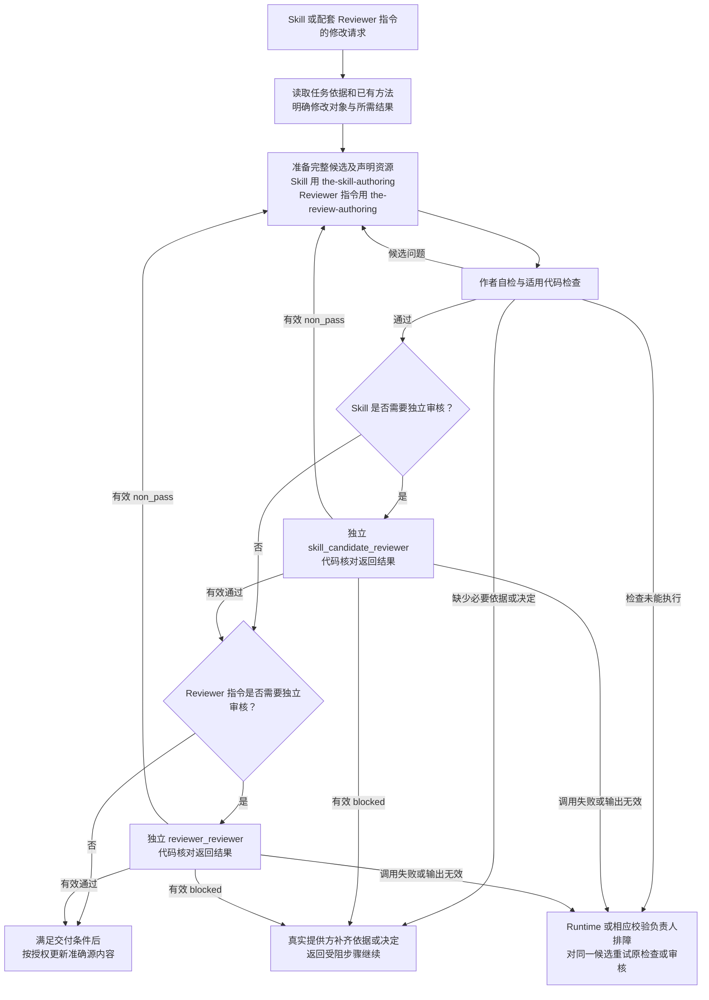

# Skill 管理（Skill Management）

Skill 是给 Agent 使用的任务方法说明，通常以 `SKILL.md` 为主文件。例如，设计文档写作 Skill 告诉 Agent 应读取哪些依据、怎样组织设计、交付什么文稿，以及如何安排必要的审核。下一次遇到同类任务，Agent 可以按这份说明开展工作。

Skill Management 指导 Skill 的编写、修改、审核和交付。本文中的作者负责编写 Skill。执行者使用写好的 Skill 完成具体任务。审核者检查这份 Skill 是否足以指导执行。具体任务要实现什么，由所属 Design 和实际授权决定。

本文是一份 T0 Design，按 DDM 的模块组织。本文规定的 `SKILL.md` 是任务方法说明，使用第 3.3 节的 Skill 结构。两者适用不同的格式和审核：DDM 审核本文，Skill 的专业审核判断实际写出的 Skill。

## 1. Primary System Flow

以下流程处理需要新增或修改 Skill 内容、配套 Reviewer 指令的请求。Primary Agent 先明确修改对象，再按第 6.1 节判断需要哪些独立审核。只复用已有方法时，按第 4.1 节取得准确入口和适用依据，无需重新审核未改变的方法。



两类审核的适用条件和先后关系见第 6.1 节。修订 Reviewer 指令若影响 Skill 的任务或交接，须重新判断 Skill 的审核需要。补齐依据、修订内容和排除执行故障分别按第 5.2 节处理。

源内容更新只完成本次方法内容的交付。宿主安装、Runtime 注册和一次执行分别按第 4.4、4.5 节处理。统筹范围和依赖的需要按第 7 章交给 System Change。

## 2. Intended Outcomes

Skill Management 应使一项已有或新写的任务方法能够被找到、使用、维护和交接。结果应满足以下要求。

1. **适用方法能够被正确选择。** Skill 的名称、描述、分类和正文指向同一项任务。使用者能区分它与直接相关方法的职责，找到准确入口。已有方法适用时可以复用；新增填补实际缺口，修订解决明确问题，不留下重复责任或无人接手的工作。
2. **方法足以指导独立执行。** Skill 写明所需输入、判断依据、真实资源、关键判断和必要动作。执行者知道可以处理和决定到哪里，哪些事项应交给其他负责人，以及怎样从行为或结果识别关键越界。方法说明不授予产品决策、操作或执行权限。执行者凭声明材料及本次任务输入即可工作，无需作者临时解释。换一组同类输入后方法仍然适用，具体分析和实现保留合理选择。
3. **任务结果有充分、可判断的要求。** 每项主要任务能力对应的实质结果、接收者用途和必要质量都已说明。执行者能够判断应该交出什么，以及何时只能部分交付或报告未知。完成动作或生成文件不能代替满足用途的结果。
4. **完整内容可以维护和移交。** 准确源文件、必要配套资源和实际需要的独立执行指令相互对应，入口及用途明确。确需独立执行时，prompt 与声明输入、资源合用后应足以指导该角色，不能依赖未声明的 SKILL.md 内容或聊天。稳定指令与本次任务数据、凭据、实际授权和运行配置分开。修订保留有效条件、例外和职责。替换或删除时，已有引用和消费者有明确处理及后续入口。
5. **审核能发现影响使用的缺陷。** 独立结论针对准确 Skill 及适用要求，说明方法是否足以指导声明任务。问题有条款、依据和执行影响，处理结果可以追溯。需要审核 Reviewer 指令时，取得针对该指令的相应结果。
6. **内容与使用环境的实际结果可区分。** 内容交付、宿主安装、Runtime 注册和具体执行分别有准确来源及实际结果。目标宿主取得选定内容和可发现入口，所需资源完整；只有确需受管理执行的任务才涉及 Module。写好 Skill 或 prompt 不代表已经安装、注册或执行。
7. **缺件和失败能得到准确交接。** 输入、权限、工具、审核或外部决定不足时，作者或执行者交出已完成部分、具体缺口、影响及继续条件，并指出提供方。已有材料和真实错误被保留，不能用无依据结论填补缺口。

## 3. Owned System Object

本章定义 Skill 的组成、身份和完整内容。它是作者编写 `SKILL.md` 的规范，不改变这份 T0 文档自身的格式。

### 3.1 方法、源文件与使用副本

作者把方法写进源文件。Agent 应用向执行者提供这份方法的读取入口。运行 Agent 并提供 Skill 入口的应用称为宿主（host）。

宿主可以读取源内容，也可以读取由源内容生成的使用副本。这种副本称为投影（projection）。方法规定怎样完成任务。源文件用于维护方法，投影供相应宿主使用。

```text
Skill Definition
    含义：一项可重复 Agent 任务的方法定义。
    内容：适用任务、预期结果、输入与依据、方法、职责边界和完成要求。
    负责人：对这项任务方法负责的所属方。
    权威依据：决定任务含义的 Design，以及本次执行的实际授权。
    边界：方法说明不授予产品决策权、操作权限或运行系统的执行权限。

Skill source
    含义：被维护和修改的准确源内容。
    组成：SKILL.md，以及随该方法维护的资源、示例、任务指令或工具说明。
    约束：说明所声明资源的准确入口和用途。执行不依赖未声明的聊天背景。

Skill projection
    含义：根据选定的源内容生成的副本，供某个宿主发现和使用。
    约束：可以加入已声明的宿主附加说明。不能另行维护一套方法来源。
```

主文件和随它交付的文件组成 Skill 包（Skill Package）。方法也可以引用包外的设计、工具或服务。作者按第 4.2 节提供这些依赖的准确入口，无需把全部依赖复制进包中。

另一宿主需要使用这套方法时，更新其安装副本。后续修订方法内容时，仍应修改准确源文件。

### 3.2 Skill 文件开头要写什么

Agent 收到“修改一份设计文档”的请求时，需要先找到相应的写作方法。它还要确认自己做什么、处理什么对象，以及优先依据哪份规范。

这些信息写在 `SKILL.md` 最顶部的 YAML 信息块中。这个信息块位于两条 `---` 之间，称为 frontmatter。

以现有的设计文档写作 Skill 为例：

```yaml
---
name: the-design-authoring
description: 编写或修订 Charter、T0、T1、T2 正式设计文档，围绕具体对象和使用情境明确功能、执行主体、交付结果与必要取舍，并组织独立审核。
metadata:
  skill_class: primary_agent_development
  primary_agent_entry_role: authoring
  primary_agent_entry_subject: design_intent
  first_authority_ref: designDoc/the_design_doc_management.md
---
```

这段信息表明：工作区内的 Primary Agent 使用这份 Skill 编写设计文档。它处理设计内容，优先遵循 Design Doc Management。具体写作方法见 Skill 正文。

`name` 和 `description` 用于发现和选择方法。`metadata` 保存使用方式和工作入口的附加信息。下表中的 `metadata.xxx` 表示 `metadata` 下面的 `xxx` 字段。

| 字段 | 它回答什么 | 填写要求或例子 |
| --- | --- | --- |
| `name` | 这份 Skill 用什么名称识别？ | 使用稳定名称，例如 `the-design-authoring`。 |
| `description` | 什么任务应当使用这份 Skill？ | 说明它处理的任务和适用情境，例如“编写或修订正式设计文档”。 |
| `metadata.skill_class` | 这份方法主要以什么方式被使用？ | 使用下表四种分类之一。示例中的 `primary_agent_development` 表示供工作区中的 Primary Agent 使用。 |
| `metadata.primary_agent_entry_role` | Agent 使用这个入口时，承担哪类工作？ | 按该入口的主要交付选择角色，取值规则见后文。 |
| `metadata.primary_agent_entry_subject` | 这项工作处理什么对象？ | 选择该入口负责处理的对象类别，复用已有名称；具体规则和组合见后文。 |
| `metadata.first_authority_ref` | 作出判断时，优先遵循哪份规范？ | 指向直接规定该任务要求的 Design；选择和路径规则见后文。 |

`skill_class` 的取值说明方法的使用方式：

| 取值 | 使用情境 |
| --- | --- |
| `primary_agent_development` | Primary Agent 在工作区接收请求后读取方法，并按它组织本次工作。上面的设计文档写作就是一例。 |
| `product_agentic` | 方法用于由运行服务管理和执行的产品 Agent 任务。 |
| `product_hybrid` | 产品任务中同时包含代码处理和 Agent 工作，方法说明两者怎样共同完成任务。 |
| `projection_only` | 向宿主提供可发现的入口，由该入口指向实际方法或执行目标。 |

第 3 章的“投影”说明副本从哪里生成。这里的 `projection_only` 表示使用分类。普通 Skill 安装成副本后，仍保留原有分类。

每份 Skill 都填写 `name`、`description` 和 `metadata.skill_class`。后三个入口字段用于 `primary_agent_development` 类 Skill，按以下方式取值。

**`primary_agent_entry_role`：按主要交付选择角色。**

| 现用值 | 什么时候选 | 现有例子 |
| --- | --- | --- |
| `routing` | 主要结果是确定请求的工作入口、适用方法和负责方。 | `the-task-routing` |
| `authoring` | 主要结果是新写或修订一份方案、设计、Skill 或指令。 | `the-design-authoring`、`the-skill-authoring` |
| `review` | 主要结果是组织已有候选的独立审核，核对结论与执行证据。 | `engineering-change-review` |
| `operator` | 主要工作是按已有方法执行操作，或管理一个执行过程。 | `agent-work-coordination` |

同一 Skill 可以包含多种动作。作者应根据主要交付选择角色。例如，设计文档写作也包含检查和审核，但主要交付是设计文稿，所以仍取 `authoring`。

`review` 表示这个入口承担审核工作。Primary Agent 不能凭这个分类，用自审替代独立审核。

**`primary_agent_entry_subject`：填写入口负责处理的对象类别。**

先确认入口接收并处理什么对象，再复用这个对象已有的类别名称，例如 `design_intent`。某份文稿的路径、某个请求的 ID 和 Reviewer 名称属于具体任务材料，不填入这个字段。

对象名与角色分别选择。编写设计文档和编写 Skill 都取 `authoring`，但对象分别是 `design_intent` 和 `skill_definition`。

工程方案入口处理修改请求，取 `engineering_change_request`。工程审核入口处理已有候选，取 `engineering_change_candidate`。不能把所有入口的 subject 都改成最终输出文件的名称。

**`first_authority_ref`：指向直接规定这项工作要求的 Design。**

作者按任务选择首要依据。写设计文档以 DDM 为准，写 Skill 以 Skill Management 为准，写 Reviewer 指令以 Review Contract 为准。

这个字段只保存一条首要依据的准确引用。其他需要共同遵守的规范，列入 Skill 的输入与依据。

Portable 治理 Skill 填写 `designDoc/<文档名>.md` 路径，使用 `/` 分隔符。路径从项目根目录解析，必须指向真实存在的对应文档。不能填写机器绝对路径、包含 `..` 的路径、负责人姓名或临时修订副本。

发布时，该引用须与清单中的 `accountable_owner_ref` 一致。对应 T0 也须在已声明依赖中。其他项目按各自的引用规则解析，无需采用 Portable 的目录布局。

下表是现有入口的实际组合，可以用来核对三个字段是否指向同一项工作：

| Skill | `primary_agent_entry_role` | `primary_agent_entry_subject` | `first_authority_ref` |
| --- | --- | --- | --- |
| `the-task-routing` | `routing` | `task_request` | `designDoc/the_task_routing.md` |
| `the-design-authoring` | `authoring` | `design_intent` | `designDoc/the_design_doc_management.md` |
| `the-skill-authoring` | `authoring` | `skill_definition` | `designDoc/the_skill_management.md` |
| `the-review-authoring` | `authoring` | `reviewer_prompt_source` | `designDoc/the_review_contract.md` |
| `engineering-code-design` | `authoring` | `engineering_change_request` | `designDoc/the_software_delivery.md` |
| `engineering-change-review` | `review` | `engineering_change_candidate` | `designDoc/the_software_delivery.md` |
| `agent-work-coordination` | `operator` | `delegated_task` | `designDoc/the_task_routing.md` |

上表列出取值示例，并未列尽所有对象。现有合同没有将角色和对象限定为全局枚举。Portable 发布检查要求这两个字段非空，并与发布清单一致。

既有对象应复用现用值。确有新职责或新对象时，作者应说明新名称的含义，并与实际消费方的约定保持一致。程序接受一个字符串，不代表任务分类已经正确。

编写或修订时，作者应对照准确 Skill 源文件和对应清单核对已有取值，不能仅凭名字猜测。结构校验规则检查字段格式和合法值。分类本身不增加业务权限、审核步骤或生命周期要求。

源路径、负责人和包内资源通过相应登记及准确文件入口确定，正文不另抄一份身份清单。

### 3.3 五个主章节

执行者先确认任务和预期结果，再了解职责、输入与交付约定，最后取得方法。`SKILL.md` 使用以下五个主章节。下表编号属于 Skill 文件；本文自身仍按 DDM 组织。

| Skill 主章节 | 应写什么 | 写完应达到的效果 | 内容边界 |
| --- | --- | --- | --- |
| `1. Task Summary` | 用简短说明交代本方法做什么、处理什么对象、何时适用，以及主要交付。 | 执行者能够判断当前请求是否应使用本方法。任务适用但材料暂缺时，仍能进入缺件处理。 | 开宗明义；详细质量要求写入 Intended Outcomes，材料清单和执行步骤放到后文。 |
| `2. Intended Outcomes` | 每项主要任务能力应交付什么实质结果，供谁在什么情境下使用，以及每项结果必须满足哪些质量。 | 执行者和审核者能逐项判断结果是否满足用途。主要交付和必要质量均在本节明确，不只列产物名称或“完整、准确”等质量词。 | 集中定义主要结果要求；文件格式、完成证据和执行方法分别在第 4、5 章展开，局部限制留在对应定义旁。 |
| `3. Boundaries` | 本 Skill 与相关 Design、Skill、工具或下游的职责和权限分界。哪些决定由谁作出，不适用的请求交给谁，关键越界能从什么行为或结果识别。 | 执行者知道可以处理到哪里、哪些事项须由别人决定，以及谁应接手。 | 规定稳定分工；本次需取得哪些授权或依据材料，在 Inputs 列出。协作不自动转移整体任务责任。 |
| `4. Inputs and Completion` | 按下面三个子节分别说明执行所需输入、实际交付物和完成条件。 | 执行者知道开始前缺什么、最后交出什么，以及怎样判断本次完成到什么程度。 | 采用前文已定的任务、目标和边界，不在这里另立目标或重复权限规则。 |
| `5. Method` | 关键判断、必要操作、条件分支、真实资源用法和有依据的常见陷阱。 | 执行者能从输入推进到交付，无需重新创造主要方法，同时保留合理的实现选择。 | 只固定影响正确性、权限或证据的步骤、顺序、工具及执行身份。完成动作后仍须按完成条件验收。 |

第 4 章必须保留以下三个子节，按表中顺序编排。

| 子节 | 应写什么 | 写完应达到的效果 | 内容边界 |
| --- | --- | --- | --- |
| `4.1 Inputs` | 本次需要的数据、材料、已定要求、资源入口和授权依据。说明各来源的用途，以及材料缺失或冲突时需要补什么、由谁提供。 | 执行者能准备工作所需输入，知道哪些判断暂时不能进行。 | 列明需要读取和取得的依据；决定权及冲突处理的职责沿用 Boundaries。 |
| `4.2 Output` | 需要交付的文稿、数据、操作结果或交接说明，以及接收方、格式、准确位置和必要配套材料。已有 schema 或路径约定时引用其准确来源。 | 执行者知道具体交什么，接收方知道从哪里取得和怎样使用。 | 承接 Intended Outcomes 的内容与质量要求，不再复述；输出存在是否足以完成任务，由 Completion Contract 判断。 |
| `4.3 Completion Contract` | 完成任务必须满足的条件，以及证明这些条件的检查、审核或操作结果。说明部分完成、失败、停止或移交时应保留和交出什么、由谁继续。 | 执行者能根据实际证据报告完成程度，准确交付缺口及恢复工作所需条件。 | 验收本次授权结果，不另加目标。方法步骤写在 Method；有文件、发出协查或停止等待均不单独证明任务完成。 |

作者按任务的主要能力核对 Intended Outcomes，再逐章反向检查其余正文，包括 Boundaries、Inputs、Output、Completion Contract 和 Method。后文首次出现的重要结果或必要质量，应补入结果章节；实现细节和局部条件不必搬入。主要能力可以共享一个结果，一项能力也可能产生多个结果，不要求逐项同名、固定条数或统一句式。

同一结果在不同章节承担不同作用：Intended Outcomes 确定实质内容与质量，Output 说明交付形式与位置，Completion Contract 规定完成所需证据，Method 说明怎样取得结果。引用同一结果不算重复定义，重复整段要求才需要合并。

例如，设计文档写作 Skill 的 Boundaries 说明谁决定产品要求；Inputs 指向本次已定要求和旧稿；Output 指定完整设计文稿及检查、审核材料；Completion Contract 说明文稿何时可以采用，以及缺少必要依据或审核时怎样交接。各项在一处写清，其他位置引用。

五个主章节保持上述顺序。确有用途的补充章节从第 6 章起连续编号。不另设 `Entry and Exit` 或 `Execution Contract` 主章节；相关要求按上述职责归位。写作类 Skill 的第 0 章和作者自检要求分别见第 3.4、3.5 节。

这套结构也适用于 `the-skill-authoring` 自身。它的结果是完整 Skill；它指导作者编写的目标 Skill 则以各自的任务结果填充同一结构。DDM 的 Design 模块不替代 Skill 结构，Skill 章节也不替代其产物自己的格式。

### 3.4 写作类 Skill 使用的共同指令

设计文档、Skill 和规则各有自己的写法，也有共同要求：内容完整、原意准确、边界清楚。这些通用写作要求由一份共享内容提供，各 Skill 使用同一来源。

如果 Skill 的实际任务是编写稳定产物，作者须在五个主章节之前增加 `## 0. AI-facing Authoring Rules`。该章完整使用共享资源 `soul:bestpractice_ai_facing_writing`。这个资源选取 `bestpractice_skill_writing` 中适用于所有 AI-facing 文档的通用片段。

代码从登记的来源提取内容，注入 Skill，并检查两者是否一致。作者不手抄或另写概括。是否需要这一章，取决于任务和实际产出。不能按 Skill 名称猜测，也不为此新增 metadata tag。

共享片段变化时，先确定哪些内容受影响，再按各自的修改范围更新和审查。

### 3.5 写作产物送审前的作者自检

有些写作产物需要独立审核。例如，Agent 按设计文档写作 Skill 完成文稿后，先检查已知缺口，再交给独立 Reviewer。这里自检的是写出的文稿。写作 Skill 本身的审核要求见第 6 章。

当 Primary Agent 使用 Skill 编写产物，且该产物随后需要独立 Reviewer 时，Skill 的 `Method` 中须包含 `Author Self-Check`。自检使用产物所属 Design 的正式检查清单（canonical checklist）。每项标准以 `check_id` 标识，用来对应候选中的证据和检查结果。

作者每次自检形成一份临时表，逐项记录 `check_id`、当前候选中的具体证据、本地判断和未解决问题。表中须覆盖所有必查项（required `check_id`），不能另写一套标准。

作者应根据当前内容重新判断历史审核问题（finding）。对已发现的问题，先核实其是否影响本次完成条件。经核实属于必修的问题，应先在本地解决。解决后，再固定候选并调用独立 Reviewer。

可选建议（note）不列入未解决的必修问题。历史意见的证据有误或超出范围时，作者应写明理由，交回独立 Reviewer 重判。作者不能根据自检判断改写原独立结论。问题标签和审核结论的共同含义由 Review Contract 定义。

自检用于帮助作者发现遗漏，不产生独立审核的 `passed` 结论或批准。自检也不要求新建持久记录、登记系统（Registry）或 schema。

纯操作、只读查询、确定性构建和 Reviewer 自己的执行，不因使用 Skill 而需要增加作者自检章节。

### 3.6 本章规范的适用范围

作者新建或修订 Skill 时，按第 3 章的定义和结构组织并提交完整版本。执行者仅为完成任务而读取旧安装或外部 Skill 时，无需自动迁移其结构。负责人提交修订候选时，再采用相应规范。

正文以中文为主，标识符和代码名称保持准确。每项定义与其适用条件集中写完整。同一要求只定义一次，其他位置引用。Skill 可以按需引用材料，无需把全部资源复制进正文。

## 4. Capability and Operation

本章说明作者怎样选用、编写和维护 Skill。源内容、安装副本和 Runtime 任务各有不同的工作对象；涉及其他负责方时，交接见第 7 章。

### 4.1 选择方法与维护源内容

范围、负责人和所需结果明确时，Primary Agent 可以在已有授权内直接开始。需要统筹范围和依赖时，按第 7 章交给 System Change。

需要固定或改进一项重复任务的方法时，先查已有 Skill。已有 Skill 能完成同一任务结果时，应优先复用或修改它。不能仅因名称不同，就新建一套平行方法。

新增或改变职责分工时，作者应核对所有受影响的方法。只修改局部内容时，读取足以判断本次变化的相关材料即可。

| 工作 | 需要作出的决定或检查 | 完成时交出什么 | 后续责任 |
| --- | --- | --- | --- |
| 发现与选用 | 是否已有适用方法，任务职责是否匹配。 | 准确 Skill 入口及适用依据，或明确缺口。 | 执行者按方法继续；需要新增或修订时进入相应编写工作。 |
| 新增与修订 | 本次任务、依据、范围及现有方法的保留和改变部分。 | 完整候选及实际声明的资源、必要 prompt。 | `the-skill-authoring` 组织编写、自检和适用审核。 |
| 内容审核 | 候选是否达到第 6 章标准，适用审核是否针对准确内容。 | 有效检查结果和独立审核结论。 | 作者处理成立的问题；输入或执行缺件交真实提供方。 |
| 源文件更新 | 第 5.1 节的采用条件是否满足。 | 已授权的准确源内容，以及实际更新结果。 | 内容负责人继续维护该来源。 |

编写或修订时，作者从一项实际任务出发，说明输入怎样经过关键判断和动作，形成所需结果。必要的条件分支、材料不足和失败处理须有明确做法。已有方法只需局部改变时，保留其他有效内容；会改变职责时，核对完整的受影响方法集合。

作者用完整候选走读这项任务，判断另一个 Agent 能否只凭声明的输入和资源继续工作。缺少主要判断方法时，应补齐方法；缺少实际工具能力时，应说明缺口及其提供方。不能把工具名称写出来，就假定它已经具备所需能力。具体编写与检查入口由 `the-skill-authoring` 提供。

### 4.2 可用资源与专业依据

接手的 Agent 需要找到方法所用的材料和工具。例如，设计文档写作 Skill 应指出依据哪份设计、从哪里读取候选、使用哪个检查入口。作者应在正文中给出这些文件、工具、接口和执行入口的准确位置，并说明用途。

随 Skill 维护的文件由 Skill 包交付。执行者通过声明的入口取得包外资源。代码和运行事实用于核对现有能力，不能代替所属 Design 决定新的产品要求。

资源或入口缺失时，执行者应说明缺少什么能力、怎样影响结果，以及应由谁提供。不能临时拼出另一条路径，就声称原任务已正式完成。

以下规则说明编写 Skill 时应读取哪些专业规范。组装 Skill 时，代码提取标记内的正文，嵌入 `the-skill-authoring` 的 `4.1 Inputs`。编写者只在任务实际定义时间或机器标识语义时，读取对应 T0。

<!-- skill-authority-input-guard:start -->
只有 Skill 的内容实际涉及供程序使用的时间或标识含义时，编写者才增加以下专业依据：

- 任务定义时间字段、时钟、日历、新鲜度或时间比较时，先读取 `designDoc/the_timestamp_semantic.md`。
- 任务在数据结构（schema）或程序边界（machine boundary）中定义标识符、引用、版本、内容哈希、指针或定位符时，先读取 `designDoc/the_identifier_and_reference_semantics.md`。

示例、普通说明文字或路径中只出现 date、ID、ref 等词时，不触发上述要求。任务未涉及这些语义时，不加载对应 T0，也不增加字段、占位章节或空引用。任务涉及这些语义时，只继承适用规则，不复制其他规范。
<!-- skill-authority-input-guard:end -->

### 4.3 交给独立 Agent 的任务指令

Agent 通常直接读取 Skill，在当前任务中使用其中的方法。有些任务需要交给运行服务单独执行，例如由专用 Reviewer 独立审核设计文稿。

Agent Runtime 负责这类任务的准入、隔离执行和结果记录。Runtime 用 Module 定义任务行为及输入输出约定。Skill 可以描述一项受管理的任务，也可以在自己的方法中调用它。普通协查或会话委派不会自动成为 Runtime Module。

执行独立任务的 Agent 需要知道自己负责什么、依据什么工作。Skill 作者为这一角色编写的稳定任务指令称为独立执行 prompt。这份指令是 Module 定义的一部分，其要求如下。

```text
独立执行 prompt
    含义：交给独立 Agent 的完整任务指令。
    适用：Skill 确实需要通过 Agent Runtime 执行独立任务时。
    内容：角色任务、输入输出、完成条件、方法与操作边界。
    完整性：指令与明确提供的输入和资源，应足以指导任务。
        不能靠未声明的 SKILL.md 内容或历史聊天补齐指令。
    边界：交付这份指令，不代表对应 Module 已注册、已配置或已执行。
```

动态任务数据和实际授权由调用方在执行时提供。凭据、模型配置和运行记录沿运行系统的实际入口处理，不写成稳定任务指令。任务的注册与执行交给第 4.5 节所列的负责方。

普通任务的 prompt 随 Skill 方法一起编写。审核任务还需要专用的 Reviewer 指令，说明审核依据和判断要求。作者用 `the-review-authoring` 编写专用部分，通用规则和 checklist 则采用各自的准确来源。

Skill 如果携带 Reviewer 源文件，须说明调用哪个 Module、何时调用，以及不可用时交给谁处理。Reviewer 源文件可以与作者方法放在同一个包中，审核仍须独立执行。Skill 和 Reviewer 指令的审查要求见第 6.1 节。

### 4.4 让目标宿主使用选定版本

源内容更新后，目标应用仍可能使用旧副本。部署负责人通过安装与分发，把选定的源内容和声明资源交到目标宿主，并提供可发现的入口。

部署负责人应核对文件是否完整、是否对应选定版本，并返回实际安装结果。源内容更新和目标安装分别记录版本与结果。

### 4.5 确需 Runtime 时的注册与执行

只有任务需要第 4.3 节所述的受管理执行时，才涉及 Module。多个 Module 需要按流程协作时，可以由 Workflow 组织。

注册处理任务定义。一次执行处理具体请求。两项工作分别取得自己的结果。

| 工作 | 核对对象 | 取得的结果 |
| --- | --- | --- |
| Runtime 注册 | 独立 Module 或 Workflow 的定义、依赖及注册前提。 | 真实注册结果；不能以 prompt 文件存在代替注册完成。 |
| Runtime 执行 | 已有目标、本次输入、执行配置和执行前提。 | 真实执行输出或失败及相应记录；注册成功不表示已经执行过本次任务。 |

Agent Runtime 及相应操作负责人承接注册与执行。Agent 可以直接读取普通 Skill，无需因此建立 Runtime Module。Skill 源文件、安装副本、Runtime 定义和执行记录各自保留准确来源。

已有 Portable 发布清单还记录 Skill 与执行目标之间的迁移关系。只有使用该清单的系统才消费下面这些字段：

| 发布清单字段 | 在清单中说明什么 |
| --- | --- |
| `lifecycle_state` | Skill 与执行目标之间的迁移状态。 |
| `direct_entry_disposition` | 直接使用 Skill 的入口是保留还是退役。 |
| `managed_target_ref` | 计划或已经接入的执行目标引用。 |

所属代码合同规定这些字段的合法值和组合。它们不表示起草、审核或交付阶段，本节也不要求每份 Skill 新增这些字段。审核通过不会自动改变这些值。普通写作不新增状态机、批准记录或平行 Registry。

### 4.6 替换与删除

方法停用或被替换后，其他 Skill、工具或使用方可能仍在引用旧入口。负责人先确定怎样处理这些引用和依赖，再交付处理结果和有效的后续入口。

System Change 确定必要的影响范围和执行顺序，各受影响内容的负责人执行。需要保留的 Skill 按其修订方法处理。整体删除不由 `the-skill-authoring` 批准，也不要求先制造一份待删 Skill。

## 5. Completion, Failure, and Recovery

本章判断一份 Skill 内容是否可以交付或采用。使用这份 Skill 执行具体任务是否完成，仍按该 Skill 自己的完成依据判断。

### 5.1 交付与采用条件

以下条件全部满足后，作者才可交付并更新源文件：

- 候选达到授权目标和第 6.2 节的质量要求。
- 适用的代码检查已经通过。
- 所需独立审核已给出有效通过结论，且结论准确对应当前内容。
- 源文件更新处于已有授权范围内。

需要审查 Reviewer prompt 时，其审核结果也须准确对应当前内容。

作者在交付说明中列出准确源文件、必要配套内容、本次适用检查和审核的实际结果，以及未完成事项。缺件或失败时，可以如实移交，但不能标记为已完成采用。结论标签、问题等级和争议处理采用 Review Contract，不另立一套含义。

### 5.2 缺件、失败与修订

作者先确认检查和审核结果有效，再按其实际含义处理。结果有效性的检查见第 6.3 节，结论标签使用 Review Contract 的定义。

| 实际情况 | 后续处理与交付 |
| --- | --- |
| 候选或其声明资源存在可修正问题 | 作者修订成立的问题，重新运行适用检查，并按第 6.1 节重新确定所需审核。 |
| 有效 `non_pass` 指出具体内容缺陷 | Primary Agent 核对证据、要求和本次影响，由对应内容的作者修订。修订后的准确内容须取得适用审核结果。 |
| 有效 `blocked` 指出缺少必要依据或决定 | Primary Agent 交出具体缺口、影响和已有材料，由真实提供方补齐。补齐后回到受阻步骤。 |
| 工具、环境或调用入口缺失，或者执行失败 | 保留原错误和已完成内容，交给相应执行或环境负责人。此时没有有效 Reviewer 结论，不能用推理补出检查成功。 |
| 输出格式、候选绑定或专用一致性校验失败 | 相应校验或执行负责人处理问题。修复后，对同一候选重试原审核，不能自行修改返回结论。 |
| 所需审核有效通过 | 核对第 5.1 节其余条件，完成授权范围内的交付和源更新。安装、注册及执行仍分别取得自己的结果。 |

可选 `note` 默认不实施。对证据错误、越界或需要争议重判的意见，按 Review Contract 交回独立 Reviewer，作者不能自行把未通过结论改成通过。真实依赖缺口须说明为什么影响当前结果，不自动扩大方法、代码、注册或部署范围。

## 6. Dependencies and Verification

本章规定实际 Skill 候选和配套 Reviewer 指令的审核依据。Skill Management 这份 T0 自身的 Design 审核，继续使用 DDM；两种对象不能互相替代。

### 6.1 审核对象与适用条件

Primary Agent 可以组织审核，Reviewer 须以不同的执行身份判断准确候选。源文件与作者方法同包存放，不改变独立执行要求。

作者可以同时修改 Skill 和 Reviewer 指令，也可以只改其中一个。两类审查分别判断以下对象：

| 审核对象 | 何时需要独立审查 | Reviewer 及其关注点 |
| --- | --- | --- |
| Skill 候选 | 新增 Skill，或改变任务、依据、方法、边界、输出及其他执行含义。 | `skill_candidate_reviewer` 判断 Skill 是否充分；含 prompt 时，也判断它与 Skill 的任务和交接是否一致。 |
| Reviewer prompt | 新增或改变其含义。 | `reviewer_reviewer` 判断审核指令本身是否完整、正确。 |

Skill 只修改文法、格式，或只做不改变含义的机械同步时，运行适用检查并确认原意保留。

两类修改都需要审查时，先完成 Skill 审查，再完成 Reviewer prompt 审查。单独修改 prompt，无需重审未变的 Skill。修改 Skill，也不自动要求重审未变的 prompt。

只有 prompt 内容、适用规则和相关依据都未改变时，才可沿用已有审核证据。其中任一项改变，就不能继续使用原证据。

Reviewer 指令有问题时，由其负责人修订。如果修订影响 Skill 的任务或交接，还须重新检查和审查受影响的 Skill。

### 6.2 判断方法内容是否充分

作者和 `skill_candidate_reviewer` 使用下面同一组标准。`check_id` 用来对应每项标准的候选证据、检查结果和问题。

本 T0 拥有 Skill 格式合同（artifact contract）。代码根据该合同生成清单，并将同一内容同步到 Reviewer prompt 和作者自检。作者和 Reviewer 不手工维护第二份标准。

审核者根据 Skill 的任务、本次授权结果和交付阶段判断内容是否完整。已有计划时，还应依据当前步骤、完成条件、相关排除项和后续边界。

合理的下层选择，以及不影响当前结果的后续工作，不列为本轮必修项。代码已经验证的格式和内容对应关系，无需由 Reviewer 重算。

1. `identity_discovery_class_and_source`：名称、description 和使用方式能否帮助 Agent 找到正确的 Skill？负责人是否与任务一致？是否需要共同首章和 Author Self-Check？字段是否合法、源路径是否唯一，采用代码检查结果。
2. `task_and_reader_gain`：Task Summary 明确重复任务。Intended Outcomes 说明任务应交付的结果、接收者的使用情境与用途，以及每项结果的必要质量要求，覆盖各项主要任务能力，保留目的依据和必要边界。对照任务及其余各章，确认主要结果没有遗漏或只藏在后文；不能仅列产物名称或空泛质量词。不以条数、篇幅或逐项同名判断完整性，不要求搬入局部执行细节。结果要求不以读者理解代替任务交付，不保证无证据结论，也不强制统一执行路径。
3. `entry_exit_and_routing`：Agent 是否知道何时进入？缺少前提时，应补充什么或何时停止？请求不适用时，应交给谁？本 Skill 与直接相关 Skill 的职责不能重叠，也不能留下空缺。
4. `inputs_authority_freshness_and_conflicts`：任务所需的输入和依据是否充分？资源入口是否明确？输入缺失或依据冲突时，是否有合理处理？只有实际涉及时间或机器标识含义时，才使用相应 T0；不增加无关要求。
5. `outputs_completion_failure_and_handoff`：Agent 能否判断应交付什么、何时完成、真实失败怎样处理，以及由谁继续？本步必须作出的决定不能缺失。可以留给下游、且不影响当前结果的合理选择，应继续保留。
6. `boundaries_and_observable_violations`：本任务涉及的权限、数据写入和相邻职责是否清楚？能否从行为或结果中识别关键越界？无需列出所有无关系统。
7. `method_result_certainty_and_agent_freedom`：方法是否足以指导任务，并保留合理判断空间？不能把过程偏好写成必经程序。需要自检时，应使用正确 checklist，先处理已确认成立且影响当前结果的必修问题。note 不自动实施，争议交回独立 Reviewer 判断。
8. `design_and_revision_fidelity`：候选是否符合本次授权目标、适用计划步骤和所属 Design？需要保留的含义是否完整？必修意见须说明为什么当前必须修改。不能根据旧实现、未来收益或 Reviewer 偏好增加产品要求。本次修改造成的实际回归仍须处理。
9. `prompt_boundary_hygiene`：稳定指令是否与具体任务数据、凭据、实际授权和运行配置分开？不能把本次执行内容写成长期要求。
10. `skill_agent_workflow_tool_separation`：Skill、代码工具、Workflow 和独立 Module 是否各自承担合适的工作？Primary Agent 可以组织检查和独立审核，但不能把自检或同包 source 当作独立审核结论（verdict）。
11. `runtime_ready_prompt_closure_if_declared`：已声明的普通 prompt 与明确提供的输入和资源合用后，能否完整指导任务？Skill 携带 Reviewer source 时，须说明具体 Module、独立调用方式和不可用时的处理，并与 Skill 的任务及交接一致。Reviewer prompt 的专用指令由 `reviewer_reviewer` 审查，此处不重复。未声明 prompt 时，使用 `not_applicable`，不要求另造 prompt。

前十项返回 `passed` 或 `finding`。第十一项仅在没有声明 prompt 时，才可以返回 `not_applicable`。具体缺陷或缺少必要依据时，关联 finding。可选 note 不使检查失败。

共同表达项 `prose_and_meaning_preservation` 按 Review Contract 放在检查结果的最后一项。十一项语义检查通过后，再执行表达检查；此前标记为 `not_run`。表达检查不改变上述十一项的含义或 `check_id`。

本 T0 的专用校验核对检查项是否齐全、适用条件是否满足。填完检查表，不代表任务已经达到要求。表达与共同审核纪律采用 Review Contract。

### 6.3 核对检查与审核结果

收到审核回复后，调用方须确认结果完整、对应当前候选，且结论与所列问题一致。送审前和返回后，代码分别核对以下事项：

| 时点 | 代码核对什么 |
| --- | --- |
| 候选送审前 | 结构、身份、声明资源和共享内容的一致性。适用 Author Self-Check 时，还核对检查项覆盖、候选一致和声明的未解决问题。 |
| Reviewer 返回后 | 完整结果格式（output schema）、检查覆盖、finding 引用和结论一致性，以及结果是否对应本次候选。 |

代码不判断自检证据是否成立，也不代替对任务和方法的独立判断。内容缺陷、依据不足、执行失败和无效输出分别按第 5.2 节处理。

候选检查只针对本次内容及其声明资源。安装投影、发布内容摘要（hash）和 Runtime 执行定义版本（release）的检查，由第 4.4、4.5 节对应的部署或注册工作处理。新 Skill 可以先接受内容审核，无需先注册为已发布对象。

`the-skill-authoring` Skill 包保存 `skill_candidate_reviewer` 的固定指令（prompt）、输入输出格式（schema）、校验样例（fixtures）和注册定义（registration source）。调用方使用这些材料准备调用和校验，独立执行仍通过实际可用的 Module 入口进行。

## 7. Peer Boundaries

Skill 作者负责写清方法需要什么。任务设计、运行服务和数据方面的决定，仍由各自负责人作出。遇到下列情况时，作者将具体问题和已有材料交给对应方，取得继续工作所需的结果。

| 出现的情况 | 负责方或依据 | 需要取得什么 |
| --- | --- | --- |
| 方法要求改变任务的功能或产品行为。 | 任务所属 Design 的负责人。 | 获授权的设计决定，作为方法的依据。 |
| 需要编写或修改 Design 文稿。 | Design Doc Management。 | 对应层级的文稿、适用检查和审核结果。 |
| 请求应由哪类任务或方法承担尚不清楚。 | Task Routing。 | 明确的工作入口与负责方。 |
| 用户要求统一规划，或未指定起点且修改确需跨层统筹；整体删除按第 4.6 节处理。 | System Change 及各受影响内容的负责人。 | 需要统筹的范围、依赖和顺序，以及各负责人完成相应修改或替换删除的结果。 |
| 需要确定审核标签、共同结果或 Reviewer 指令规则。 | Review Contract。 | 可直接引用的共同规则；Skill 专用判断仍使用第 6.2 节。 |
| 需要注册、配置或执行受管理的任务。 | Agent Runtime 及相应操作负责人。 | 第 4.5 节分别要求的注册、执行和校验事实。 |
| 需要让其他宿主发现或使用 Skill。 | Agency Platform 与部署负责人。 | 宿主组合、发现入口和跨环境安装的实际结果，见第 4.4 节。 |
| 方法所需的操作权限或数据尚未具备。 | 授权与数据负责人。 | 实际权限与数据访问决定。 |
| 方法需要新增或修改代码工具。 | Software Delivery。 | 按方法的目标和约束，取得本次授权范围内所需的 Code Design、实现、验证或发布结果，并遵守相应适用条件。 |

## 8. References

- [Design Doc Management](the_design_doc_management.md)
- [Task Routing](the_task_routing.md)
- [System Change Governance](the_system_change_governance.md)
- [Review Contract](the_review_contract.md)
- [Agent Runtime](the_agent_runtime.md)
- [Agency Platform](the_agency_platform.md)
- [Product Authorization](the_product_authorization.md)
- [Software Delivery](the_software_delivery.md)
- [Timestamp Semantics](the_timestamp_semantic.md)
- [Identifier and Reference Semantics](the_identifier_and_reference_semantics.md)
