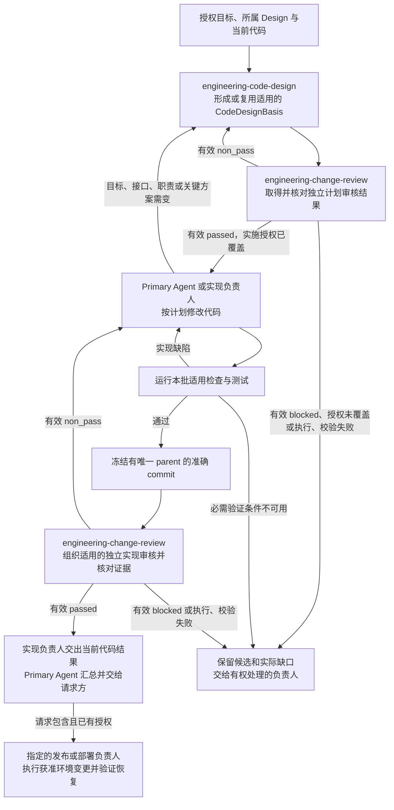

# 软件交付（Software Delivery）

Software Delivery 规定怎样把授权目标和设计要求落实为可靠的软件修改。工程计划先说明改法并接受独立审核，实现随后按计划完成验证和独立审核。请求包含发布、部署或数据迁移时，再按对应范围与授权交付实际结果。

`engineering-code-design` 指导作者编写工程计划。`engineering-change-review` 组织计划和实现的独立审核。两种审核都使用 `engineering_change_reviewer`，各自判断准确的受审对象。

## 1. Primary System Flow

图示主要工程路径。计划复用条件见第 4.2 节，实施后的纯格式或机械重生成例外见第 5.1 节。检查发现实现缺陷时按原计划修复；关键方案变化则先修订计划并重新审核。流程不要求为每个动作建立软件接口、错误码或状态记录。

## 2. Intended Outcomes

Software Delivery 应把授权目标和所属设计落实为可验证的软件修改。交付范围包含环境操作时，还应取得对应环境的实际结果。

1. **工程方案足以指导本批实施。** 实施前已明确目标差异、修改范围、正确代码位置、实现办法、必要依赖与兼容要求，以及验证和适用恢复安排。实现者无需补定产品要求或猜测关键改法。复用计划仍覆盖当前工作；必要设计取舍有明确依据。
2. **实现满足设计并保持清楚的代码责任。** 实际行为、接口、副作用和业务结果符合已定要求。变化进入正确的既有实现，确需新抽象时有独立职责及理由。相关调用方和兼容需求得到处理，失败后已发生的影响能够判断，最终代码、测试和文档描述同一方案。
3. **验证证据足以支持所声称的结果。** 适用检查可重复，能够发现对应行为、边界、兼容或恢复缺陷。实际涉及的数据库、网络、模型及集成有对应真实验证；未验证的部分明确保留。证据说明范围、环境和结果，局部通过不会被宣称为更大范围通过。
4. **独立审核针对准确阶段和内容。** 工程计划的可实施性和代码实现的符合性分别有对应判断及必要证据。必修问题说明依据、影响及当前必要性，候选变化不会被旧结论覆盖。有效审核结果与工程交付通过有明确区别，执行或校验故障不被当成专业结论。
5. **获准环境变更有真实结果及必要恢复能力。** 请求包含发布、部署或迁移时，源版本、产物、目标环境和允许影响相互对应。指定负责人提供实际操作、观察及适用恢复证据。退役时仍在使用的入口、消费者、运行任务和数据义务有处理安排，不因停止使用而丢失必要数据。
6. **交付和未完成事项可以继续接手。** 请求方取得实际代码、验证和审核材料，以及本次环境操作的实际结果。缺陷、缺少决定、权限或执行条件分别有负责人、影响和继续条件。计划、实现、审核组织与环境变更各按自己的证据报告完成，已有授权内的工作持续推进。

## 3. Owned System Object

Software Delivery 负责软件修改的工程要求和交付条件。以下名称区分交付中的不同对象，不要求项目新增生命周期系统或 Registry。

| 对象或结果 | 含义与用途 |
| --- | --- |
| Software Change | 本次授权范围内的软件修改，包括实际涉及的代码、schema、migration、测试及其他交付文件。 |
| CodeDesignBasis / plan doc | 实施前的工程修改计划。可以用一份 Markdown 或已有工作文档中的明确章节承载，供实现者和 Reviewer 使用。 |
| 准确代码候选 | 实现审核针对有唯一 parent 的 exact commit。代码从 Git 对象取得内容、差异和身份，不把未提交工作区混入候选。 |
| 发布结果 | 明确源 commit、构建产物和适用的兼容要求。 |
| 部署结果 | 明确某个版本进入哪个环境、允许产生什么影响，以及观察和恢复的实际结果。 |

产品和领域设计决定预期行为、职责、接口含义与业务接受标准。用户或其明确委派的负责人决定目标和允许的影响面。Primary Agent 在授权内组织工程计划、实施、验证和修订，以及请求包含的发布、部署和必要迁移。本规范不取得产品取舍、数据库权限、Runtime 执行或领域产物接受标准的决定权。

新的产品或架构取舍、超出现有授权的外部写入，以及更大的环境影响，须先取得相应决定或授权。已有授权覆盖当前工作时直接推进，不重复申请。

## 4. Capability and Operation

### 4.1 核对设计依据与工作入口

工程计划说明怎样实现已明确的设计。缺少产品目标、职责边界或关键接口决定时，作者将具体缺口交给所属 Design 负责人，使用 Design Doc Management（DDM）的写作和审核方法补齐。当前代码能运行，不代表设计取舍已经获准。

统一规划使用 System Change Governance 的适用条件：用户明确要求统一规划，或者未指定起点且修改需要跨层统筹范围、职责和依赖时进入。用户已指定代码起点时，可以直接进入工程方法；工程内部的依赖和实施顺序由 CodeDesignBasis 说明。需要统一规划的工作可以将工程步骤指向这份工程计划，两份材料各自承载必要内容，不重复写同一方案。

### 4.2 在实施前形成或复用工程计划

进入交付结果的代码、schema、migration 和测试修改，实施前必须有 CodeDesignBasis。计划不要求额外的 Registry、状态、请求 ID 或审批 ID。调查当前代码、隔离实验和诊断不等于交付实现；实验结果需要采用时，仍须进入明确的工程计划及验证范围。

计划至少回答以下问题：

| 内容 | 需要作出的决定 |
| --- | --- |
| 目标与依据 | 本批要取得什么结果，为什么修改，依据哪项已明确的 Design 或用户决定。 |
| 范围与责任 | 修改哪些交付文件，由谁负责，哪些内容明确排除；本批完成条件及后续边界是什么。 |
| 实现方案 | 怎样进入现有实现，主要调用或数据路径是什么，实际接口的输入、输出和影响怎样改变。 |
| 依赖与失败 | 哪些依赖、兼容、数据或外部副作用确实受影响，失败时已发生什么及怎样处理。 |
| 实施与验证 | 按什么顺序实现，用哪些可重复检查证明本批结果；涉及上线或持久数据时怎样恢复。 |

计划先给出最小有用的 Flowmap，再说明变化的接口和实现。复杂关系先分清职责、数据流与实际代码位置。图中的连线不要求新建 interface ID。篇幅与问题相称，小修改可以用一段短计划和一个小流程图；不为填满模板加入数据库、状态机、并行方案、未来能力清单或多层 Slice。

作者自检和适用代码检查完成后，完整计划必须先接受独立外审。修订到通过后，再核对实施授权。用户确认与独立外审是不同条件；代码完成后的审核也不能代替实施前的计划外审。

旧计划只有在内容未变、原外审仍适用，且目标、范围、接口、依赖和验证要求仍覆盖本次修改时才可复用。作者说明复用依据。不得在代码已经改完后倒推一份计划，声称它是实施前依据。分批交付以本批可独立验证的结果为界，必要依赖须具备，不把未影响本批的未来整合收益提前变成完成条件。

Code Design 和实现按下列条件选择专业依据。这段规则由共享资源选择器提供给 engineering-code-design 的 Inputs，标记界定选取范围。

<!-- engineering-authority-input-guard:start -->
Code Design 或 implementation 只有在实际触及对应 machine-facing meaning 时才增加下列 authority input：
新增或修改 time-bearing field、clock、calendar、freshness 或 time comparison 时，先读取
`designDoc/the_timestamp_semantic.md`；新增或修改 schema 或 machine boundary 中的 Identifier、Reference、
version、content hash、pointer 或 locator 时，先读取
`designDoc/the_identifier_and_reference_semantics.md`。只是在局部变量、普通 prose、路径或未改变的既有
字段中出现 date、ID、ref 等词，不构成适用条件。未触及这些语义时不加载对应 T0，也不增加字段、占位
章节或空引用；触及时只绑定适用规则，不复制 peer contract，也不由 Code Design 或 Reviewer 重新定义。
<!-- engineering-authority-input-guard:end -->

### 4.3 在正确的实现位置完成修改

新行为先放到已有的正确负责人和代码路径。只有职责确实独立、不能合理并入时，才引入新抽象。不能为了少改原代码而增加平行 wrapper、adapter、Registry 或隐藏入口。逻辑职责与物理文件可以分别说明，不要求每个职责注册 Module 或每个文件对应 Slice。

最终代码、测试、注释和文档描述当前方案。被否定方案的讨论留在必要的设计记录中，不成为最终命名、注释或包装的负担。确需兼容旧行为时，说明真实消费者和处理范围；删除旧路径前核对引用与使用方。

程序需要根据不同失败采取动作时，使用接口已有或明确设计的稳定错误合同。error code、结构化错误或异常合同由接口负责人定义，调用方引用。不能只因图中有失败分支就新增错误码；日志用于诊断，不能代替必要的失败判断。

### 4.4 用适用验证证明本批结果

计划按实际风险选择检查，覆盖适用的接口行为、负例、兼容、依赖、数据迁移、权限、恢复和生成内容一致性。使用现成代码运行检查，记录命令、环境、范围和实际结果，不要求先注册一套通用 risk policy。

测试应能发现它声称覆盖的缺陷。哈希绑定要解析并比较真实内容；边界检查同时证明允许和拒绝的情形；恢复检查要证明实际可恢复。只检查字段存在或调用成功，不能支持更强的结论。

单元测试可以使用固定数据和 in-memory 实现。本批结果涉及数据库、网络、模型或跨包集成时，才要求验证对应真实接口。局部通过不代表全仓通过。已有失败与本批新增失败分别核对，未经复现的“基线问题”不能成为免除缺陷的理由。

### 4.5 发布、部署、迁移和退役

实现负责人向 Primary Agent 交出代码结果和验证、审核证据，Primary Agent 向请求方说明交付结果及剩余工作。请求包含且已授权的环境操作，由 Primary Agent 交给本次指定的发布或部署负责人（Release Engineer）；Primary Agent 也可以承担这项职责，无需新建角色系统。

指定负责人在授权内执行发布、部署和必要的数据迁移，完成环境观察及适用的恢复验证，并将实际结果和证据交给 Primary Agent 汇总交付。代码交付与环境变更分别取得授权和结果。执行者使用第 3 章定义的版本、产物、环境及影响范围；实际涉及数据库或不可逆副作用时，先确认迁移顺序、数据保全和恢复办法，再执行获准操作。

已有构建工具、CI、包管理和部署系统可以记录事实，不要求为每种操作另建 Registry 或状态机。Canary、分批切换和回滚演练按实际风险使用，不作为所有修改的统一步骤。

移除软件或停止服务前，检查仍在使用的入口、消费者、运行中任务和数据义务。需要跨职责统一安排时，按第 4.1 节确定规划入口。历史和已发布版本按实际恢复、审计或兼容需要保留；停止使用不意味着可以销毁必要数据。

## 5. Dependencies and Verification

### 5.1 审核对象与适用条件

工程计划先由独立 `engineering_change_reviewer` 判断目标、方案、范围和验证安排是否足以实施。实现完成后，有实际行为、接口、依赖、安全或数据影响的修改，再由同一 Reviewer 判断实现。计划与实现不拆成两个 Reviewer，也不把背景变成额外受审对象。

实施后的纯格式修复或不改变含义的机械重生成，可以只运行适用代码检查和保真自检；本次明确要求独立实现审核时，仍须完成。这项例外不豁免工程计划和实施前外审。已有有效已审计划覆盖格式化或生成动作时复用该计划，不为同一动作重复立项。

固定 prompt、input/output schema、样例和 registration source 位于 engineering-change-review Skill Package。通用指令来自 Review Contract，专业 checklist 由本规范定义并由代码嵌入。Portable Governance 的 Software Delivery 校验代码提供准确输入组装、输出检查与执行证据核对。

### 5.2 固定受审内容与必要材料

审计划时，代码固定完整计划、授权目标和必要的 Design/code context，不要求未来 commit 或尚未产生的测试结果。审实现时，代码从唯一 parent 的准确 commit 生成变更路径、两侧内容、diff 和 subject hash，并绑定已通过外审的工程计划、必要背景、声明命令和实际测试证据。另有 SystemChangePlan 时提供相关步骤，没有时不伪造。

来源、schema、hash、投影、工具范围及结果绑定由代码核对，不维护第二份手工 ChangeSetManifest。补充文件必须先进入准确审核材料；整个脏工作树不能成为 Reviewer 的自由读取范围。Reviewer 消费这些确定性结果，不用文字重新计算哈希或证明 schema 合法。

### 5.3 专用审核标准

<!-- engineering-change-review-checklist:start -->
`engineering_change_reviewer` 在一次审核中完整判断以下结果：

1. 使用代码已校验的真实受审对象和证据：计划审核针对完整 CodeDesignBasis，实施审核针对 exact commit 及其已外审计划；目标和范围明确，背景未变成额外 subject；另有 SystemChangePlan 时核对相关步骤、完成条件、排除项和后续边界，不把其缺失当作统一前置失败；
2. 实现依据足以说明预期结果与职责边界；缺少应由上游决定的 Design meaning 时返回对应负责人，不从代码反推新需求，也不重新审查未改变的有效设计；真实依赖缺失、规则冲突、新证据或原处理失败使既定方案不能成立时，说明影响并交原负责人重新判断，不自行扩展范围；涉及时间或机器引用含义时使用对应 T0 的适用规则；
3. 计划的方案、范围、依赖、顺序和本次结果完整一致；审实现时再确认代码实现了这些要求。分批交付不把明确留给后续且不影响本批的结果变成当前要求，也不接受未授权副作用；本次修改造成的实际回归即使计划未逐字列出，仍属于需报告的缺陷；
4. 计划说明需要变化的输入、输出、影响和失败处理；审实现时确认实际代码与计划及所属接口一致。已有错误合同被正确消费，不为无需要的路径要求新编号或机制；
5. 计划清楚区分最终方案与必要的取舍讨论；审实现时确认代码、测试和交付文档不保留只为解释已否定方案而留下的命名、包装或兼容路径，真实兼容义务仍得到保留；
6. 计划把新行为安排到正确的既有负责人和代码位置，必要的新抽象有职责依据；审实现时确认它未增加未声明的平行实现或隐藏依赖；
7. 计划的测试与验证安排足以证明声明结果，覆盖适用的行为、负例、兼容与恢复，不要求先运行尚未实现的代码。审实现时核对实际测试证据，区分本次缺陷、既有问题和环境缺口，不把局部通过说成整体通过，也不豁免真实失败；
8. 语义判断成立后检查本次修改中供人阅读的文档、注释、错误信息与发布说明，保持事实、职责、因果、不确定性和停止条件；不把代码风格偏好当作表达缺陷；
9. 整体结论、检查结果、findings 和下一步相符；每个必须修改的问题有具体证据、适用要求、当前后果及本批处理的必要性，可选建议和未来收益不成为通过条件。
<!-- engineering-change-review-checklist:end -->

input schema 的 `required_check_ids` 与上述九项使用相同序号，取值为字符串 `1` 至 `9`。输出 `check_results` 按顺序逐项对应。第 8 项承担表达检查，不另加一个表达项目。每项都须判断，不能使用 `not_applicable`；其余项存在未解决语义问题时，第 8 项使用无 finding 引用的 `not_run`，语义通过后再做表达检查。准确规则由随包 output schema 和专用 validator 检查。

工程审核使用本规范定义的工程证据和输出合同，准确结构与检查约定由随包 schema、专用 validator 落实。Review Contract 提供共同审核规则、结论含义和问题标签。`verdict` 表明当前对象是否满足要求；`check_results` 对应九项专业检查；`findings` 交出准确证据、适用要求、当前后果、负责人及必须恢复的结果；`safe_next_step` 说明本次可以继续的工作，不增加实施、注册或部署授权。

### 5.4 独立执行与真实证据

实现审核需要读取准确代码并复现必要测试。计划审核按判断方案所需读取现有代码和设计，不要求未来实现已经存在。执行环境提供现成、受限的文件读取、搜索和授权命令工具，按本次任务需要使用，不要求每次调用全部工具。允许的草稿和补充测试放在隔离目录；受审代码保持只读，未授权资源不能访问。无工具的文字审核不能代替所需验证。

优先使用已配置的 Runtime Reviewer。采用明确授权的等价独立外审入口时，仍使用同一固定指令、准确受审内容、工具边界和输出校验，并如实标明实际执行方式。

准确计划或 commit、独立执行身份、命令及真实结果由代码绑定。engineering-change-review 的组织者使用 Software Delivery 校验代码，核对实际执行记录与本次声明是否一致，再接受 Reviewer 结论。必需测试失败不能通过；必需验证条件不可用时说明缺口并返回 blocked。未执行、未知命令或伪造证据不能算作完成，可选探针未运行不增加通过条件。

非零退出须按实际证据区分原因。真实代码导致测试失败属于 fix；无法运行且尚不能归因于代码时，属于必要判断条件的缺口。调用超时、认证或输出格式失败没有有效 Reviewer verdict，不能伪装成 passed、non_pass 或 blocked。历史结果保留原格式和含义，不改造成新格式的通过记录。

## 6. Completion, Failure, and Recovery

### 6.1 分别判断计划、实现、审核和环境结果

| 本次工作 | 完成条件与后续 |
| --- | --- |
| 工程计划交接 | 当前完整计划取得有效独立 passed，实施授权已经覆盖。交给实现负责人；已有明确授权不重复申请。 |
| 代码交付 | 实际代码实现已审计划，适用检查通过，且所需独立实现审核有效通过并绑定当前 commit。纯格式或机械重生成按第 5.1 节的适用例外处理。 |
| 一次审核组织工作 | 取得并核验准确对象的有效独立结果及所需真实证据，交给 Primary Agent。有效 non_pass 或 blocked 是审核结果，仍按其缺陷或缺口继续工程工作；不等同于工程交付通过。 |
| 发布或部署 | 第 4.5 节指定的负责人满足范围、授权和恢复要求，取得目标版本、产物或环境的实际结果，由 Primary Agent 汇总交给请求方。代码审核通过不能替代这些证据。 |

审核结果的字段与检查约定见第 5.3 节。

### 6.2 缺陷、缺件与执行失败

Primary Agent 逐项核对 finding 的证据、范围、当前后果和本批必要性。成立的实际缺陷交作者修正；缺少 Design、权限或环境条件时，交给有权补齐的负责人。note 默认不实施。证据错误或越界意见附理由交回独立 Reviewer 重判，作者不能自行把 non_pass 改成 passed。

实现仍符合原计划时，按原计划修复代码。需要改变目标、接口、职责、关键依赖或验证方案时，先修订工程计划、重新外审并取得所需决定，再继续实施。修改准确候选后，重新验证并取得适用审核，旧计划或旧 commit 的通过结果不能覆盖新内容，两种审核结果也不能互换。

执行或输出校验失败时，保留准确候选、已有结果和实际错误，交给接口或执行负责人。必要条件修复后按 Review Contract 重试相应步骤。不得把失败调用记为有效专业结论，也不得以停止等待代替原任务完成。

多轮使用同一授权目标与完成条件。重开已处理问题须说明新证据、候选变化或原处理失败；此前遗漏的真实缺陷和本批造成的回归仍须处理。修订不自动扩大授权范围。

## 7. Peer Boundaries

| 协作方 | 向工程工作提供什么 | 继续负责什么 |
| --- | --- | --- |
| Project Charter 与所属 Design 负责人 | 产品范围、人类授权和已明确的设计目标、职责、接口与业务验收要求。 | 产品取舍、人类决策权和领域结果。 |
| Task Routing 与 System Change | 工作入口及实际适用的统一变更计划。 | 意图导航与跨职责规划；工程步骤按第 4.1 节交接。 |
| Design Doc Management | 文档层级、结构和独立 Design 审核规则。 | Design 文稿要求与审核，不判断代码已经正确实现。 |
| Skill Management | 工程 Skill 的结构、可发现性和独立 Skill 审核要求。 | 完整 Skill 内容要求，不接管工程语义。 |
| Review Contract | 通用审核规则、prompt 布局及指令审核要求。 | 共同审核约定，不接管工程 checklist 或实现判断。 |
| Agent Runtime | Reviewer 执行、受限工具和实际证据。 | Module、Profile 与执行机制，不决定代码交付是否达到专业要求。 |
| Data Governance 与 Product Authorization | 实际数据变更和受保护操作的约束。 | 数据归属、访问权限和写入规则。 |
| Timestamp and Clock Semantics、Identifier and Reference Semantics | 第 4.2 节条件触发时适用的时间或机器引用规则。 | 相应数据语义和共同定义。 |

本 T0 文稿自身的写作、审核和采用按 DDM 处理。工程计划、代码结果与这份文稿的审核分别判断。

## 8. References

- Project Charter：`designDoc/the_charter.md`，由消费项目提供。
- [Design Doc Management](the_design_doc_management.md)
- [Task Routing](the_task_routing.md)
- [System Change Governance](the_system_change_governance.md)
- [Skill Management](the_skill_management.md)
- [Review Contract](the_review_contract.md)
- [Agent Runtime](the_agent_runtime.md)
- [Data Governance](the_data_governance.md)
- [Product Authorization](the_product_authorization.md)
- [Timestamp and Clock Semantics](the_timestamp_semantic.md)
- [Identifier and Reference Semantics](the_identifier_and_reference_semantics.md)
