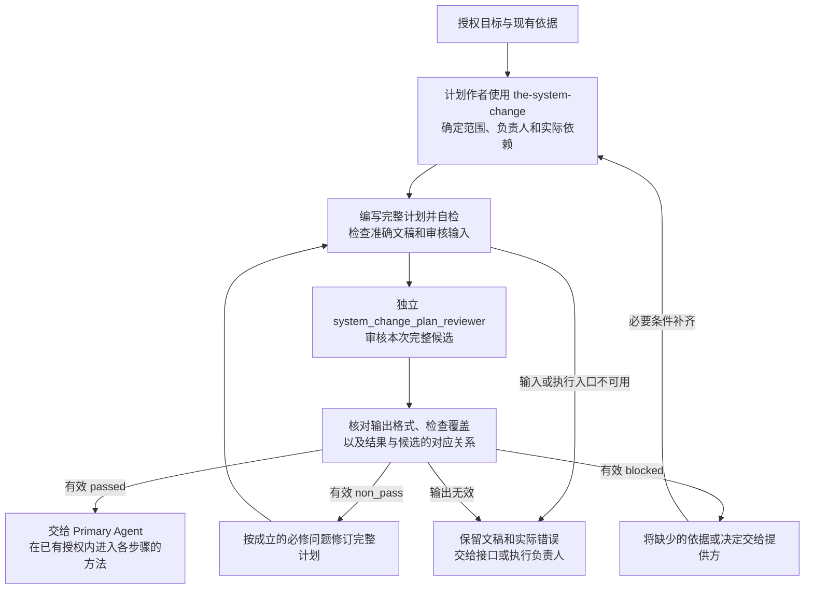

# 系统变更治理（System Change Governance）

同一项修改可能同时影响设计文档、Skill、代码、运行配置和交付。System Change Governance 指导 Primary Agent 把授权目标和现有依据整理成统一变更计划，名称沿用 `SystemChangePlan`。计划使用普通 Markdown，交给 Primary Agent 安排后续工作。

`the-system-change` 是编写这份计划的 Skill。`system_change_plan_reviewer` 是独立审核计划的 Reviewer。本规范定义计划内容、工作方式、专用审核要求和交接条件。

## 1. Primary System Flow

图中的交接针对计划本身。后续步骤使用各自的方法、检查和审核。第 4 章规定如何形成计划，第 5 章规定审核依据，第 6 章规定完成及异常处理。

## 2. Intended Outcomes

需要统一规划的变更，应交付一份 Primary Agent 能据以安排后续工作的 SystemChangePlan。计划应满足以下结果要求。

1. **范围足以实现有限授权目标。** 本次要得到的结果、纳入的修改和明确排除的内容都有依据。实际需要的设计、Skill、代码或其他受影响面没有遗漏；排除项不会使结果无法成立，邻接改进和未来收益也不会自动扩大本次工作。
2. **每项工作有准确归属和可用入口。** 各修改的对象类型、层级、负责人和修改理由明确。每步的最终负责人、编写或实施方法、产出类型、审核门和完成条件足够具体，接手者无需重新寻找主要方法或猜测职责。整体删除或退役也能拆成各负责面的实际工作。
3. **步骤顺序满足真实依赖。** 每步输入及其提供路径明确，必要决定、审核和授权能够在使用前取得。没有循环等待，也不按文件类别强制排队。已经具备且仍适用的依据直接复用，未来运行条件不被提前当成起草前提。
4. **整体验收与步骤交接一致。** 各步目标、输入、产出、验收、相关排除项和后续边界可一并交给负责人。步骤结果合起来足以证明授权目标成立；计划不代替下游产物的专业决定、审核或实际执行证据。
5. **计划的交接状态有准确依据。** 完整计划的适用检查和独立审核针对同一准确内容，问题说明当前影响及需要恢复的结果。Primary Agent 能区分可在既有授权内执行的计划，以及仍需修订、补件或排障的已有工作。只有有效独立 passed 才支持可执行交接；机械检查通过、调用结束或无效输出不代替内容判断。通过也不批准下游候选或增加权限。
6. **缺口及后续变化可以继续处理。** 不能作为可执行计划交接时，已有草稿、具体缺口、影响和负责人一并交出。必要决定或依据不足不能被写成条件已经具备。真实依赖变化使计划失效时，能据具体影响重新规划，同时保留原范围与授权边界。

## 3. Owned System Object

`SystemChangePlan` 是统一变更计划的名称。它记录要改变什么以及怎样安排工作。计划至少包含以下内容；表中的既有名称用于对应审核接口和历史材料，不要求作者使用同名标题或 JSON 字段。

| 内容 | 必须写清的要求 |
| --- | --- |
| 目标与授权（`requested_result`） | 最终要交付的有限范围结果、已有授权和支持本次规划的依据。 |
| 修改范围（`affected_surfaces`） | 本次结果实际需要的完整受影响范围。纳入修改的文件或受治理面须说明受审对象类型、层级、负责人、具体修改、理由，以及它为何是本次结果所必需。 |
| 排除项（`excluded_surfaces`） | 容易被误纳入、但本次明确不改的邻近面及原因。排除项不能使当前结果无法成立。 |
| 执行步骤（`ordered_steps`） | 每步处理的对象、唯一最终负责人、所需输入、一个编写或实施方法、一个产出对象类型、一个审核门和一个完成条件。说明实际依赖及其提供路径，并随步骤交出目标、相关排除项和后续边界。 |
| 整体验收 | 哪些实际检查、独立审核或操作结果能证明整个授权目标成立。 |
| 待决事项（`unresolved_decisions`） | 每项使计划暂时不能执行的决定及有权作出该决定的负责人。没有待决事项时明确说明。 |

这些内容可以用自然段或表格表达。受影响范围和步骤路由都是同一份计划的内容。Primary Agent 直接使用这份 Markdown；需要展示页面时，可以投影它，不另行维护第二份计划。

本规范负责计划要求、形成方法、专用审核标准和交接条件。下游 Design、Skill、Code、Runtime、Data 和 Release 的内容、审核、批准、准入、执行与生命周期分别归其负责人。计划不承载候选产物状态、执行进度、批准或准入汇总，也不建立 `SystemChangeCase`、`ScopeAssessment`、`WorkPackage`、`CandidateSet`、`ClosureRecord` 或监督账本。

## 4. Capability and Operation

### 4.1 判断是否需要规划，并确定修改范围

用户明确要求统一规划，或者未指定起点且修改需要跨层统筹范围、职责和依赖时，使用本规范。Task Routing 可以将已确定需要规划的请求交给计划作者。用户指定从文档、Skill 或代码开始时，直接使用对应方法；这些方法自己的输入、授权、检查和独立审核仍然适用。

作者从授权目标出发，读取实际相关的文档、代码、索引和工具说明，确定第 3 章要求的修改范围。已有项目索引用于定位对象、负责人及来源关系。没有计划 Registry、专用 Schema、构建器或父计划，仍可以起草；缺少真实产品决定或必要依据时，则须说明具体缺件及其提供方。

作者依据所属 Design 确定每项修改的层级、语义负责人、编写方法和产出类型。Design、Skill、Code、Runtime 和 Release 用于分类和路由。受审对象类型决定审核类型，实际入口由所属 Design 登记。文件名、所属 T0 名称、模型提供方、模型或附近 Skill 都不能替代这些依据。

受影响面的负责人决定对应内容应该怎样改变。结构和产品取舍交给有权作出决定的上级负责人；本规范只把这些决定列为相应工作的输入，不定义结构决策对象或结构审查方法。读取相关材料也不自动把它们纳入修改范围。复用已有依据时准确引用，无需修改的对象不制造空候选。

### 4.2 按实际依赖安排步骤

作者逐步说明需要谁先作决定、使用什么输入，以及开始前必须具备哪些检查结果与授权，再形成可执行顺序。相邻步骤不自动互为前置，Design、Skill、Code、Runtime 和 Release 也不是所有任务必须依次经过的阶段。没有依赖的工作不必互相等待；计划可以按用户要求逐项执行，没有依赖不代表已经取得并行操作权限。

目标、职责和接口含义须先明确。例如，已有 Design 足以规定工具行为时，可以先按工程方法准备并验证工具，再将可用接口用于 Skill 或 prompt。代码计划审核和所属方法的其他必要检查仍须完成。只有当前步骤实际使用的材料才构成前置，不能要求起草时就具备未来投入运行的全部条件。

遇到循环依赖时，作者区分三类需要：必须先明确的语义、当前步骤使用的接口材料，以及投入执行所需的实现。按真实输入拆开工作，消除仅由类别顺序造成的等待。若规则确有冲突或必要决定尚缺，交回相应负责人；占位材料和未经审核的结果不能冒充已满足的前置。

### 4.3 分解 Skill 退役或整体删除请求

对已授权的 Skill 退役或整体删除，计划先形成完整的处理安排及负责人路由。作者分别检查 Design 引用、Skill 源、Runtime 注册、宿主投影、路由和代码等实际受影响面。

每个删除或调整步骤使用该面的真实负责人已经登记的编写或实施方法、产出类型、审核门和完成条件。继续存在且需要修改的 Skill definition 才进入 `the-skill-authoring`。实际删除步骤由对应负责人处理，不把它送入 Skill 编写方法，也不临时创造专用的删除方法或候选类型。

## 5. Dependencies and Verification

### 5.1 准备独立审核

计划作者使用 `the-system-change` 编写和自检。这个 Skill 是 Primary Agent 的方法，不注册为 Runtime Module。独立审核使用已注册的 `system_change_plan_reviewer`，其 prompt、input/output schema、样例和 registration source 随该 Skill Package 提供。

审核只针对一份准确冻结的完整计划。这里的“冻结”表示审核输入保留准确且不变的正文，不要求作者为计划新建 ID、版本、时间字段、存储服务或 Registry。现有审核输入用 `document_id`、`owner_ref`、`title` 和 `body` 包装文稿，并提供授权目标、必要依据和需要重新判断的历史 finding。包装字段的定义沿用实际 input schema，不把计划变成另一种必须预先注册的机器对象。

Review Contract 提供通用指令、共同审核阶段、准确对象边界及结果含义。代码按已登记绑定将通用规则加入 Reviewer 指令。Agent Runtime 执行已注册 Module，提供执行证据和共同格式校验。本规范拥有第 5.3 节的专业 checklist、专用校验及第 6 章的计划完成条件。

### 5.2 确定性检查

现有工具检查审核输入输出格式、明确引用、检查项覆盖和顺序、finding 与 verdict 的一致性，以及结果与本次准确文稿的对应关系。专用输出 validator 由 Portable Governance 中 System Change 的校验代码提供，读取第 5.1 节所述 schema。它的判定含义由本规范负责。具体 CLI 参数和执行错误使用实际工具说明，本规范不另造错误码。

项目已有可用的计划辅助检查时，作者可以使用并报告实际结果。没有执行的检查不能声明通过。辅助检查不改变普通 Markdown 计划的输入输出约定，也不成为起草的前提。

代码检查能确认格式和对应事实。范围是否完整、负责人是否正确、依赖是否可满足，由作者自检和独立 Reviewer 判断。格式通过或调用成功不能代替这些内容判断。

### 5.3 专用 checklist 与结果对应

作者自检和独立 `system_change_plan_reviewer` 使用同一份完整 checklist。Reviewer 只审核本次计划，不重新批准背景 Design 或下游候选。

<!-- system-change-plan-review-checklist:start -->
目标特定 checklist 按以下顺序且完整包含八项：

1. 本次有限授权结果实际需要的受影响文件或受治理面都已纳入或被明确排除；排除项不会使当前结果无法成立，且不存在会让计划暂时无法执行的 `unresolved_decisions`；
2. 每个受影响面都被正确归入 Design、Skill、Code、Runtime 或 Release；
3. 每项修改的目标结果、原因和本次必要性清楚，不把邻接改进或未来收益自动纳入当前工作；
4. 每一步的实际依赖与提供路径明确，顺序能够满足依赖且没有循环；所属方法要求的检查与授权保留，不按 Design、Skill、Code、Runtime 或 Release 类别强制排队；
5. 每个步骤都有一个最终问责负责人、一个编写方法、一个产出对象类型、一个审核门和一个完成条件，并能连同相关排除项与后续边界交给下游；
6. 实际复用的既有依据准确引用且仍然适用，不为无需修改的对象制造空候选；
7. Reviewer 路由由产出对象类型决定，不能由文件名、所属 T0 名称、模型、provider 或附近 Skill 决定；
8. 计划在规划和路由处结束，不包含执行状态、生命周期、`CandidateSet`、闭包、批准或准入汇总。
<!-- system-change-plan-review-checklist:end -->

input schema 的 `required_check_ids` 与上述八项按以下顺序一一对应，输出 schema 使用相同标识：

| 项次 | `check_id` |
| --- | --- |
| 1 | `scope_and_unresolved_decisions` |
| 2 | `layer_classification` |
| 3 | `change_goal_and_reason` |
| 4 | `dependency_order` |
| 5 | `step_route_closure` |
| 6 | `frozen_upstream_prerequisite` |
| 7 | `reviewer_routing` |
| 8 | `no_execution_ownership` |

输出的 `check_results` 先记录八项语义判断，末项为 `prose_and_meaning_preservation`。语义全部通过后，才对同一份计划做表达检查；此前表达项为 `not_run`。这些检查不能使用 `not_applicable`。语义项仅在缺少必要依据、整体结论为 `blocked` 时可以使用 `not_run`；具体结果仍须满足专用 validator。

专用校验检查完整覆盖、准确计划对应关系、逐项判断与 findings 的对应，以及上述表达检查顺序。整体 verdict 和问题标签沿用 Review Contract，不建立另一套结论含义。

## 6. Completion, Failure, and Recovery

### 6.1 计划何时完成

只有已注册 `system_change_plan_reviewer` 的独立执行结果对应本次准确冻结的完整计划、覆盖完整 checklist、通过共同输出格式及本规范专用校验，且 verdict 为 `passed`，计划才达到交接条件。Primary Agent 随后在既有授权内使用这份计划，进入各步骤的方法。通过结果不批准下游候选，也不增加执行权限。

System Change Governance 在计划通过并交给 Primary Agent 后结束。本 T0 文稿自身的编写、审核和采用使用 DDM；文稿审核通过与具体计划审核通过分别判断。

### 6.2 未完成时怎样处理

| 实际情况 | 保留的结果与下一步负责人 |
| --- | --- |
| 作者自检发现范围、负责人、方法或依赖缺口 | 作者修订计划；真实产品决定交给有权决定的人，并保留已有草稿。 |
| 输入格式错误、Reviewer 不可用或执行失败 | 保留文稿和工具实际错误，交给接口或执行负责人。此时没有有效 Reviewer 结论。 |
| 输出格式、检查覆盖或候选对应关系校验失败 | 保留原输出并报告校验失败，由对应接口或执行负责人处理；无效输出不能作为专业判断。 |
| 有效 `non_pass` | Primary Agent 按成立的必修问题重新进入同一 Skill，修订完整候选并复审。 |
| 有效 `blocked` | 将准确 blocker、缺少的输入或决定及已有文稿交给审核结果指定的负责人，补齐必要条件后重新进入。 |

`non_pass` 和 `blocked` 都不能将计划作为可执行结果交接；仍须交出已有工作、具体缺口及其负责人。

作者按 Review Contract 核对 finding 的证据、范围、负责人和当前必要性，修订成立的必修问题。note 默认不实施。证据错误或越界意见保留原结果并交回独立 Reviewer 重判，作者不能自行改成通过。多轮修订沿用同一授权目标和完成条件；重开已处理决定须有新证据、候选变化或原处理失败，真实遗漏和本轮回归仍须处理。

### 6.3 交接后何时重新规划

下游发现真实依赖缺失、负责人错误、适用规则冲突，或新证据、原处理失败使计划无法实现目标时，Primary Agent 返回真实负责人重新判断。确需改变计划时，形成完整新候选，重新冻结、检查和独立审核。

可选收益或偏好不同不使计划自动失效，发现问题也不自动授权扩大范围。本规范不维护执行前序关系、进度或状态转换；下游产物的问题由各自负责人处理。

## 7. Peer Boundaries

Project Charter 提供宪制约束，并保留产品宪章和人类决策权。计划涉及产品宪制或所需 T0 权责类别的改变时，先取得相应宪制决定。Charter 不维护当前 T0 清单。

| 协作方 | 向规划提供什么 | 接手或继续负责什么 |
| --- | --- | --- |
| Task Routing | 已确定需要规划的授权修改请求。 | 请求的意图导航及按所属规范选择入口。 |
| 项目文档、索引与实际代码接口的负责人 | 当前对象、负责人、层级、文件及依赖事实；已有 Registry 时使用其内容。 | 项目对象含义、代码能力和本地索引；不因一次规划要求新建计划基础设施。 |
| Design Doc Management 与各 Design 负责人 | 适用的设计写作规则、目标设计依据和审核要求。 | DDM 管理文稿规则与审核；各 Design 负责人决定各自的设计含义和取舍。 |
| Skill Management | Skill 编写方法、完整性和审核要求。 | Skill definition、候选和 Skill 审核。退役或整体删除的跨面安排使用第 4.3 节，各面负责人执行实际动作。 |
| Review Contract | 共同审核规则、准确对象边界、通用指令与结果结构。 | 通用审核约定；计划的专业标准和交接条件由本规范规定。 |
| Agent Runtime | 已注册 Reviewer 的执行入口、实际执行证据和共同格式校验。 | Module 执行、ExecutionProfile、Attempt 和 Ledger；不取得计划专业判断的设计权。 |
| Agency Platform | 受影响宿主组合或 Workflow Control Plane 的变更事实。 | 企业产品宿主、执行宿主绑定和 Workflow Control Plane 决定。 |
| Product Authorization | 涉及数据库操作时，由数据访问边界消费的 user_key 对 database_id 的 read/write 权限决定。 | 权限分配、数据库可见性及数据库操作的 allow/deny 含义；不提供通用计划动作或 Runtime 资格授权。 |
| Data Governance | 数据、写入器、放置、迁移和保留要求。 | Managed Data Asset 和物理 Data Binding。 |
| Timestamp and Clock Semantics | 实际涉及的时间字段和顺序要求。 | 时间数据语义。 |
| Software Delivery | 工程设计、实现、工程审核、发布与恢复方法。 | 软件变更、发布、部署和回滚准入。 |
| Primary Agent | 授权目标和当前工作依据；计划失效时提供具体后果。 | 使用已审计划逐步工作，保留整体任务责任和当前执行上下文。 |

计划只引用本次需要的对等输入和输出，不复制对方内部工作流、错误表、数据库状态或批准记录。

## 8. References

- Project Charter：`designDoc/the_charter.md`，由消费项目提供。
- [Task Routing](the_task_routing.md)
- [Design Doc Management](the_design_doc_management.md)
- [Skill Management](the_skill_management.md)
- [Review Contract](the_review_contract.md)
- [Agent Runtime](the_agent_runtime.md)
- [Agency Platform](the_agency_platform.md)
- [Product Authorization](the_product_authorization.md)
- [Data Governance](the_data_governance.md)
- [Timestamp and Clock Semantics](the_timestamp_semantic.md)
- [Software Delivery](the_software_delivery.md)
